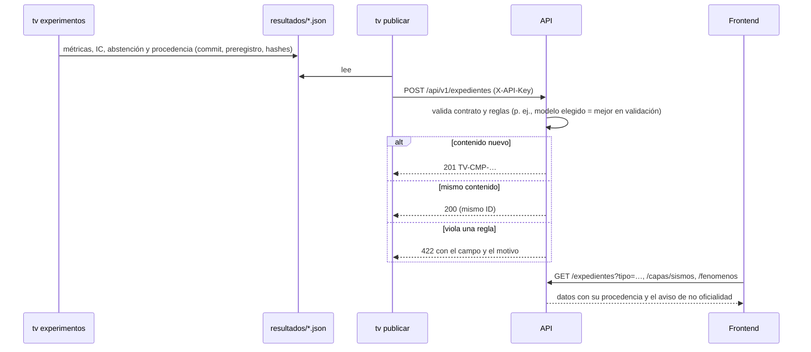
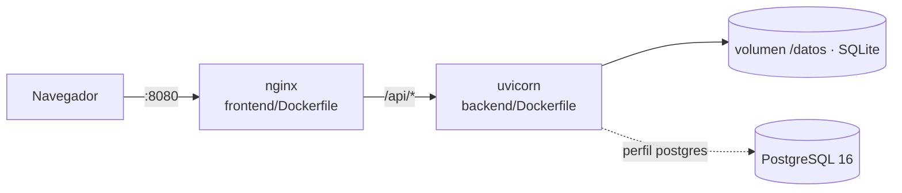

# Arquitectura de TerraVerdict: vista completa

Cómo viaja un dato desde su fuente hasta la pantalla, sin perder su procedencia. El detalle de
cada capa está en [`arquitectura/`](arquitectura/README.md) (ADR, pipeline, pruebas); los
contratos, en [`api/README.md`](api/README.md) e [`integracion-ciencia-datos.md`](integracion-ciencia-datos.md);
los métodos, en [`metodologia.md`](metodologia.md).

## Contexto

```mermaid
flowchart LR
    subgraph Fuentes reales
      F1[NASA POWER · IMERG · MODIS]
      F2[CHIRPS · ClimateSERV]
      F3[USGS · IGP · GVP · NASA GLC]
      F4[NOAA ONI · GHCN]
      F5[AUTODEMA · eventos citados]
    end
    Fuentes reales -->|tv ingest-fenomenos| RAW[(data/raw<br/>manifiestos SHA-256)]
    RAW --> CI[Paquete científico<br/>src/terraverdict]
    PRE[preregistro.yaml<br/>congelado] --> CI
    CFG[config/*.yaml] --> CI
    CI -->|tv experimentos| RES[(resultados/*.json)]
    CI -->|tv trends| EXP[(expedientes/*.json)]
    RES -->|tv informe| DOC[docs/experimentos.md]
    RES & EXP -->|tv publicar · X-API-Key ingesta| API[Backend FastAPI<br/>/api/v1]
    CFG & F5 -->|python -m app.cli importar| API
    API --- DB[(SQLite / PostgreSQL)]
    API -->|JSON · GeoJSON · OpenAPI| WEB[Frontend React<br/>tipos generados del OpenAPI]
```

## Capas y responsabilidades

| Capa | Dónde | Responsabilidad | Regla |
|---|---|---|---|
| Ingesta | `src/terraverdict/ingest/` | Descargar y guardar el crudo exacto con su SHA-256, URL y fecha | Nada se transforma al descargar. Todo error queda en `registro_descarga.json` |
| Señales y selección | `senales/`, `seleccion/` | SPI, climatologías, regímenes, escalas, ventana y mRMR | Solo se ajustan con el entrenamiento |
| Modelos y evaluación | `modelos/`, `evaluacion/`, `experimentos/` | Zoológico, referencias, IC, Diebold-Mariano, conformal, deriva y abstención | La prueba se usa una vez |
| Caos | `caos/` | Diagnóstico de dinámica validado con sistemas de referencia | Nunca afirma caos sin todas las condiciones |
| Tendencias | `trends/`, `expedientes/` | Sello de Confianza | p conservador y pruebas preregistradas |
| Informe | `experimentos/informe.py` | `docs/experimentos.md` | Solo cifras de los JSON |
| Publicación | `publicar/` | Resultados → contrato de expedientes → `POST /expedientes` | Idempotente; un 422 no se "arregla" en el cliente |
| API | `backend/app/` | Catálogo, series, expedientes inmutables, procesos, capas y verificador | Las reglas científicas viven en los esquemas |
| Interfaz | `frontend/src/` | Panel, mapa, series, expedientes, fenómenos y asistente | Sin lógica científica; muestra la procedencia y las abstenciones |

Las dependencias van solo hacia abajo: la interfaz no calcula y la API no entrena. El paquete
científico no depende de la API, salvo el cliente de publicación, que solo hace HTTP.

## Flujo de un resultado



## Datos y almacenamiento

| Qué | Dónde | ¿En git? |
|---|---|---|
| Crudos | `data/raw/<fuente>/` | No (se regeneran). Sí sus `manifiesto.json` y `registro_descarga.json` |
| Recorte real para pruebas | `tests/fixtures/raw_reducido/` | Sí, con `origen.json` (SHA-256 de cada original) |
| Resultados | `resultados/*.json` | Sí, para la trazabilidad |
| Expedientes de tendencias | `expedientes/*.json` | Sí |
| Base de la API | SQLite (`backend/terraverdict.db`) o PostgreSQL | No: se reconstruye con `migrar` + `importar` + `tv publicar` |

## Seguridad

- **Personas:** JWT con roles `lector`, `analista` y `admin`.
- **Pipeline:** claves de servicio con alcance `ingesta` o `trabajador`. Solo se guarda su hash.
- **Respuestas:** cabeceras de seguridad y CORS cerrado. En producción se exige un secreto de ≥ 32 caracteres.
- **Límite de inicio de sesión:** vive en memoria del proceso. Con varias réplicas debe aplicarse en el proxy (nginx) o en un almacén compartido.
- **Secretos:** tokens de terceros (Earthdata) y claves solo en el entorno, nunca en el repositorio (`.env*` está ignorado).

## Despliegue



`docker compose up --build` levanta la API y la interfaz. Al arrancar, la API migra el esquema e
importa los datos versionados. `--profile postgres` agrega PostgreSQL: hay que definir
`TV_DATABASE_URL`; ver `.env.example`.

## Calidad

`.github/workflows/ci.yml` corre tres trabajos:
- **Backend:** ruff, mypy y pytest, incluida la deriva del OpenAPI.
- **Ciencia:** ruff, mypy y pytest. Incluye el motor, el caos, las pruebas de humo con datos reales recortados y la integración con el backend.
- **Frontend:** comprueba que los tipos coinciden con el OpenAPI, y corre typecheck, lint, test y build.
