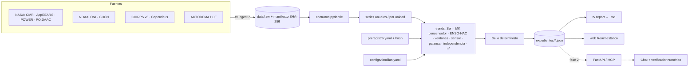

# Arquitectura de TerraVerdict

Complementa [`../diseno-tecnico.md`](../diseno-tecnico.md) (qué se construye y por qué) con **cómo se organiza el código, los datos y el trabajo** para el hackathon. Las decisiones nuevas están en [`adr/`](adr/README.md).

| Documento | Contenido |
|---|---|
| [`adr/`](adr/README.md) | ADR-012 a ADR-019: corte vertical, p conservador, almacenamiento, escenarios, frontend, ingesta, Sello, IA |
| [`pipeline.md`](pipeline.md) | Etapas con entradas, salidas y validación; contratos; caché; comandos |
| [`datos-y-ingesta.md`](datos-y-ingesta.md) | Cómo se descarga cada fuente, volúmenes, credenciales, reglas |
| [`api-y-frontend.md`](api-y-frontend.md) | Esqueleto de la web, API mínima y contrato con el expediente |
| [`pruebas.md`](pruebas.md) | Estrategia local: golden, sintéticos, referencia con R, AUTODEMA |
| [`plan-36h.md`](plan-36h.md) | Plan hora a hora, responsables y orden de recorte |
| [`revision-hallazgos.md`](revision-hallazgos.md) | 13 hallazgos de la revisión con su estado |

## Vista de contexto



## Capas y dependencias (regla: solo hacia abajo)

```
web/ · api/ · cli.py      ← presentación (sin lógica científica)
expedientes/               ← construir, hashear, validar esquema
trends/ · relevance/ · hydro/ · forecast/ · decision/   ← ciencia (funciones puras)
preprocess/ · contracts/   ← transformar y validar
ingest/                    ← red y disco (único lugar con I/O externo)
config.py                  ← preregistro + YAML
```

- `trends/` no importa nada de `ingest/`: recibe arrays y devuelve diccionarios. Por eso se prueba sin red.
- Todo resultado publicable pasa por `expedientes/build.py` (hash de entradas + preregistro + commit).

## Esqueleto actual del repositorio

```
preregistro.yaml · pyproject.toml · Makefile
configs/        chili.yaml · familias.yaml
src/terraverdict/
  config.py  cli.py
  ingest/       http · manifest · power · noaa · autodema_pdf (esqueleto)
  contracts/    series · expediente
  preprocess/   anual
  trends/       sen · mk · enso · ventanas · detectabilidad · sensor · palanca · independencia · sello · analizar
  expedientes/  hash · build
tests/          unit · statistical (slow) · reference (airGR) · fixtures
web/            visor React (paso 1)
```
Por crear según el plan: `ingest/{earthaccess_,appeears,chirps}.py`, `preprocess/zonal.py`, `relevance/`, `hydro/`, `llm/verificador_numerico.py`, `api/`.
