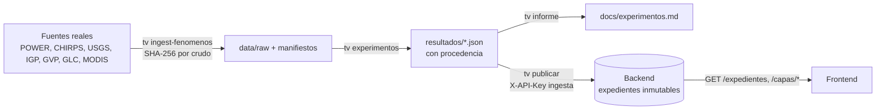
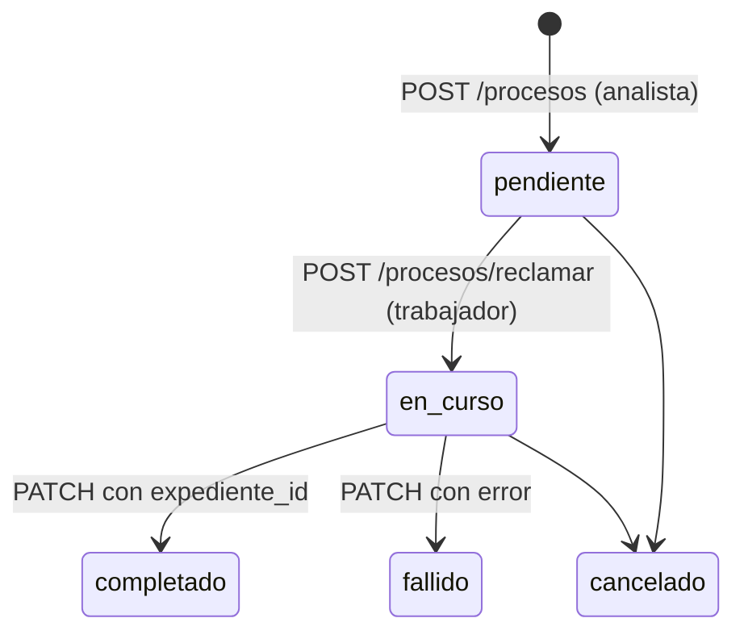

# Integración ciencia de datos ↔ backend

Cómo entra un resultado del paquete científico (`src/terraverdict`) al backend (`backend/`) y de
ahí al frontend, sin perder la procedencia. El contrato exacto está en
[`docs/api/openapi.json`](api/openapi.json); este documento explica cómo se usa.

## Identificadores y unidades

| Objeto | Formato | Ejemplo |
|---|---|---|
| Dominio | slug de `config/dominios.yaml` | `chili_analisis`, `sur_peru_fenomenos` |
| Fuente | clave de `config/fuentes.yaml` | `chirps_v2_diaria`, `usgs_comcat` |
| Serie | `<dominio>.<unidad>:<variable>:<fuente>:<frecuencia>` (minúsculas) | `chili_analisis.cabecera_power:temperatura_aire_2m:power_mensual:p1y` |
| Expediente | `TV-<TIPO>-<12 hex del SHA-256 del contenido>` (lo asigna el backend) | `TV-CMP-…`, `TV-SIS-…` |
| Frecuencia | duración ISO 8601 | `P1D`, `P8D`, `P1M`, `P1Y` |
| Unidad de medida | código del vocabulario `GET /unidades-medida` (compatible con UCUM) | `mm`, `Cel` |

Toda fecha es ISO 8601. Una observación sin dato válido se envía como `valor: null`: **nunca se interpola**.

## Procedencia (obligatoria en series y expedientes)

| Campo | Contenido |
|---|---|
| `fuentes[]` | IDs del catálogo, con colección, versión, DOI o URL si aplica |
| `codigo` | Repositorio, commit (7–40 hex) y script que produjo el resultado |
| `preregistro_sha256` | Hash de `preregistro.yaml` (congelado el 2026-11-15) |
| `hash_entradas` | SHA-256 de cada crudo usado (`carpeta/archivo`) y de `config/fenomenos.yaml` |
| `pasos[]` | Grafo del cálculo ("Cómo llegué a esto"). Las entradas `paso:<id>` deben existir |
| `generado_utc` | Momento del cálculo |

El backend rechaza una fuente, un dominio o un expediente que no existan (404 con el campo que falla).

## Series

1. `POST /api/v1/series` registra la serie (`SerieCrear`), con su unidad y su procedencia.
2. `PUT /api/v1/series/{id}/observaciones` carga hasta 100 000 observaciones.
   - Es idempotente por fecha: vuelve a escribir las fechas existentes y sube `version`.
   - `reemplazar: true` borra las observaciones previas.
3. `GET /api/v1/series/{id}/observaciones` devuelve un `ETag` con la versión: los clientes usan `If-None-Match`.

Esta es también la vía para las **fuentes nacionales sin API** (SENAMHI, ANA, INGEMMET): una
descarga manual verificada entra como serie con su procedencia, sin cambiar la arquitectura.

## Expedientes

- `POST /api/v1/expedientes` con una clave de alcance `ingesta`.
- **Idempotencia:** el ID sale del contenido. El mismo contenido devuelve 200 con el expediente existente; otro contenido produce un expediente nuevo.
- **Nada se edita:** un expediente nuevo puede declarar `reemplaza_a`; el anterior queda `retirado` y se conserva.
- **Reglas científicas:** cada tipo valida las suyas. Por ejemplo: el modelo elegido debe ser el mejor en validación; un "caos" exige todas las condiciones; una abstención lleva motivo. Ver la tabla en [`api/README.md`](api/README.md#tipos-de-expediente). Un 422 no se corrige en el cliente: se revisa el resultado.

### De `resultados/*.json` a expedientes (`tv publicar`)

| Archivo | Expedientes |
|---|---|
| `lluvia_extrema.json`, `lluvia_extrema_chirps.json` | `comparacion_modelos` (variables, ventana, ablaciones, confiabilidad, importancia, abstención) |
| `sequia.json`, `sequia_chirps.json` | Un `comparacion_modelos` por horizonte (1 y 3 meses), con la cobertura conformal |
| `sismos.json` | `sismicidad` (Mc, b, tasas y mapa M ≥ 5) y `comparacion_modelos` (conteos frente a Poisson) |
| `volcanes.json` | `recurrencia` (`es_pronostico: false`) |
| `deslizamientos.json` | `inventario` (sin umbral mientras haya menos de 30 eventos) |
| `caos.json` | `caos` (veredictos, espacio de fases, sustitutos y miniatura de recurrencia) |
| `expedientes/TV-*.json` | `tendencia` del Sello de Confianza |

`fuentes.json` (contraste entre fuentes) no se publica como expediente: es control de calidad y
está en `docs/experimentos.md`.

En las tendencias, el paquete llama "frágil" a una tendencia significativa con pruebas
**pendientes**. El backend reserva `fragil` para pruebas **fallidas**, así que esas se publican
como `preliminar`.

## Procesos y protocolo del trabajador

1. Un analista solicita `POST /procesos` con `tipo` y sus parámetros obligatorios (p. ej., `serie_id` para `tendencia`).
2. El trabajador, con una clave de alcance `trabajador`, llama a `POST /procesos/reclamar` con `{trabajador, tipos}`.
   - La asignación es atómica: dos trabajadores nunca reciben el mismo proceso.
   - Si no hay procesos pendientes de esos tipos, responde 204.
3. Durante el cálculo, el trabajador envía:
   - `PATCH /procesos/{id}` con `progreso` (0–1);
   - eventos a la bitácora con `POST /procesos/{id}/eventos`.
4. Al terminar:
   - publica el expediente;
   - envía `PATCH` con `estado: completado` y el `expediente_id`, que debe existir;
   - si falla, envía `estado: fallido` con `error`.
5. Solo el trabajador que reclamó un proceso puede actualizarlo. Una persona solo puede cancelarlo.

## Variables de entorno del pipeline

| Variable | Uso |
|---|---|
| `EARTHDATA_TOKEN` (o el token solo en `.env`) | IMERG por OPeNDAP de GES DISC. La cuenta debe aceptar una vez la licencia de GES DISC |
| `TV_CLAVE_INGESTA` | Clave de servicio para `tv publicar` |

Ningún token ni clave se escribe en crudos, manifiestos, resultados ni en el repositorio.
