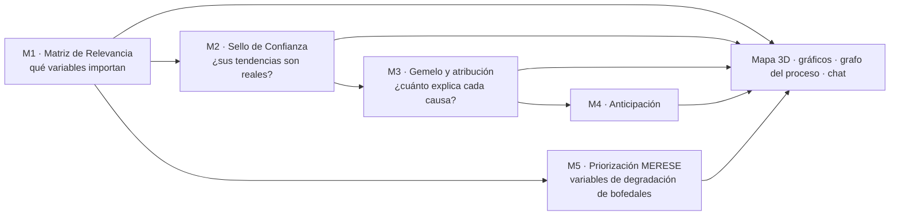

# Módulo M1 · Matriz de Relevancia

> **Estado (15-11-2026): implementado para P1** con datos reales (`src/terraverdict/experimentos/relevancia.py`, `tv experimentos --solo relevancia`, resultado en `resultados/relevancia.json` y en la matriz de `/relevancia`). Diferencias con el diseño de abajo, decididas al probarlo: (1) predictores disponibles = ONI, T2M, humedad relativa y viento (POWER); la humedad del suelo no se mide y queda como candidata sin dato; (2) la significancia es **condicional por variable** (se desplaza la variable, no el objetivo), porque el nulo de objetivo desplazado hacía significativo al ruido; (3) la estabilidad usa k ≤ n − 1. P2–P4 siguen pendientes de datos (ver `pendientes.md`).

> **Pregunta que responde:** para un problema concreto (por ejemplo, lluvia extrema en la cabecera o degradación de bofedales), **¿qué variables importan, en qué dirección y con cuánta confianza?** Es la parte que el reto describe como la más difícil: elegir qué variables mirar.

## 1. Principios

1. **Primero la física, después los datos.** Cada problema parte de una plantilla con variables candidatas justificadas en la literatura y en el diagrama de relaciones ([variables](variables.md#3-relaciones-científicas-que-el-sistema-pone-a-prueba)). No se prueban cientos de variables a ciegas, porque eso fabrica hallazgos falsos.
2. **Relevancia predictiva, no causalidad.** Que una variable "importe" significa que mejora la predicción fuera de muestra. La interpretación causal requiere el gemelo hidrológico (M3).
3. **Nada sin validación fuera de muestra.** Toda importancia se mide en datos que el modelo no vio.
4. **La estabilidad es parte del resultado.** Una variable que solo aparece en algunas corridas se marca como inestable.
5. **Se puede no saber.** Si ningún modelo le gana a la línea base, el resultado es "estas variables no alcanzan para explicar el problema".

## 2. Plantillas de problema

| ID | Problema | Objetivo medible | Variables candidatas | Muestras disponibles | Estado |
|---|---|---|---|---|---|
| **P1** | Lluvia extrema en la cabecera | Días con lluvia ≥ percentil 99 (IMERG Final diaria) | ONI (desfase 0–3), agua precipitable y viento en 500 hPa (MERRA-2), humedad del suelo previa (GLDAS; SMAP desde 2015), T2M, mes | ~10 000 días (1998–2025) | Viable con datos verificados |
| **P2** | Degradación de bofedales | Pendiente del NDVI de época seca por bofedal | Lluvia y T de la temporada, humedad del suelo, quemas (VIIRS/MCD64A1), pendiente, altitud, distancia a la red de drenaje | Miles de píxeles × años | Viable (HLS desde 2013; Landsat desde 1984, con acceso pendiente) |
| **P3** | Déficit de las represas | Almacenamiento al cierre de abril | Lluvia dic–mar, T, nieve, ET, ONI, almacenamiento inicial | ~25 temporadas | **Pocos datos:** solo modelos lineales regularizados, con advertencia |
| **P4** | Turbidez en la captación | Cortes documentados | Lluvia de 3–24 h, humedad previa, erosión potencial | 3 eventos documentados | **Insuficiente:** prototipo con umbrales, sin ranking |

La biblioteca de plantillas se amplía para escalar a otras regiones: sequía agrícola, olas de calor, incendios, retroceso glaciar, ciclones tropicales. Cada una con su objetivo, sus candidatas y su justificación.

## 3. Algoritmo

```
Entrada: plantilla (objetivo y, candidatas X), periodo y preregistro (hash)
1. Preparar: anomalías, desfases declarados en la plantilla y estandarización
   (los parámetros se ajustan solo con los datos de entrenamiento de cada pliegue)
2. Partición sin fuga de información:
     temporal → validación cruzada por bloques de años (dejar un año fuera)
     espacial → bloques espaciales (P2), para que píxeles vecinos no caigan a ambos lados
   + años finales apartados desde el inicio (prueba final; no se tocan hasta el paso 7)
3. Línea base: climatología (P1, P3) o persistencia (P2)
4. Modelos: A = regresión regularizada elastic-net (interpretable)
            B = árboles con gradiente, de profundidad limitada (no lineal)
5. Importancia en los pliegues de validación:
     · importancia por permutación por bloques (Breiman, 2001)
     · dirección y forma del efecto: SHAP y dependencia parcial
6. Estabilidad: 200 remuestreos por bloques → frecuencia con que cada variable
   queda en el top-k (Meinshausen y Bühlmann, 2010)
   Significancia: comparar con la importancia que da un objetivo barajado
   por bloques (distribución nula) → p por variable → corrección FDR
7. Selección: top-k, con k elegido por validación (tope de 10) → reentrenar
   → evaluar UNA vez en los años apartados → habilidad frente a la línea base
8. Publicación: si la habilidad > 0 con IC al 90 %, se publica la versión;
   si no, el resultado es "no explicable con estas variables"
9. Registro: versión, hash de datos y del preregistro, parámetros, métricas,
   importancias, estabilidades y p ajustados
```

**Por qué dos modelos:** si el lineal y el no lineal coinciden en las variables principales, el resultado es más confiable. Si discrepan, se muestra la discrepancia.

## 4. Salidas

| Salida | Contenido |
|---|---|
| **Matriz problema × variable** | Celda = importancia normalizada (color), estabilidad y p ajustado (intensidad del color; lo incierto se ve pálido), dirección (▲▼) y "no aplica" (gris) |
| **Historial variable × versión** | Cómo cambia cada importancia con los datos nuevos; revela variables inestables |
| **Detalle por celda** | Gráfico de dependencia parcial, datos de origen con DOI, años usados, métricas y p ajustado |
| **Ficha de versión** | Habilidad frente a la línea base, matriz de confusión (P1), errores (P2, P3) e IC |
| **Expediente JSON** | Lo que leen la API, el servidor MCP y el chat |

## 5. Actualización automatizada

- Se reentrena una versión nueva cuando llegan datos (ritmo mensual para IMERG Final y MERRA-2; anual para MOD16).
- La versión nueva solo reemplaza a la anterior si su habilidad en los años apartados no empeora más allá de una tolerancia preregistrada.
- La **deriva** se detecta comparando la distribución de las variables nuevas con la de entrenamiento (índice de estabilidad de población), y se marca en la interfaz.

## 6. Cómo se conecta con los demás módulos



## 7. Validación del propio método

| Experimento | Diseño | Criterio de éxito |
|---|---|---|
| **R1 · Recuperación sintética** | Se generan datos con variables relevantes conocidas, más ruido autocorrelacionado y variables falsas correlacionadas entre sí | Las relevantes se recuperan y la tasa de falsas relevantes queda cerca del FDR nominal |
| **R2 · Estabilidad** | Se repite con distintas semillas y periodos | Coincidencia del top-k (índice de Jaccard) por encima del umbral preregistrado |
| **R3 · Coherencia física** | Signos frente al diagrama de relaciones (por ejemplo, ONI → lluvia: negativo) | Los signos coinciden o la discrepancia se explica |
| **R4 · Habilidad** | Años apartados frente a la línea base | Habilidad > 0 con IC al 90 % |

**Estado:** diseño. Nada de este módulo está implementado todavía. El primer análisis real del proyecto ([`analisis_preliminar.json`](verificacion/analisis_preliminar.json)) ya mide una de sus relaciones: la correlación entre la lluvia de dic–mar en la cabecera y el ONI de dic–feb es **r = −0,345 (p = 0,024)**, con el signo que espera la física.
