# Pipeline de datos de TerraVerdict: especificación de construcción

> **Para quién:** la persona responsable de datos o ciencia de datos que construirá el pipeline.
> **Qué contiene:** qué construir, en qué orden, con qué datos exactos, qué reglas cumplir y cómo saber que está terminado.
> **Fuentes de verdad:** [`config/fuentes.yaml`](../config/fuentes.yaml) (catálogo de datos), [`config/dominios.yaml`](../config/dominios.yaml) (zonas y particiones), [`docs/verificacion/`](verificacion/) (evidencia de que cada fuente existe).
> **Estado:** especificación. Lo único que ya corre son los scripts de verificación y el análisis preliminar ([`scripts/`](../scripts/)).

---

## 1. Objetivo y principios no negociables

**Objetivo:** convertir datos satelitales y de tierra, verificados y abiertos, en **series y cubos analíticos trazables** por unidad de análisis (subcuenca, represa, bofedal y celda). Sobre ellos corren los módulos científicos M1–M5 y la interfaz M6.

| # | Principio | En la práctica |
|---|---|---|
| P1 | **Solo datos reales** | Cada valor tiene colección, versión, DOI, fecha de descarga y hash. Prohibido rellenar con datos sintéticos fuera de las pruebas |
| P2 | **Reproducible** | La misma configuración y los mismos datos de entrada dan la misma salida, byte a byte |
| P3 | **Idempotente e incremental** | Volver a correr no descarga ni recalcula lo que ya existe; solo procesa lo nuevo |
| P4 | **Falla en voz alta** | Un contrato de datos roto detiene la etapa. Nada se "arregla" en silencio |
| P5 | **Sin fuga de información** | Normalizaciones, umbrales e hiperparámetros se ajustan solo con datos de entrenamiento |
| P6 | **Recortar en el servidor** | Usar AppEEARS, subconjuntos de NASA o lectura en la nube. No descargar escenas completas si basta un recorte |
| P7 | **Separar los productos rápidos de los finales** | IMERG Early y Late nunca entran a una serie de tendencia |

---

## 2. Arquitectura del pipeline

```mermaid
flowchart LR
    subgraph E0["E0 · Configuración"]
        C1[fuentes.yaml] & C2[dominios.yaml] & C3[preregistro.yaml]
    end
    subgraph E1["E1 · Geometrías"]
        G[Polígonos: cuencas, represas,<br/>captación, bofedales, bloques espaciales]
    end
    subgraph E2["E2 · Ingesta"]
        I1[CMR/earthaccess] & I2[AppEEARS] & I3[POWER] & I4[ASF / CDSE] & I5[NOAA · KNMI · CHIRPS · AUTODEMA]
    end
    subgraph E3["E3 · Estandarización + QC"]
        Q[Escala/offset · fill · bits de calidad<br/>unidades SI · CRS · tiempo]
    end
    subgraph E4["E4 · Almacenamiento"]
        R[(raw/ inmutable)] --> Z[(Cubo Zarr por dominio)]
    end
    subgraph E5["E5 · Derivados"]
        D[Agregación zonal · anomalías · índices<br/>SPI/SPEI · ETCCDI · VCI · MNDWI · RUSLE]
    end
    subgraph E6["E6 · Conjuntos de entrenamiento"]
        T[Tablas P1–P4 · teselas de imagen<br/>particiones temporal/espacial]
    end
    subgraph E7["E7 · Publicación"]
        P[Parquet · GeoJSON · COG · STAC · expedientes]
    end
    E0 --> E1 --> E2 --> E3 --> E4 --> E5 --> E6 --> M[Módulos M1–M5]
    E5 --> E7
    M --> E7
```



### 2.1 Estructura de almacenamiento

```
data/                                   # fuera de git; versionado con hashes en manifiestos
├── raw/<fuente>/<version>/<archivo>    # tal como llega; nunca se modifica
├── interim/<fuente>/...                # recortado, escalado y con QC aplicado (NetCDF/COG)
├── cubo/<dominio>.zarr                 # cubo analítico: (tiempo, y, x) por variable, CRS común
├── series/<dominio>/<unidad>/<variable>.parquet
├── entrenamiento/<problema>/<version>/ # tablas y teselas con su partición
└── manifiestos/<etapa>_<fecha>.json    # entradas, hashes, conteos, descartes, duración
publicado/                              # lo que lee la web/API/MCP
├── stac/catalog.json
├── series/*.parquet · capas/*.tif (COG) · geometrias/*.geojson
└── expedientes/*.json
```

**CRS de trabajo:**
- Para áreas y análisis en metros: **EPSG:32719 (UTM 19S)**, porque la cuenca cruza las zonas 18S y 19S (teselas HLS T18LZH y T19LBC, vistas en el catálogo).
- Para publicar en la web: **EPSG:4326**.
- Los productos MODIS vienen en proyección sinusoidal y se reproyectan solo en la etapa de derivados, nunca antes del control de calidad.

---

## 3. Etapas en detalle

### E0 · Configuración

- `fuentes.yaml` y `dominios.yaml` ya existen.
- Crear `config/preregistro.yaml` **antes** de mirar resultados, con: α, longitud mínima de ventana, desfases de El Niño, umbrales de fracción válida, k máximo de la Matriz de Relevancia, umbrales de habilidad y la tolerancia frente a Giovanni. El pipeline calcula su SHA-256 y lo escribe en cada manifiesto y expediente.
- **Secretos** (nunca en git): credenciales de Earthdata (`~/.netrc`), token de Copernicus Data Space, cuenta USGS ERS para M2M y `FIRMS_MAP_KEY`.

### E1 · Geometrías

| Geometría | Cómo obtenerla | Criterio de terminado |
|---|---|---|
| Subcuenca de cada represa | Polígonos de la ANA si están disponibles; si no, delimitar con NASADEM (relleno de depresiones, dirección de flujo D8, acumulación) desde la presa | Área en km² documentada; incluye las áreas de trasvase |
| Contorno máximo de cada represa | Máximo histórico de agua con MNDWI de HLS (2013 →) | Polígono validado visualmente con Worldview |
| Subcuencas de turbidez | Drenan a la captación de La Tomilla sin pasar por un embalse | Delimitadas con NASADEM |
| Bofedales candidatos | NDVI de época seca (jun–sep) + pendiente baja, en la etapa E5 | Validados con muestras fotointerpretadas |
| Bloques espaciales | Rejilla de 1° × 1° sobre `andes_sur_entrenamiento` | Ningún bloque mezcla datos de entrenamiento y de prueba |

**Herramientas:** `geopandas`, `shapely`, `pysheds` o `whitebox`, `rasterio`.

### E2 · Ingesta

| Vía | Librería o servicio | Fuentes | Práctica senior |
|---|---|---|---|
| CMR + DAAC | `earthaccess` (búsqueda por `short_name`, `version`, `bounding_box` y `temporal`) | IMERG, MERRA-2, GLDAS, FLDAS, HLS, SWOT, ICESat-2, NISAR, VIIRS fuegos | Usar subconjuntos del servidor (Harmony u OPeNDAP) cuando la colección lo permita. Si no, descargar y recortar de inmediato, sin guardar el archivo global en `interim` |
| AppEEARS | API REST (`/api/login`, `/api/task` con un polígono GeoJSON) | MODIS, VIIRS, SMAP, NASADEM | **Enviar todas las tareas en la primera hora:** tardan horas. Guardar el `task_id` en el manifiesto y descargar por *polling* |
| POWER | API `temporal/monthly/point` y `daily/point` | T2M, PRECTOTCORR, radiación, humedad, viento | Ya funciona en `scripts/analisis_preliminar.py`; reutilizar |
| ASF | `asf_search` o la API `services/search/param` | Sentinel-1, NISAR | Filtrar por órbita y por fechas de interés (temporada de lluvias, eventos) |
| Copernicus | API OData del catálogo + descarga con token | Sentinel-1/2 | Respetar el uso justo; preferir HLS cuando alcance |
| HTTP | `requests` con reintentos y *backoff* | ONI, RONI, Niño3.4, GHCN, CHIRPS v3, AUTODEMA | Guardar la respuesta cruda con fecha y hash |

**Reglas de ingesta:**
1. Cada descarga registra en el manifiesto la URL, la colección y versión, el gránulo, los bytes, el SHA-256 y la fecha UTC.
2. Reintentos con *backoff* exponencial. Ante un error 4xx que no sea 429, se detiene con un error claro.
3. Concurrencia limitada (de 4 a 8 descargas) para no ser bloqueados.
4. **Nunca** reemplazar un archivo en `raw/`. Una versión nueva del producto va a otra carpeta.

### E3 · Estandarización y control de calidad

| Producto | Trampa conocida | Regla |
|---|---|---|
| IMERG mensual V07 | La variable `precipitation` viene en **mm/hr** (tasa media) | × horas del mes → mm/mes |
| IMERG diario | El día es **UTC**; Arequipa es UTC−5 | Documentarlo; para extremos subdiarios usar los productos de 30 min |
| MERRA-2 PRECTOT/PRECTOTCORR | Viene en **kg m⁻² s⁻¹** | × 86 400 → mm/día |
| MERRA-2 T2M | Viene en **K** y es el promedio de una celda de ~55 km | Pasar a °C y corregir por altitud con NASADEM (−6,5 °C/km; sensibilidad con 5,5 y 7,5) |
| MOD11A2 / MYD11A2 | Escala 0,02; fill = 0; bits de QC | Usar solo los píxeles con QC "buena calidad"; día y noche por separado |
| MOD13Q1 | Escala 0,0001; fill = −3000 | Usar solo `pixel_reliability` ∈ {0, 1} |
| MOD16A2GF | Escala 0,1; fill de 32761 a 32767 (agua, nieve, urbano, etc.) | Enmascarar los fill **antes** de sumar |
| MOD10A1F | Valores > 100 son códigos de clase, no porcentajes | Solo 0–100 es fracción de nieve |
| SMAP L3 | Hay pasadas AM y PM, con una bandera de calidad de recuperación | Tratar AM y PM por separado; usar solo la calidad recomendada |
| HLS | Escala 0,0001; máscara Fmask por bits; dos zonas UTM | Enmascarar nubes, sombras y nieve con Fmask; reproyectar a EPSG:32719 antes de mosaicar |
| Landsat C2 L2 | Escala 0,0000275 y offset −0,2; L7 sin corrector de líneas (SLC-off) desde 2003-05 | Armonizar TM y ETM+ con OLI (Roy et al., 2016); no interpolar las franjas sin dato |
| SWOT LakeSP | Banderas de calidad; versiones C y D con cambios | Usar solo `quality_f` buena; fijar la versión D; **verificar los nombres de las variables con la guía del producto** |
| Todos | Áreas en grados | Ponderar por el área real de cada píxel (cos φ) o trabajar en UTM |

**Contrato de una serie** (validar con `pandera`):

```
fecha (date, primer día del mes) · valor (float64, SI, sin centinelas) · unidad (vocabulario controlado)
fuente · coleccion · version · doi · familia · frac_valida ∈ [0, 1] · n_pixeles · hash_entrada
```

Si `frac_valida` cae bajo el umbral del preregistro, el mes queda como **nulo y marcado**, no interpolado.

### E4 · Cubo analítico

- **Zarr** por dominio, con fragmentos pensados para leer series rápido (fragmentos largos en el tiempo y cortos en el espacio).
- **Xarray + Dask** para procesar sin cargar todo en memoria.
- Coordenadas y atributos al estilo CF (unidades, `long_name`, fuente).
- Catálogo **STAC** (`pystac`) que describe cada producto publicado y apunta a su procedencia.

### E5 · Derivados

| Derivado | Método | Herramienta |
|---|---|---|
| Series por unidad | Estadística zonal ponderada por área (media, p10, p90, fracción válida) | `exactextract` o `rasterstats` |
| Anomalías | Climatología mensual del periodo de entrenamiento (sin fuga hacia validación ni prueba) | `xarray` |
| SPI / SPEI | 3, 6 y 12 meses; distribución ajustada solo con el periodo de entrenamiento | `climate-indices` o implementación propia probada |
| ETCCDI | Rx1day, Rx5day, R95pTOT, CDD con IMERG diario | Implementación propia con pruebas |
| VCI | Por mes calendario | `xarray` |
| MNDWI + Otsu | Por escena dentro del contorno máximo de la represa | `scikit-image` |
| RUSLE relativo | R (IMERG), LS (NASADEM), C (NDVI) | `numpy` / `xarray` |
| Evapotranspiración potencial | Oudin (temperatura y radiación extraterrestre); Penman para embalses | Implementación propia con pruebas |

### E6 · Conjuntos de entrenamiento

| Conjunto | Dominio | Unidad de muestra | Etiqueta | Tamaño esperado (estimado) |
|---|---|---|---|---|
| **P1 · Lluvia extrema** | `andes_sur_entrenamiento` | Celda IMERG × día | Lluvia ≥ percentil 99 de la propia celda | Millones de pares celda-día (eventos raros: hay que balancear) |
| **P2 · Bofedales** | `andes_sur_entrenamiento`, altitud ≥ 3500 m | Píxel HLS o polígono de bofedal × año | Pendiente del NDVI de época seca | De decenas a cientos de miles de píxeles |
| **P3 · Déficit de represas** | `chili_analisis` | Temporada | Volumen a fin de abril (AUTODEMA, SWOT o Landsat) | ~25 muestras: **solo modelos lineales regularizados** |
| **P4 · Turbidez** | `chili_analisis` | Día | Corte documentado | ~3 eventos: **sin entrenamiento**, solo umbrales |
| **Segmentación agua/bofedal** | `andes_sur_entrenamiento` | Tesela HLS de 224 × 224 | Máscaras: agua (JRC Global Surface Water, acceso por confirmar) y bofedal (fotointerpretación; buscar un inventario oficial) | Del orden de miles de teselas |

**Particiones** (de `dominios.yaml`):
- Temporal: entrenamiento 1998–2015, validación 2016–2020 y **prueba final 2021–2025-09**, que se toca una sola vez.
- Espacial: bloques de 1° × 1°, dejando un bloque fuera.
- **La cuenca del Chili nunca entra al entrenamiento regional:** es la prueba de que el modelo generaliza.

### E7 · Publicación

- Series en **Parquet**, capas en **COG**, geometrías en **GeoJSON** y catálogo **STAC**.
- **Expedientes JSON** con el resultado, la procedencia (colecciones, versiones, DOI, hashes), el hash del preregistro y el commit del código.
- La web, la API y el servidor MCP **solo leen `publicado/`**.

---

## 4. Volumen de datos (estimado, a confirmar al descargar)

| Grupo | Archivos sobre la cuenca (real, catálogo) | Recortado al Chili | Recortado a Andes del sur |
|---|---|---|---|
| IMERG (mensual, diario y de 30 min) | 333 / 10 135 / ~506 000 | < 100 MB | ~1–5 GB |
| MERRA-2, GLDAS, FLDAS, SMAP, POWER | De 319 a 33 961 | < 1 GB | ~5–10 GB |
| MODIS y VIIRS | De 614 a 9 757 | ~1–5 GB | ~20–60 GB |
| HLS (solo bandas necesarias, sin nubes, época seca) | 6 785 | ~5–20 GB | ~100–300 GB |
| Sentinel-1 (solo fechas de interés) | 6 573 | ~10–30 GB | No es necesario |
| SWOT e ICESat-2 | 1 361 / 216 | ~1–5 GB | — |

**Infraestructura sugerida:**
- **Para el hackathon:** solo el dominio Chili, en una laptop con unos 100 GB libres.
- **Para entrenar a nivel regional:** procesar en la nube junto a los datos (NASA Earthdata Cloud está en AWS us-west-2) y usar una GPU para la segmentación.

---

## 5. Orquestación, calidad y operación

| Tema | Decisión |
|---|---|
| Orquestación | **Snakemake** (DAG declarativo, reejecuta solo lo que cambió). Si después se necesita programar tareas por horario con interfaz, migrar a Prefect sin cambiar las funciones de cada etapa |
| Entorno | `uv` o `conda` con **versiones fijadas** (archivo de bloqueo). Python 3.11+ |
| Librerías base | `earthaccess`, `requests`, `xarray`, `rioxarray`, `rasterio`, `dask`, `zarr`, `geopandas`, `exactextract`, `pandera`, `pydantic`, `pystac`, `scipy`, `statsmodels`, `pymannkendall`, `scikit-learn`, `lightgbm`, `shap` |
| Aprendizaje profundo | `torch` + TerraTorch (IBM) para ajustar Prithvi-EO de NASA e IBM. **Verificar la disponibilidad y la licencia de los pesos antes de comprometer el plan** |
| Pruebas | `pytest`: unidades y escalas por producto con un gránulo real pequeño guardado; contratos; propiedades (no negatividad, conservación de masa); regresión contra Giovanni para una serie de área |
| CI | GitHub Actions: lint (`ruff`), tipos (`mypy`), pruebas y validación de contratos en cada PR |
| Actualización | Programada según la latencia de cada fuente: IMERG Early cada 30 min (solo anticipación); IMERG Final, MERRA-2 y GLDAS mensual; MOD16A2GF anual |
| Observabilidad | Manifiesto por corrida con conteos de entrada y salida, meses descartados por QC, duración y errores. Alerta si una fuente deja de publicar o si la fracción válida cae |
| Datos grandes | `raw/` y `cubo/` fuera de git; hashes en los manifiestos; DVC opcional si el equipo crece |

---

## 6. Plan de construcción por hitos

| Hito | Entregable | Criterio de aceptación |
|---|---|---|
| **H0** (horas 0–2) | Cuentas (Earthdata, CDSE, USGS, FIRMS); `preregistro.yaml`; **tareas de AppEEARS enviadas** | Manifiesto con los `task_id`; hash del preregistro calculado |
| **H1** | Geometrías E1 del Chili | Áreas documentadas; polígonos en `publicado/geometrias` |
| **H2** | Ingesta y estandarización de IMERG Final, CHIRPS v3, POWER y ONI/RONI | 3 familias de lluvia por subcuenca, con contrato válido y unidades correctas |
| **H3** | Validación contra Giovanni | Serie de área de IMERG dentro de la tolerancia preregistrada |
| **H4** | Derivados: anomalías, SPI, ETCCDI | Pruebas en verde |
| **H5** | Productos de AppEEARS en el cubo (NDVI, LST, ET, nieve, SMAP) | Series con su fracción válida |
| **H6** | HLS y agua en las represas (MNDWI + Otsu) | Serie de superficie de El Frayle y Aguada Blanca; validación visual con Worldview |
| **H7** | SWOT LakeSP de las represas presentes en la base de lagos | Cambio de almacenamiento frente a los reportes de AUTODEMA disponibles |
| **H8** | Conjuntos de entrenamiento P1 y P2 con particiones | Fuga verificada por prueba: ninguna fecha ni bloque compartido entre particiones |
| **H9** | Publicación STAC y expedientes | La web y el MCP leen sin acceder a `raw/` |

**Orden para las 48 horas:** H0 → H1 → H2 → H3 → H4 → H5 → H6. H7–H9 solo si lo anterior está en verde.

---

## 7. Errores que un senior evita

1. **Mezclar IMERG Final con Early o Late** en una misma serie → falsas tendencias en los últimos meses.
2. **Olvidar que IMERG mensual viene en mm/hr** → lluvias 700 veces más bajas.
3. **Promediar píxeles sin ponderar por área** o sumar píxeles de relleno → sesgos.
4. **Interpolar meses sin dato** antes de calcular tendencias → se inventa la señal.
5. **Calcular la climatología o la normalización con todo el periodo** y luego validar → fuga de información.
6. **Validación cruzada aleatoria** en series temporales o espaciales → habilidad inflada. Siempre por bloques.
7. **Mosaicar HLS de dos zonas UTM sin reproyectar** → desplazamientos y huecos.
8. **Tomar la deriva de Terra como calentamiento** → contrastar con Aqua y VIIRS.
9. **Contar MERRA-2, GLDAS y FLDAS como confirmaciones independientes** → comparten forzantes.
10. **Tocar los años de prueba antes del final** → el resultado deja de ser una prueba.

---

## 8. Definición de terminado

El pipeline está listo para los módulos científicos cuando:

- [ ] Una corrida desde cero reproduce los mismos hashes de salida.
- [ ] Cada serie publicada pasa su contrato y tiene procedencia completa.
- [ ] La serie de IMERG coincide con Giovanni dentro de la tolerancia.
- [ ] Las tres familias de lluvia están disponibles para cada subcuenca.
- [ ] Las particiones están verificadas por prueba (sin fuga).
- [ ] El manifiesto de la última corrida no tiene errores sin explicar.
