<div align="center">

# TerraVerdict

**Veredictos auditables del sistema Tierra para una ciudad de montaña que pierde agua por sequía y por inundaciones**

NASA Space Apps Challenge 2026 · [Be An Earth System Trend Detective!](https://www.spaceappschallenge.org/2026/challenges/earth-system-trend-detective/) · Equipo TerraVerdict · Arequipa, Perú

[](https://terraverdict.vercel.app)
[](https://github.com/OwerLopez/terraverdict/actions/workflows/ci.yml)
[](https://terraverdict.vercel.app/api/docs)
[](docs/trazabilidad.md)
[](LICENSE)

[Aplicación en vivo](https://terraverdict.vercel.app) · [Referencia de la API](https://terraverdict.vercel.app/api/docs) · [English version](readme.md)

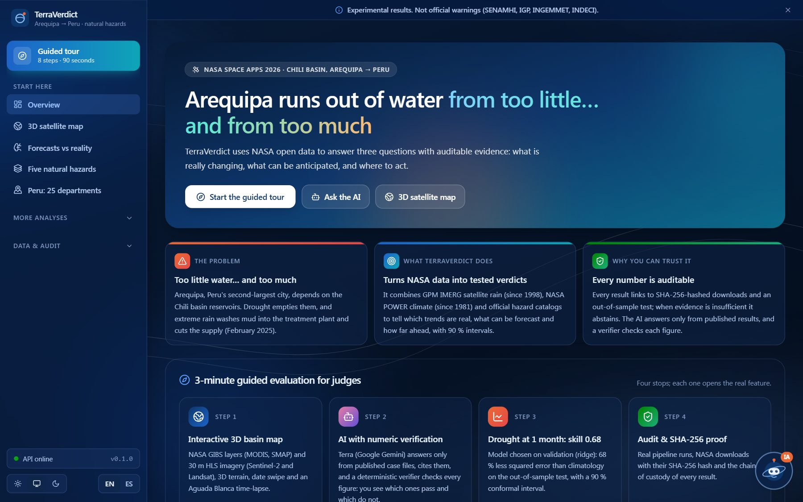

</div>

> **Aviso.** TerraVerdict publica resultados experimentales de investigación. No son alertas oficiales ni reemplazan a SENAMHI, IGP, INGEMMET, INDECI o ENFEN.

---

## Contenido

1. [Resumen](#1-resumen)
2. [Lo más destacado](#2-lo-más-destacado)
3. [Planteamiento del problema](#3-planteamiento-del-problema)
4. [Recorrido por el producto](#4-recorrido-por-el-producto)
5. [Datos](#5-datos)
6. [Metodología](#6-metodología)
7. [Resultados](#7-resultados)
8. [Arquitectura e ingeniería](#8-arquitectura-e-ingeniería)
9. [Reproducibilidad](#9-reproducibilidad)
10. [Aseguramiento de la calidad](#10-aseguramiento-de-la-calidad)
11. [Despliegue, seguridad y operación](#11-despliegue-seguridad-y-operación)
12. [Amenazas a la validez y limitaciones](#12-amenazas-a-la-validez-y-limitaciones)
13. [Estado de los módulos y hoja de ruta](#13-estado-de-los-módulos-y-hoja-de-ruta)
14. [Equipo](#14-equipo)
15. [Mapa de la documentación](#15-mapa-de-la-documentación)

---

## 1. Resumen

TerraVerdict es un sistema de ciencia de datos geoespaciales que responde cuatro preguntas para una cuenca de montaña regulada: **qué está cambiando, por qué, con cuánta confianza y dónde actuar**. El piloto es el sistema regulado del Chili, que abastece a Arequipa, la segunda ciudad del Perú; el mismo motor se aplica a los 25 departamentos del país.

Su decisión de diseño central es que **cada número que ve un usuario es un expediente publicado e inmutable**. Cada expediente (`TV-…`) lleva la estimación, su intervalo de incertidumbre del 90 % y su veredicto, las fuentes, los SHA-256 de sus datos crudos, el hash del preregistro y el commit que lo produjo. La aplicación web, la API REST, los informes ejecutivos en PDF y el asistente de IA leen de esos expedientes; ninguno calcula ni escribe cifras por su cuenta.

Cuando la evidencia no alcanza, el sistema lo dice: se abstiene, califica las tendencias como *preliminares* o *frágiles* y nombra la prueba que falló.

## 2. Lo más destacado

| | Qué hace | Por qué importa |
|---|---|---|
| **Sello de Confianza** | Toda tendencia debe pasar seis pruebas adversariales (ventanas, filtro de El Niño, cambio de sensor, familias de datos independientes, detectabilidad, años influyentes) antes de llamarse robusta | Separa las tendencias reales de los artefactos de El Niño, de los cambios de sensor o de unos pocos años extremos |
| **Pronóstico honesto** | Un zoológico de modelos (clásicos, gradient boosting, diez arquitecturas neuronales, ensambles) se elige en validación y se evalúa una sola vez en 2021–2026, con intervalos por bootstrap de bloques, pruebas de Diebold–Mariano y bandas conformales | La habilidad para la sequía a 1 mes, 0,68 (IC 90 % 0,54–0,78), está confirmada fuera de muestra; las señales débiles se informan como tales |
| **Dos familias de evidencia independientes para deslizamientos** | El Global Landslide Catalog de la NASA (basado en noticias) se contrasta con el inventario de campo de INGEMMET (28 915 registros) frente a una línea base de lugares al azar | 24 de 30 eventos de la NASA (80 %) caen a menos de 5 km de un movimiento inventariado, frente al 39,5 % de lugares al azar (p binomial < 0,001) |
| **Evidencia satelital a la escala correcta** | Mapa 3D sobre NASA GIBS con cortina de dos fechas alineada píxel a píxel: el embalse a 30 m (HLS), el verdor de la cuenca a 1 km (MODIS NDVI) y la humedad del suelo a 9 km (SMAP), además de un time-lapse mensual 2020–2026 solo con escenas sin nubes verificadas | Cada comparación se abre al acercamiento que su resolución permite leer y dice qué se puede y qué no se puede concluir |
| **IA verificada** | Terra (Google Gemini) responde solo con expedientes y eventos citados. Un verificador determinista comprueba cada cifra **y la fuente de datos a la que se atribuye**, y pide reescribir cuando alguna no tiene respaldo | Las cifras inventadas y las atribuciones cruzadas entre fuentes se detectan antes de mostrarse |
| **Pensado para una revisión de 3 minutos** | Un recorrido guiado de 8 pasos resalta cada función en su página real; inglés por defecto y español completo; funciona en teléfonos | Un jurado o un tomador de decisiones ve qué resuelve el sistema sin tener que buscarlo |
| **Cadena de custodia** | 143 archivos crudos verificados contra manifiestos SHA-256 antes y después de cada corrida; 12 resultados sellados; la verificación TLS nunca se desactiva (a INGEMMET se llega fijando su certificado intermedio faltante) | Cualquier revisor puede reproducir cada cifra con los mismos datos |

## 3. Planteamiento del problema

La cuenca del Chili falla en las dos direcciones, a menudo dentro del mismo ciclo de El Niño–Oscilación del Sur (ENOS):

| Fecha | Evento | Cifra | Fuente citada |
|---|---|---|---|
| Nov 2023 | Sequía: almacenamiento en las siete represas | 159 de 409 hm³ útiles (39 %) | La República |
| Mar 2024 | Colmatación de la represa Aguada Blanca | Capacidad de diseño 43 hm³, estimada 22 hm³ | El Búho |
| Feb 2025 | Turbidez por crecida en la captación de la ciudad | 5000 NTU; corte de agua a más del 70 % de la población | El Búho, Andina |
| Ago–oct 2026 | Estado de ENOS | ONI +2,46 °C (episodio El Niño según el criterio de NOAA) | NOAA CPC |

La brecha científica es de observación. La única estación GHCN-Daily de Arequipa tiene 14 años completos de lluvia y ninguno desde 2010. Los productos satelitales y de reanálisis cubren la cuenca, pero discrepan entre sí, cambian de sensor y están confundidos por ENOS. La tarea no es producir más tendencias: es decidir **qué variables tienen señal, qué tendencias sobreviven a pruebas adversariales y cuándo la respuesta honesta es "no hay evidencia suficiente"**.

## 4. Recorrido por el producto

La aplicación abre con lo que resuelve el sistema y un **recorrido guiado de 8 pasos** que navega por las páginas reales y resalta cada función.

| | |
|---|---|
| 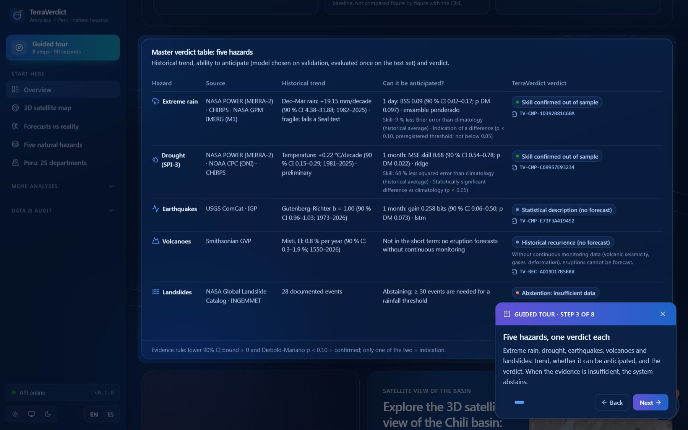<br>**Recorrido guiado.** Ocho pasos por la aplicación, con teclado y también en móvil. | 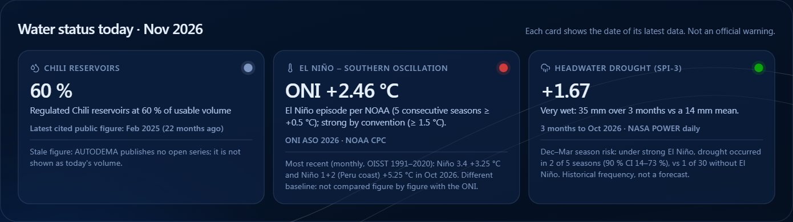<br>**Cómo estamos hoy.** Represas, ONI y Niño 3.4 / 1+2 mensuales, SPI-3 de la cabecera, cada uno con la fecha de su último dato real. |
| 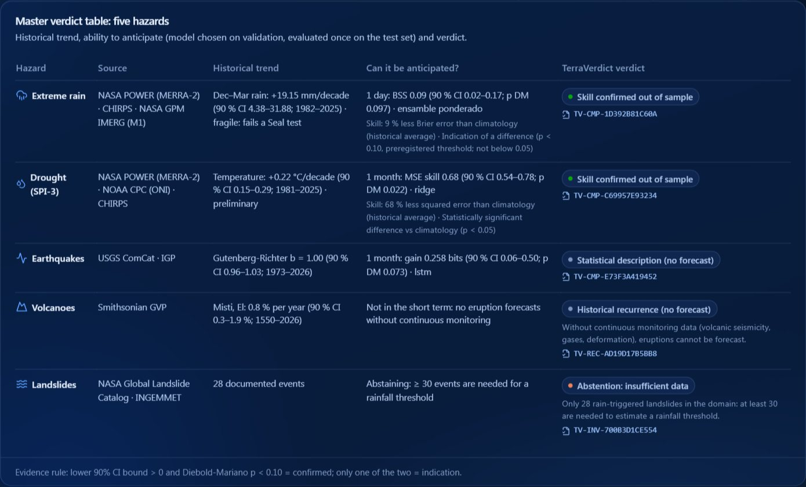<br>**Tabla maestra de veredictos.** Cinco amenazas con su tendencia, su capacidad de anticipación fuera de muestra y su veredicto, enlazadas a su expediente. | 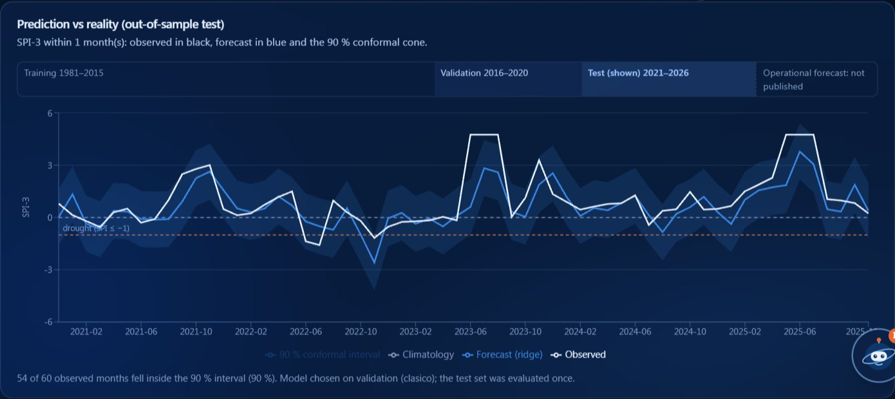<br>**Pronóstico frente a realidad.** SPI-3 a 1 mes en años que el modelo nunca vio, con la banda conformal del 90 %. |
| 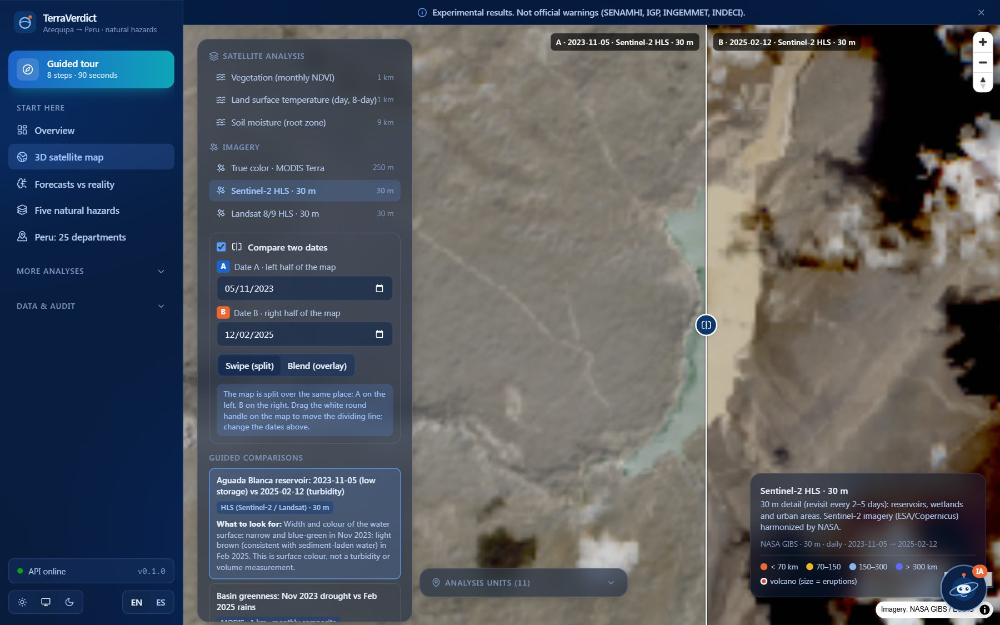<br>**Embalse a 30 m.** Cortina alineada: Aguada Blanca angosta y verde azulada en la sequía de 2023 (izquierda), parda clara en la turbidez de febrero de 2025 (derecha). | 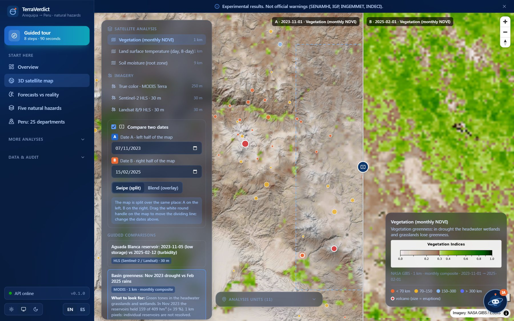<br>**Verdor de la cuenca a 1 km.** MODIS NDVI: mínimo de estiaje en noviembre de 2023 frente al reverdecimiento tras las lluvias de febrero de 2025. |
| 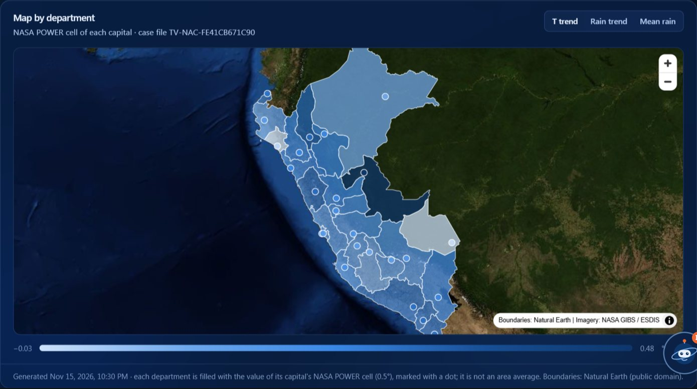<br>**Escala nacional.** El mismo motor para 25 departamentos; cada uno se colorea con la celda POWER de su capital (se declara que no es un promedio del territorio). | 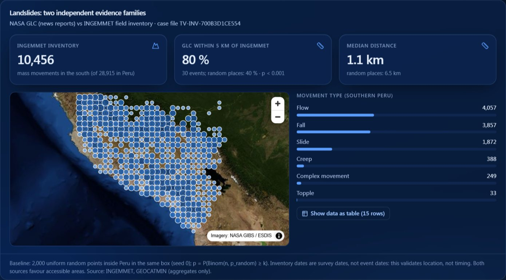<br>**Deslizamientos, dos familias de evidencia.** NASA GLC frente al inventario de campo de INGEMMET, con línea base al azar y densidad del inventario. |
| 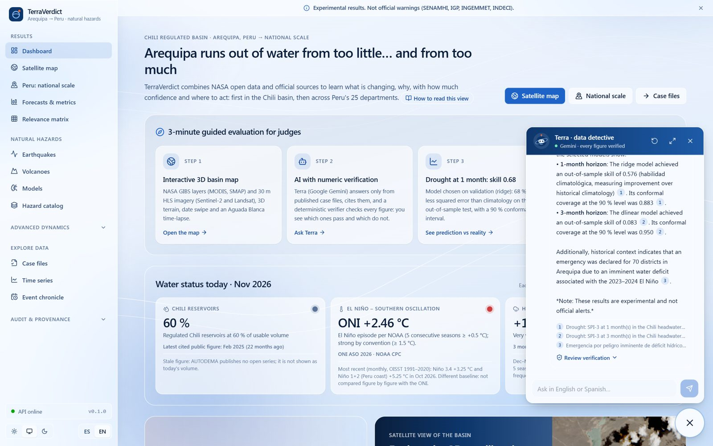<br>**Terra, la IA verificada.** Cita los expedientes; cada cifra y su fuente se comprueban antes de mostrarse. | 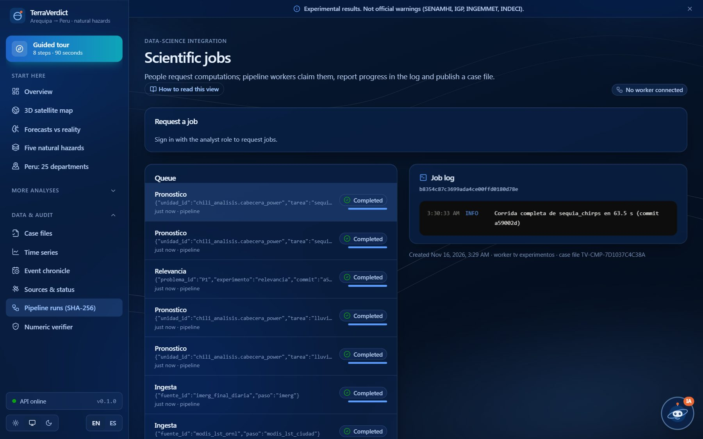<br>**Auditoría.** Ejecuciones reales del pipeline, descargas de NASA con su SHA-256 y el commit detrás de cada resultado. |

<p align="center">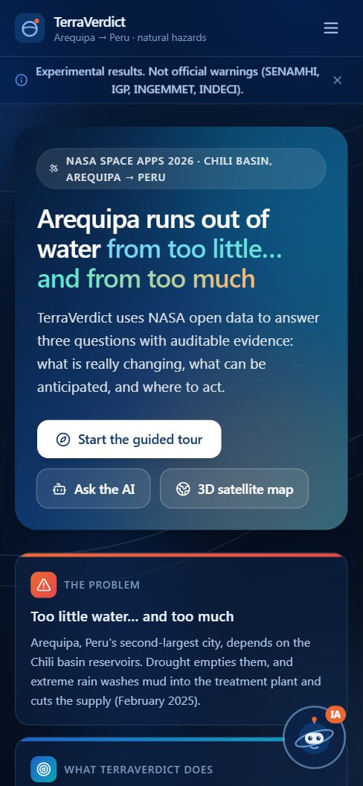</p>

## 5. Datos

### 5.1 Fuentes

| Producto | Proveedor | Cobertura usada | Rol |
|---|---|---|---|
| GPM IMERG Final diaria, V07 (0,1°) | NASA GES DISC | Ene 1998 – sep 2025, completa | Objetivo de la Matriz de Relevancia; familia de lluvia independiente |
| POWER (meteorología MERRA-2; radiación CERES/SRB) | NASA LaRC | Diaria ene 1981 – oct 2026; 25 celdas departamentales | Tendencias, SPI, modelos de lluvia extrema y sequía, escala nacional |
| Harmonized Landsat Sentinel-2, S30/L30 (30 m) | NASA/USGS; Sentinel-2 de ESA/Copernicus | 2020–2026, una escena verificada por mes | Cortina y time-lapse del embalse, caso de estudio |
| MODIS Terra color real, NDVI (1 km), LST (1 km) | NASA vía GIBS y ORNL DAAC | 2000 – hoy | Capas del mapa; contraste de temperatura de superficie |
| SMAP L4 humedad del suelo en la zona radicular (9 km) | NASA vía GIBS | 2015 – hoy | Capa del mapa (no entra en los modelos) |
| Global Landslide Catalog | NASA | Sur del Perú | Inventario de deslizamientos (basado en noticias) |
| Inventario de peligros geológicos (GEOCATMIN) | INGEMMET | 28 915 movimientos en masa, nacional | Segunda familia de evidencia de deslizamientos, de campo |
| Índice Oceánico El Niño; Niño 3.4 y 1+2 (OISST v2.1) | NOAA CPC | 1950 – oct 2026 | Covariable ENOS y estado actual |
| GHCN-Daily, estación PE000084752 | NOAA NCEI | Registro de la estación | Validación puntual, referencia de gradiente térmico |
| ComCat | USGS | 1973 – nov 2026 | Sismicidad |
| Volcanoes of the World | Smithsonian GVP | Desde 1550 | Recurrencia volcánica |
| CHIRPS v2.0 | UCSB Climate Hazards Center | 1981 – 2026 | Familia de lluvia independiente para el Sello |
| Límites admin-1 v5.1.2 | Natural Earth (dominio público) | Perú | Coropletas por departamento; línea base al azar |
| SRTM vía Mapzen Terrain Tiles | NASA/NGA, USGS, NOAA | — | Relieve 3D |

Cada fuente se comprobó contra su catálogo oficial con consultas reales ([`docs/verificacion/README.md`](docs/verificacion/README.md)). Las fuentes nacionales se volvieron a consultar el 15-11-2026 con verificación TLS activa: INGEMMET está integrado; SENAMHI (GeoServer WMS/WFS) y CENEPRED (ArcGIS REST) responden pero aún no se usan; el observatorio vulcanológico del IGP no resuelve en DNS. Atribuciones y licencias en [`docs/licencias-y-atribuciones.md`](docs/licencias-y-atribuciones.md). TerraVerdict no está avalado por NASA, ESA, USGS ni por ninguna institución peruana.

### 5.2 Gobierno de datos

- Cada descarga se guarda con su entrada de manifiesto (URL, producto, versión, bytes, SHA-256, fecha). `tv verificar-integridad` verifica los 143 archivos crudos antes y después de cada corrida.
- Los resultados están sellados: `resultados/indice.json` guarda el SHA-256 de cada uno de los 12 resultados, así que cualquier edición se detecta.
- Las imágenes satelitales se eligen por regla, no a mano. `scripts/timelapse_hls.py` evalúa cada adquisición HLS sobre la huella del embalse (OpenStreetMap way 23815221) y conserva la escena con cobertura completa y la menor fracción de píxeles brillantes, como máximo 10 %. Los meses sin escena válida quedan vacíos y nunca se interpolan.
- Ninguna fuente se consulta con la verificación TLS desactivada. El servidor de INGEMMET omite su certificado intermedio; se añade el intermedio oficial de Sectigo con huella SHA-256 fijada y una prueba rechaza cualquier copia alterada.

## 6. Metodología

### 6.1 Protocolo de evaluación

- **Partición temporal congelada.** Entrenamiento 1981–2015, validación 2016–2020, prueba 2021–2026. La partición forma parte de un preregistro cuyo hash va en cada resultado; una prueba falla si el preregistro se edita.
- **Selección solo en validación.** Hiperparámetros, ventanas, calibración, pesos de ensamble y el modelo informado se eligen en validación. La prueba se evalúa una sola vez y solo se informa.
- **Origen móvil.** Un historial año a año (2016–2026) reajusta el diseño congelado, con entrenamiento hasta Y−2, validación en Y−1 y prueba en Y. Los años hasta 2020 se marcan como optimistas porque informaron el diseño.
- **Zoológico de modelos.** Referencias de persistencia y climatología; modelos lineales, regularizados y de gradient boosting; diez arquitecturas neuronales (GRU, LSTM, TCN, MLP, DLinear, N-BEATS, N-HiTS, PatchTST, iTransformer y un modelo de espacio de estados selectivo); y dos ensambles. Las redes se corren con varias semillas y se informa su dispersión.

### 6.2 Habilidad, incertidumbre y significancia

| Magnitud | Definición |
|---|---|
| Brier skill score | BSS = 1 − BS(modelo) / BS(climatología), para la probabilidad diaria de lluvia fuerte |
| Habilidad en MSE | 1 − MSE(modelo) / MSE(climatología), para la regresión del SPI-3 |
| Ganancia de información | Ganancia de log-verosimilitud sobre un proceso de Poisson de tasa constante, en bits por mes, para conteos sísmicos |
| Intervalos de confianza | Bootstrap de bloques móviles del diferencial de pérdida en la prueba (90 %) |
| Significancia | Prueba de Diebold–Mariano con varianza HAC y corrección de Harvey–Leybourne–Newbold, frente a la climatología |
| Intervalos predictivos | Conformal partido, calibrado en validación (nominal 90 %) |
| Calibración | Diagrama de confiabilidad y error de calibración esperado (bins de igual frecuencia) |

**Regla de evidencia.** La habilidad está *confirmada* cuando el límite inferior del IC del 90 % es mayor que cero **y** el p de Diebold–Mariano es menor que 0,10, el umbral preregistrado. Cumplir solo una de las dos es un *indicio*. Un modelo que no supera a la climatología en validación no se publica como pronóstico: el sistema se abstiene y explica por qué.

### 6.3 Detección de tendencias y Sello de Confianza

Las pendientes son de Theil–Sen. La inferencia usa el más conservador de los p de Mann–Kendall original, Hamed–Rao y con preblanqueo. Una tendencia significativa se califica *robusta* solo si pasa todas las pruebas del Sello:

1. **Ventanas.** El signo es estable en subperiodos móviles.
2. **ENOS.** La pendiente se mantiene al quitar el ONI, con inferencia HAC.
3. **Sensor.** No hay cambio de signo ni cambio relativo grande en las transiciones de sensor o producto.
4. **Independencia.** El signo coincide entre familias de datos independientes (POWER, CHIRPS, IMERG).
5. **Detectabilidad.** Hay años suficientes para detectar el efecto con el ruido observado.
6. **Palanca.** La tendencia sobrevive al quitar sus años más influyentes.

Una prueba fallida da *frágil*; las condiciones no evaluadas dan *preliminar*. El contrato de la API rechaza un veredicto *robusto* con alguna prueba no aprobada y un *frágil* que no nombre la prueba fallida.

### 6.4 Matriz de Relevancia (M1)

Para el problema P1, lluvia extrema en la cabecera con objetivo IMERG, la matriz combina importancia por permutación en bloques de validación, estabilidad en 200 remuestreos, significancia condicional con control FDR de Benjamini–Hochberg y una única evaluación en 2021–2025. El procedimiento se validó con datos sintéticos de variables relevantes conocidas. Los problemas P2–P4 (degradación de bofedales, déficit de represas, turbidez) se muestran a la espera de datos locales en vez de rellenarse.

### 6.5 Evidencia de deslizamientos entre familias

Para cada evento del NASA GLC en el sur del Perú se calcula la distancia al punto más cercano del inventario de INGEMMET y se compara con 2000 lugares uniformes al azar dentro del Perú en la misma caja (semilla 0). La fracción a menos de 5 km se contrasta con una prueba binomial unilateral frente a la fracción de los lugares al azar. Las fechas del inventario son de levantamiento, no del evento, así que la comparación valida la **ubicación**, no el momento; ambas fuentes favorecen terrenos accesibles, y así se declara junto al resultado.

### 6.6 Indicadores del estado actual

`tv publicar` calcula `indicadores.json` a partir de los crudos: estado del episodio ENOS (criterio de NOAA), SPI-3 de la cabecera (ajuste gamma con el periodo de entrenamiento y meses no confiables marcados), frecuencia de sequía condicionada a ENOS (intervalos de Wilson y prueba exacta de Fisher unilateral; descriptiva, no un pronóstico) y el gradiente térmico observado entre la estación GHCN (2520 m) y la celda POWER de la cabecera (4232 m), comparado con la referencia de 6,5 °C/km, nunca usado como corrección.

## 7. Resultados

Todas las cifras se leen de `resultados/contrato/*.json`, producidas con datos descargados el 15-11-2026. Las tablas completas están en [`docs/experimentos.md`](docs/experimentos.md).

### 7.1 Veredictos por amenaza

| Amenaza | Señal histórica | Capacidad de anticipar fuera de muestra (prueba 2021–2026) | Veredicto |
|---|---|---|---|
| Sequía (SPI-3, cabecera) | Temperatura media +0,22 °C/década (IC 90 % 0,15–0,29; 1981–2025); preliminar, independencia pendiente | A 1 mes, Ridge: habilidad MSE 0,68 (IC 90 % 0,54–0,78), p DM = 0,022, cobertura conformal 0,90 | Habilidad confirmada |
| Lluvia extrema (día siguiente ≥ p90 del entrenamiento) | Lluvia dic–mar +19,15 mm/década (IC 90 % 4,38–31,88; 1982–2025); frágil, falla la prueba de palanca | Ensamble ponderado: BSS 0,092 (IC 90 % 0,02–0,17), p DM = 0,097, ECE 0,035 | Confirmada en el umbral preregistrado; en la práctica, solo monitoreo |
| Sismos (350 km de Arequipa) | Gutenberg–Richter b = 1,00 (IC 90 % 0,96–1,03), Mc 4,5 | Conteos mensuales: 0,26 bits/mes sobre Poisson, p DM = 0,073 | Descripción estadística, no un pronóstico |
| Volcanes | Probabilidad anual de erupción del Misti 0,8 % (IC 90 % 0,3–1,9 %) | No se intenta sin datos de monitoreo continuo | Recurrencia histórica |
| Deslizamientos por lluvia | 28 eventos con serie de lluvia (NASA GLC); ubicación corroborada por INGEMMET (80 % a menos de 5 km frente a 39,5 % al azar, p < 0,001) | El umbral de lluvia exige al menos 30 eventos | Abstención |

A tres meses, la habilidad para la sequía baja a 0,14 (iTransformer, POWER) y a 0,08 (DLinear, CHIRPS). La habilidad a un mes proviene sobre todo de la persistencia del SPI-1 y el SPI-3; el ONI aporta en el horizonte más largo.

### 7.2 Estado actual (calculado de los crudos)

| Indicador | Valor | Periodo |
|---|---|---|
| ONI | +2,46 °C; episodio El Niño (5 temporadas seguidas ≥ +0,5) | Ago–oct 2026 |
| Anomalía mensual Niño 3.4 / Niño 1+2 | +3,25 °C / +5,25 °C (OISST, base 1991–2020; no comparable cifra a cifra con el ONI) | Oct 2026 |
| SPI-3 de la cabecera | +1,67, muy húmedo | Ago–oct 2026 |
| Frecuencia de sequía en temporadas de El Niño fuerte | 2 de 5 (IC Wilson 90 % 14–73 %), frente a 1 de 30 en el resto; p de Fisher = 0,10 | 1982–2026 |
| Último dato público de las represas | 60 % del volumen útil | Feb 2025 (se muestra como desactualizado) |

### 7.3 Evidencia de observación de la Tierra

| 5 nov 2023, sequía | 12 feb 2025, episodio de turbidez |
|---|---|
| 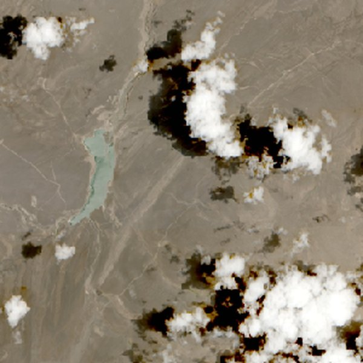 | 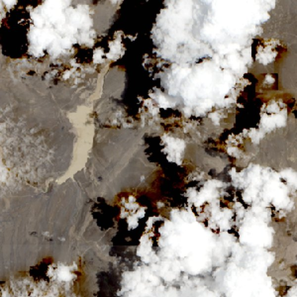 |

HLS S30 a 30 m sobre Aguada Blanca. El espejo de agua es verde azulado en la sequía de 2023 y pardo claro durante el corte de febrero de 2025, compatible con agua cargada de sedimentos. Es color de reflectancia de superficie, no una medición de turbidez ni de volumen, y la aplicación lo dice. En febrero de 2025 la celda de la cabecera registró 9 días de lluvia fuerte, en los que el modelo de lluvia extrema asignó una probabilidad media de 0,50, frente a 0,15 de la climatología.

## 8. Arquitectura e ingeniería

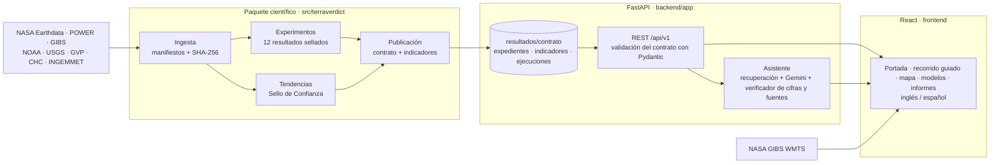

**Decisiones de diseño**

- **El contrato como interfaz.** La API solo importa `resultados/contrato/` al arrancar y no depende de la pila científica (NumPy, PyTorch). La función serverless queda pequeña y la ciencia puede volver a correrse sin desplegar código.
- **Reglas científicas en el esquema.** Los validadores de Pydantic codifican reglas del dominio: una tendencia robusta exige todas las pruebas del Sello aprobadas, una frágil debe nombrar su falla y un modelo publicado debe superar a la climatología en validación. La ciencia inválida se rechaza con HTTP 422 en vez de mostrarse.
- **Publicación idempotente.** Los expedientes se direccionan por contenido; republicar lo mismo no crea duplicados.
- **Generación anclada.** El asistente recupera expedientes y eventos citados por REST. Del texto generado se extraen los números y los nombres de fuentes; cada uno se contrasta con los expedientes citados y una respuesta sin respaldo se reescribe o se marca. Un servidor MCP para agentes externos está diseñado pero **no implementado**.
- **Flujo de datos en el frontend.** Todos los datos vienen del cliente OpenAPI tipado (`openapi-typescript`) con caché de TanStack Query. Los gráficos usan Recharts; el mapa usa MapLibre GL con relieve Terrarium y un segundo mapa sincronizado para la cortina. Los textos de la interfaz se escriben en los dos idiomas a la vez y una prueba lo comprueba; los textos de datos se traducen con un glosario que conserva cada dígito.

**Pila.** Python 3.12, pandas, SciPy, scikit-learn, PyTorch · FastAPI, SQLAlchemy 2, Alembic, Pydantic 2 · React 18, TypeScript, Vite, TanStack Query, Recharts, MapLibre GL 4, Tailwind CSS · Playwright · GitHub Actions · Vercel.

**Estructura del repositorio**

```
src/terraverdict/    ingesta, señales, tendencias y Sello, modelos, experimentos, publicación
backend/app/         rutas de la API, esquemas, servicios (asistente, verificador), persistencia, migraciones
frontend/src/        páginas, mapa, gráficos, recorrido guiado, portada, cliente tipado, i18n
config/              configuración congelada: fenómenos, fuentes, métricas, particiones, certificados fijados
datos/               eventos documentados citados; reporte de AUTODEMA transcrito
resultados/          resultados sellados y el contrato de la API
scripts/             selección del time-lapse HLS, glosario, verificación de fuentes y enlaces
tests/               pruebas científicas: unitarias, estadísticas, integración, integridad, portabilidad
docs/                metodología, auditorías, guía de la API, despliegue, bitácora, traspaso, propuesta original
```

## 9. Reproducibilidad

```bash
python -m venv .venv && . .venv/bin/activate              # Windows: .venv\Scripts\activate
pip install torch --index-url https://download.pytorch.org/whl/cpu
pip install -e ".[dev,ml]" && pip install -e "backend[dev]"
```

Regeneración completa, de las descargas al contrato de la API (IMERG exige `EARTHDATA_TOKEN`):

```bash
tv ingest-fenomenos && tv ingest-nino && tv ingest-ingemmet && tv verificar-integridad
tv experimentos && tv trends && tv informe
tv publicar --exportar resultados/contrato/expedientes.json
tv verificar-integridad
```

Haga commit antes de `tv experimentos`: cada resultado registra el commit `HEAD` que lo produjo.

Aplicación en local:

```bash
cd backend && python -m app.cli migrar && python -m app.cli importar && uvicorn app.main:app --port 8000
```
```bash
cd frontend && npm ci && npm run dev
```
```bash
docker compose up --build
```

Los secretos solo se leen de `.env` o de la plataforma de hosting: `EARTHDATA_TOKEN`, `TV_GEMINI_API_KEY` y `TV_JWT_SECRETO` (ver [`.env.example`](.env.example)). En Windows, use `git config core.autocrlf false`: los sellos SHA-256 suponen saltos de línea LF.

## 10. Aseguramiento de la calidad

| Suite | Alcance | Comando | Último resultado |
|---|---|---|---|
| Paquete científico | Unitarias, propiedades estadísticas, recuperación sintética, integración con el contrato, integridad, portabilidad | `pytest` | 168 aprobadas, 2 omitidas |
| Backend | Endpoints, validadores científicos, asistente (verificación de cifras y fuentes), seguridad, migraciones | `cd backend && pytest` | 111 aprobadas |
| Frontend | Componentes, formato, completitud i18n, unión de coropletas, lógica de la portada | `cd frontend && npm test` | 48 aprobadas |
| Extremo a extremo | Primera visita en inglés, recorrido guiado completo de 8 pasos, procedencia, verificador numérico, vistas de fenómenos, cambio a español | `cd frontend && npm run e2e` | 3 de 3, en local y contra producción |
| Análisis estático | Tipos y lint | `ruff`, `mypy`, `npm run typecheck`, `npm run lint` | Limpio |

GitHub Actions corre todas las suites en cada push (`.github/workflows/ci.yml`) y el documento OpenAPI se regenera desde el código y se compara contra deriva. Las 16 páginas también se revisaron a ancho de teléfono (375 px) en busca de desbordes horizontales y errores de consola.

## 11. Despliegue, seguridad y operación

- **Hosting.** Vercel sirve el build estático de React y `api/index.py` como función Python; cada push a `main` despliega. En un arranque en frío la función aplica migraciones a SQLite en `/tmp` e importa el contrato en 2–4 s, y el cliente muestra un aviso real de conexión mientras hay consultas pendientes. Los resultados científicos son inmutables y se reconstruyen igual en cada instancia. Las cuentas de usuario solo persisten con `TV_DATABASE_URL` apuntando a PostgreSQL; la demo pública es de solo lectura y no requiere inicio de sesión.
- **Seguridad.** Content Security Policy estricta, HSTS, `nosniff`, `X-Frame-Options`, `Referrer-Policy` y `Permissions-Policy`. Sin `TV_JWT_SECRETO` la API funciona en solo lectura. El asistente tiene límites por IP y globales, y la clave del proveedor del modelo solo vive en el servidor.
- **Operación.** El procedimiento de publicación, la gestión de secretos y el runbook de actualización de datos están en [`docs/traspaso.md`](docs/traspaso.md) y [`docs/despliegue.md`](docs/despliegue.md).

## 12. Amenazas a la validez y limitaciones

- **Muestras de prueba pequeñas.** Los periodos de prueba son cortos (por ejemplo, 60 meses para el SPI-3). Los intervalos son anchos y se informan así; no se interpretan años sueltos.
- **Resolución del reanálisis.** Las celdas POWER son de 0,5° × 0,625°; los extremos puntuales se suavizan.
- **Una sola familia de datos a escala nacional.** Con solo POWER a escala nacional, la prueba de independencia queda pendiente: las tendencias nacionales llegan como máximo a *preliminar* o *frágil*.
- **Estado de las represas.** AUTODEMA no publica series abiertas, lo que bloquea el gemelo del embalse (M3) y el problema P3.
- **Catálogos de eventos.** El NASA GLC se basa en noticias y subregistra eventos rurales; INGEMMET valida la ubicación, no las fechas. El umbral de deslizamientos se abstiene con menos de 30 eventos.
- **Completitud sísmica.** Mc = 4,5 se declaró antes del análisis y se mantiene como limitación explícita.
- **El color no es concentración.** La comparación HLS del embalse documenta color de superficie, no turbidez.

## 13. Estado de los módulos y hoja de ruta

| Módulo | Estado |
|---|---|
| M1 Matriz de Relevancia | Implementado para P1; P2–P4 esperan datos locales |
| M2 Tendencias + Sello de Confianza | Implementado, seis pruebas, expedientes publicados |
| M3 Gemelo hidrológico y atribución | No implementado: requiere series de aporte y volumen de AUTODEMA (o SWOT) para calibrar GR2M + embalse |
| M4 Anticipación | Parcial: pronósticos de lluvia y sequía fuera de muestra; el pronóstico estacional condicionado a ENOS y la alerta de turbidez dependen de M3 |
| M5 Decisiones de cuenca | No implementado: requiere la serie del espejo de agua de Aguada Blanca y la erosión RUSLE |
| M6 Amenazas naturales · M7 Escala nacional · M8 Historial de métricas | Implementados |

Siguiente: convenios de datos con SENAMHI, AUTODEMA y ANA (desbloquean P2–P4, M3 y la prueba de independencia nacional); integrar los escenarios de riesgo de CENEPRED; un servidor MCP para agentes externos; almacenamiento persistente en PostgreSQL para operación multiusuario.

## 14. Equipo

**Equipo TerraVerdict** · NASA Space Apps Challenge 2026 · Arequipa, Perú

| Integrante | Contribuciones |
|---|---|
| Ower Frank (Ower López, UNSA) | Dueño del repositorio; planteamiento del problema y propuesta; backend FastAPI; frontend React; motor científico (Sello de Confianza, análisis de caos, zoológico de modelos); escala nacional; cadena de custodia; Matriz de Relevancia; asistente de IA; despliegue |
| MaxsForocca (UNSA) | Arquitectura; corridas completas de experimentos; caos en series observadas; integración ciencia–API; CI; Docker; pruebas de extremo a extremo; documentación; ingesta de IMERG |
| DiegoNiS | Integrante del equipo; organización del equipo en GitHub durante la primera etapa |

Las contribuciones por commit se listan con `git shortlog -sn`; el registro detallado está en [`docs/bitacora.md`](docs/bitacora.md).

## 15. Mapa de la documentación

| Documento | Propósito |
|---|---|
| [`docs/experimentos.md`](docs/experimentos.md) | Resultados vigentes, generados desde los JSON sellados |
| [`docs/metodologia.md`](docs/metodologia.md) | Métodos estadísticos y sus referencias |
| [`docs/diseno-tecnico.md`](docs/diseno-tecnico.md) | Diseño técnico, ecuaciones y registros de decisiones de arquitectura |
| [`docs/auditoria-metricas.md`](docs/auditoria-metricas.md) | Auditoría del protocolo de evaluación (19 hallazgos y su resolución) |
| [`docs/modulo-relevancia.md`](docs/modulo-relevancia.md) | Matriz de Relevancia (M1) |
| [`docs/trazabilidad.md`](docs/trazabilidad.md) | Requisitos de cadena de custodia |
| [`docs/api/README.md`](docs/api/README.md) | Guía de la API, modelo de errores y `openapi.json` |
| [`docs/despliegue.md`](docs/despliegue.md) | Opciones de despliegue y verificación en producción |
| [`docs/traspaso.md`](docs/traspaso.md) | Traspaso operativo y runbook de actualización de datos |
| [`docs/bitacora.md`](docs/bitacora.md) · [`docs/pendientes.md`](docs/pendientes.md) | Bitácora de ingeniería y pendientes |
| [`docs/propuesta-original.md`](docs/propuesta-original.md) | Propuesta original en español: hipótesis, objetivos, módulos y referencias |

---

Licencia MIT. TerraVerdict usa datos abiertos de NASA, NOAA, USGS, ESA/Copernicus, Smithsonian Institution, UCSB CHC, INGEMMET y Natural Earth, y fuentes peruanas citadas.
