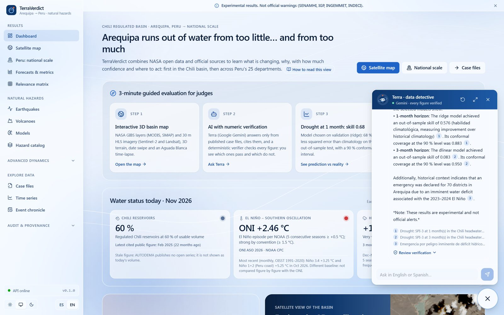
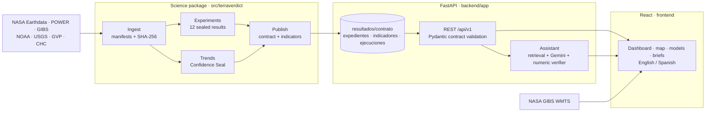

<div align="center">

# TerraVerdict

**Auditable Earth-system verdicts for mountain cities that lose water to drought and to floods**

NASA Space Apps Challenge 2026 · Challenge: [Be An Earth System Trend Detective!](https://www.spaceappschallenge.org/2026/challenges/earth-system-trend-detective/) · Team TerraVerdict · Arequipa, Peru

[](https://terraverdict.vercel.app)
[](https://terraverdict.vercel.app/api/docs)
[](docs/trazabilidad.md)
[](LICENSE)

[Live application](https://terraverdict.vercel.app) · [API reference](https://terraverdict.vercel.app/api/docs) · [Versión en español](readme.es.md)


</div>

> **Disclaimer.** TerraVerdict publishes experimental research results. They are not official warnings and do not replace SENAMHI, IGP, INGEMMET, INDECI or ENFEN.

---

## Contents

1. [Summary](#1-summary)
2. [Problem statement](#2-problem-statement)
3. [System overview](#3-system-overview)
4. [Data](#4-data)
5. [Methodology](#5-methodology)
6. [Results](#6-results)
7. [Architecture and engineering](#7-architecture-and-engineering)
8. [Reproducibility](#8-reproducibility)
9. [Quality assurance](#9-quality-assurance)
10. [Deployment, security and operations](#10-deployment-security-and-operations)
11. [Threats to validity and limitations](#11-threats-to-validity-and-limitations)
12. [Roadmap](#12-roadmap)
13. [Team](#13-team)
14. [Documentation map](#14-documentation-map)

---

## 1. Summary

TerraVerdict is a geospatial data-science system that answers four questions for a regulated mountain basin: **what is changing, why, with how much confidence, and where to act**. The pilot case is the Chili regulated system, which supplies the city of Arequipa (Peru), and the same engine runs for Peru's 25 departments.

Its central design choice is that **every number shown to a user is a published, immutable case file**. Each case file (`TV-…`) carries the estimate, its 90 % uncertainty interval and verdict, the sources, the SHA-256 hashes of its raw inputs, the preregistration hash and the git commit that produced it. The web application, the REST API, the executive PDF briefs and the AI assistant all read from these case files. None of them computes or types figures of its own.

The system is deployed at <https://terraverdict.vercel.app>.

## 2. Problem statement

The Chili basin fails in both directions, often within the same El Niño–Southern Oscillation (ENSO) cycle:

| Date | Event | Figure | Cited source |
|---|---|---|---|
| Nov 2023 | Drought: storage in the seven reservoirs | 159 of 409 hm³ usable (39 %) | La República |
| Mar 2024 | Sedimentation of Aguada Blanca reservoir | Design capacity 43 hm³, estimated 22 hm³ | El Búho |
| Feb 2025 | Flood-driven turbidity at the city intake | 5,000 NTU; supply cut to more than 70 % of the population | El Búho, Andina |
| Aug–Oct 2026 | ENSO state | ONI +2.46 °C (El Niño episode by NOAA criterion) | NOAA CPC |

The scientific gap is observational. Arequipa's only GHCN-Daily station has 14 complete years of rainfall and none since 2010. Satellite and reanalysis products cover the basin, but they disagree, they change sensors over time, and they are confounded by ENSO. The task is therefore not to produce more trends. It is to decide **which variables carry signal, which trends survive adversarial testing, and when the honest answer is "not enough evidence"**.

## 3. System overview

| Need | Capability | Where |
|---|---|---|
| Situational awareness | Water-status indicators: latest reservoir figure with its real date, ONI and monthly Niño 3.4 / 1+2, headwater SPI-3, historical drought frequency conditional on ENSO | Dashboard `/` |
| Trend detection | Theil–Sen slopes with conservative Mann–Kendall inference and a six-test Confidence Seal | `/series`, `/peru`, case files |
| Predictability | Model zoo evaluated once out of sample, with conformal intervals and an explicit abstention rule | `/metricas`, `/modelos` |
| Variable relevance | Relevance matrix (M1): block-permutation importance, resampling stability, conditional significance with FDR control | `/relevancia` |
| Earth observation | 3D map on NASA GIBS, HLS 30 m date swipe and a 2020–2026 monthly time-lapse of Aguada Blanca | `/mapa` |
| Decision support | Executive two-page PDF brief per case file; ENSO stress scenario; documented case study of February 2025 | `/informe/:id`, dashboard |
| Explanation | Terra, an assistant that answers only from case files and cited events, with deterministic numeric verification | All pages |
| Auditability | Pipeline runs, input hashes and source verification | `/procesos`, `/fuentes` |

| | |
|---|---|
| <br>3D satellite map: HLS 30 m time-lapse of Aguada Blanca, NASA GIBS layers, USGS earthquakes and GVP volcanoes. | <br>Terra: answers grounded in case files, inline citations and a per-figure verification report. |
| <br>Master verdict table: trend, out-of-sample skill and verdict per hazard, each linked to its case file. | <br>Prediction versus observation on the test period, with the 90 % split-conformal band (54 of 60 months covered). |

## 4. Data

### 4.1 Sources

| Product | Provider | Coverage used | Role |
|---|---|---|---|
| GPM IMERG Final daily, V07 (0.1°) | NASA GES DISC | Jan 1998 – Sep 2025, complete | Target of the relevance matrix; independent rainfall family |
| POWER (MERRA-2 meteorology; CERES/SRB radiation) | NASA LaRC | Daily Jan 1981 – Oct 2026; 25 departmental cells | Trends, SPI, extreme-rain and drought models, national scale |
| Harmonized Landsat Sentinel-2, S30/L30 (30 m) | NASA/USGS; Sentinel-2 by ESA/Copernicus | 2020–2026, one image per month | Reservoir time-lapse, date comparison, case study |
| MODIS Terra true colour, NDVI, LST | NASA via GIBS and ORNL DAAC | 2000 – present | Map layers; land surface temperature contrast |
| SMAP L4 root-zone soil moisture (9 km) | NASA via GIBS | 2015 – present | Context layer (not used in models) |
| Global Landslide Catalog | NASA | Southern Peru | Landslide inventory |
| Oceanic Niño Index; Niño 3.4 and 1+2 (OISST v2.1) | NOAA CPC | 1950 – Oct 2026 | ENSO covariate and current state |
| GHCN-Daily, station PE000084752 | NOAA NCEI | Station record | Point validation, lapse-rate reference |
| ComCat | USGS | 1973 – Nov 2026 | Seismicity |
| Volcanoes of the World | Smithsonian GVP | Since 1550 | Volcanic recurrence |
| CHIRPS v2.0 | UCSB Climate Hazards Center | 1981 – 2026 | Independent rainfall family for the Seal |
| SRTM via Mapzen Terrain Tiles | NASA/NGA, USGS, NOAA | — | 3D terrain |

All sources were checked against their official catalogues with live queries: 37 of 40 checks passed, and the three that did not respond are marked as unverified ([`docs/verificacion/README.md`](docs/verificacion/README.md)). Attributions and licences are listed in [`docs/licencias-y-atribuciones.md`](docs/licencias-y-atribuciones.md). TerraVerdict is not endorsed by NASA, ESA or USGS.

### 4.2 Data governance

- Every download is stored with a manifest entry (URL, product, version, byte count, SHA-256, timestamp). `tv verificar-integridad` verifies all 143 raw files before and after each run.
- Results are sealed: `resultados/indice.json` stores the SHA-256 of each of the 12 result files, so any edit is detected.
- Satellite imagery is selected, not curated by hand. `scripts/timelapse_hls.py` evaluates every HLS acquisition over the reservoir footprint (OpenStreetMap way 23815221). It keeps the scene with full coverage and the lowest bright-pixel fraction, provided that fraction is at most 10 %. It records the tile URL and its hash. Months without a valid scene stay empty and are never interpolated.

## 5. Methodology

### 5.1 Evaluation protocol

- **Frozen temporal split.** Training 1981–2015, validation 2016–2020, test 2021–2026. The split is part of a preregistration whose hash is embedded in every result; a dedicated test fails if the preregistration is edited.
- **Selection on validation only.** Hyperparameters, input windows, calibration, ensemble weights and the reported model are all chosen on validation. The test set is evaluated once and only reported.
- **Rolling origin.** A year-by-year history (2016–2026) re-fits the frozen design, with training up to Y−2, validation on Y−1 and test on Y. Years up to 2020 are flagged as optimistic because they informed the design.
- **Model zoo.** Persistence and climatology references; linear, regularised and gradient-boosted models; ten neural architectures (GRU, LSTM, TCN, MLP, DLinear, N-BEATS, N-HiTS, PatchTST, iTransformer and a selective state-space model); and two ensembles. Neural models are run with several seeds, and the seed dispersion is reported.

### 5.2 Skill, uncertainty and significance

| Quantity | Definition |
|---|---|
| Brier skill score | BSS = 1 − BS(model) / BS(climatology), for daily heavy-rain probability |
| MSE skill | 1 − MSE(model) / MSE(climatology), for SPI-3 regression |
| Information gain | Log-likelihood gain over a constant-rate Poisson process, in bits per month, for earthquake counts |
| Confidence intervals | Moving-block bootstrap of the test loss differential (90 %) |
| Significance | Diebold–Mariano test with HAC variance and the Harvey–Leybourne–Newbold correction, against climatology |
| Predictive intervals | Split-conformal, calibrated on validation (nominal 90 %) |
| Calibration | Reliability diagram and expected calibration error (equal-frequency bins) |

**Evidence rule.** Skill is *confirmed* when the lower bound of the 90 % CI is above zero **and** the Diebold–Mariano p-value is below 0.10, the preregistered threshold. Meeting only one of the two is an *indication*. A model that does not beat climatology on validation is not published as a forecast: the system abstains and states why.

### 5.3 Trend detection and the Confidence Seal

Slopes are Theil–Sen estimates. Inference uses the most conservative of the original, Hamed–Rao and pre-whitened Mann–Kendall p-values. A significant trend is labelled *robust* only if it passes every test of the Confidence Seal:

1. **Windows.** The sign is stable across sliding sub-periods.
2. **ENSO.** The slope remains after regressing out the ONI, with HAC inference.
3. **Sensor.** There is no sign change or large relative change across known sensor or product transitions.
4. **Independence.** The sign agrees across independent data families (POWER, CHIRPS, IMERG).
5. **Detectability.** Enough years exist to detect the effect at the observed noise level.
6. **Leverage.** The trend survives the removal of its most influential years.

A failed test yields *fragile*; untested conditions yield *preliminary*. The contract layer rejects any *fragile* verdict that does not name the failed test.

### 5.4 Relevance matrix (M1)

For problem P1, extreme rain in the headwaters with an IMERG target, the matrix combines:
- permutation importance computed on validation blocks;
- stability across 200 resamples;
- a shuffled null with conditional significance under Benjamini–Hochberg FDR;
- a single evaluation on 2021–2025.

The procedure was validated on synthetic data with known relevant variables. Problems P2–P4 (wetland degradation, reservoir deficit, turbidity) are declared and shown as awaiting data rather than filled in.

### 5.5 Current-state indicators

`tv publicar` computes `indicadores.json` from raw files:

- **ENSO episode status.** NOAA criterion: five consecutive overlapping seasons with ONI ≥ +0.5 °C.
- **Headwater SPI-3.** Gamma fit with a zero-precipitation probability, parameters estimated on the training period only. A month is flagged unreliable when its climatological three-month total is below 10 mm (dry season).
- **ENSO-conditional drought frequency.** February SPI-3 ≤ −1 by DJF ONI category, with Wilson 90 % intervals and a one-sided Fisher exact test. This is a descriptive frequency, not a forecast.
- **Observed lapse rate.** GHCN station at 2,520 m against the POWER headwater cell at 4,232 m, compared with the 6.5 °C/km standard-atmosphere reference. The reference is never used as a correction.

## 6. Results

All figures below are read from `resultados/contrato/*.json`, produced on commit `a59002d` with data downloaded on 15 Nov 2026. Complete tables are in [`docs/experimentos.md`](docs/experimentos.md).

### 6.1 Verdicts by hazard

| Hazard | Historical signal | Out-of-sample predictability (test 2021–2026) | Verdict |
|---|---|---|---|
| Drought (SPI-3, headwaters) | Mean temperature +0.22 °C/decade (90 % CI 0.15–0.29; 1981–2025); preliminary | 1-month horizon, Ridge: MSE skill 0.68 (90 % CI 0.54–0.78), DM p = 0.022, conformal coverage 0.90 | Skill confirmed |
| Extreme rain (next day ≥ training p90) | Dec–Mar rainfall +19.15 mm/decade (90 % CI 4.38–31.88; 1982–2025); fragile, fails the leverage test | Weighted ensemble: BSS 0.092 (90 % CI 0.02–0.17), DM p = 0.097, ECE 0.035 | Skill confirmed at the preregistered threshold; operationally, monitoring only |
| Earthquakes (350 km of Arequipa) | Gutenberg–Richter b = 1.00 (90 % CI 0.96–1.03), Mc 4.5 | Monthly counts: 0.26 bits/month over Poisson, DM p = 0.073 | Statistical description, not a forecast |
| Volcanoes | El Misti annual eruption probability 0.8 % (90 % CI 0.3–1.9 %, Garwood) | Not attempted without continuous monitoring data | Historical recurrence |
| Rain-triggered landslides | 28 events in the domain (NASA GLC) | Threshold requires at least 30 events | Abstention |

At three months, drought skill falls to 0.14 (iTransformer, POWER) and to 0.08 (DLinear, CHIRPS). The one-month skill comes mainly from the persistence of SPI-1 and SPI-3, with the ONI contributing at the longer horizon.

### 6.2 Current state (computed from raw data)

| Indicator | Value | Reference period |
|---|---|---|
| ONI | +2.46 °C; El Niño episode (5 consecutive seasons ≥ +0.5) | Aug–Oct 2026 |
| Niño 3.4 / Niño 1+2 monthly anomaly | +3.25 °C / +5.25 °C (OISST, 1991–2020 base; not comparable figure-by-figure with the ONI) | Oct 2026 |
| Headwater SPI-3 | +1.67, very wet (35 mm vs a 14 mm climatological mean) | Aug–Oct 2026 |
| Drought frequency in strong-El Niño seasons | 2 of 5 (Wilson 90 % CI 14–73 %), versus 1 of 30 in other seasons; Fisher p = 0.10 | 1982–2026 |
| Latest public reservoir figure | 60 % of 404 hm³ usable | Feb 2025 (shown as stale) |

### 6.3 Earth-observation evidence

| 5 Nov 2023, drought | 12 Feb 2025, turbidity episode |
|---|---|
|  |  |

HLS S30 at 30 m over Aguada Blanca. The reservoir surface is blue-green during the 2023 drought and light brown during the February 2025 outage, which is consistent with sediment-laden water. This is surface reflectance colour, not a turbidity or volume retrieval, and the application states this.

During February 2025 the headwater cell recorded 9 heavy-rain days. On those days the extreme-rain model assigned a mean probability of 0.50, against 0.15 for climatology and 0.25 on the remaining days of the month.

## 7. Architecture and engineering



**Design decisions**

- **Contract as the interface.** The API imports only `resultados/contrato/` at start-up and has no dependency on the scientific stack (NumPy, PyTorch). The serverless function therefore stays small, and the science can be re-run without redeploying code.
- **Scientific rules in the schema.** Pydantic validators encode domain rules: a robust trend needs every Seal test approved, a fragile one must name its failure, and a published model must beat climatology on validation. Invalid science is rejected with HTTP 422 instead of being displayed.
- **Idempotent publication.** Case files are content-addressed. Republishing identical content returns 200 without creating a duplicate.
- **Grounded generation.** The assistant is retrieval-augmented over case files and cited events, using REST. Generated text is parsed for numbers and each one is matched against the cited sources. Unsupported answers trigger a rewrite or are flagged. An MCP server for external agents is designed but **not implemented**.
- **Front-end data flow.** All data come from the typed OpenAPI client, generated with `openapi-typescript`, and are cached with TanStack Query. Charts use Recharts and the map uses MapLibre GL with Terrarium DEM tiles. Interface strings are written bilingually inline and checked by a test; data texts are translated through a glossary that preserves every digit.

**Stack.** Python 3.12, pandas, SciPy, scikit-learn, PyTorch, ruptures, PyWavelets · FastAPI, SQLAlchemy 2, Alembic, Pydantic 2 · React 18, TypeScript, Vite, TanStack Query, Recharts, MapLibre GL 4, Tailwind CSS · Playwright · Vercel.

**Repository layout**

```
src/terraverdict/    ingest, signal processing, trends and Seal, models, experiments, publication
backend/app/         API routers, schemas, services (assistant, verifier), persistence, migrations
frontend/src/        pages, map, charts, dashboard components, typed API client, i18n
config/              frozen configuration: phenomena, sources, metrics, partitions
datos/               cited documented events; transcribed AUTODEMA report
resultados/          sealed results and the API contract
scripts/             HLS time-lapse selection, glossary, source and link verification
tests/               science tests: unit, statistical, integration, integrity, portability
docs/                methodology, audits, API guide, deployment, logbook, handover
```

## 8. Reproducibility

```bash
python -m venv .venv && . .venv/bin/activate              # Windows: .venv\Scripts\activate
pip install torch --index-url https://download.pytorch.org/whl/cpu
pip install -e ".[dev,ml]" && pip install -e "backend[dev]"
```

End-to-end regeneration, from raw downloads to the API contract (IMERG requires `EARTHDATA_TOKEN`):

```bash
tv ingest-fenomenos && tv ingest-nino && tv verificar-integridad
tv experimentos && tv trends && tv informe
tv publicar --exportar resultados/contrato/expedientes.json   # also writes ejecuciones.json and indicadores.json
tv verificar-integridad
```

Commit before running `tv experimentos`: every result records the `HEAD` commit that produced it.

Run the application locally:

```bash
cd backend && python -m app.cli migrar && python -m app.cli importar && uvicorn app.main:app --port 8000
```
```bash
cd frontend && npm ci && npm run dev                      # http://localhost:5173
```
```bash
docker compose up --build                                 # API on :8000, web on :8080
```

Secrets are read only from `.env` or the hosting platform: `EARTHDATA_TOKEN`, `TV_GEMINI_API_KEY` and `TV_JWT_SECRETO` (see [`.env.example`](.env.example)). On Windows, set `git config core.autocrlf false`, because the SHA-256 seals assume LF line endings.

## 9. Quality assurance

| Suite | Scope | Command | Latest result |
|---|---|---|---|
| Science package | Unit, statistical properties, synthetic recovery, integration with the API contract, integrity, portability | `pytest` | 168 passed, 2 skipped (16 Nov 2026) |
| Backend | Endpoints, scientific validators, assistant and verifier, security, migrations | `cd backend && pytest` | 109 passed |
| Frontend | Components, formatting, i18n completeness, dashboard logic | `cd frontend && npm test` | 48 passed |
| End-to-end | Main user journey against a live API | `cd frontend && npm run e2e` | CI |
| Static analysis | Types and lint | `npm run typecheck && npm run lint`, `ruff`, `mypy` | Clean |

GitHub Actions runs every suite on each push (`.github/workflows/ci.yml`). The OpenAPI document is regenerated from code and checked for drift.

## 10. Deployment, security and operations

- **Hosting.** Vercel serves the static React build and `api/index.py` as a Python function, and every push to `main` deploys. On a cold start the function applies migrations to SQLite in `/tmp` and imports the contract in 2–4 s, while the client shows a real status banner. Scientific results are immutable and rebuilt identically on each instance. User accounts persist only when `TV_DATABASE_URL` points to PostgreSQL; the public demo is read-only.
- **Security.** The deployment sets a strict Content Security Policy, HSTS, `nosniff`, `X-Frame-Options`, `Referrer-Policy` and `Permissions-Policy`. Without `TV_JWT_SECRETO` the API runs read-only. The assistant has per-IP and global rate limits, and the model provider key is held on the server only.
- **Operations.** The release procedure, secret management and the data-refresh runbook are in [`docs/traspaso.md`](docs/traspaso.md) and [`docs/despliegue.md`](docs/despliegue.md).

## 11. Threats to validity and limitations

- **Small samples in the test period.** Annual and monthly test sets are short (for example, 60 months for SPI-3). Intervals are wide and are reported as such, and individual years are not interpreted on their own.
- **Reanalysis resolution.** POWER cells are 0.5° × 0.625°. The "city" cell averages terrain at about 3,330 m, while the airport station is at 2,520 m. Point-scale extremes are therefore smoothed.
- **Single data family at the national scale.** With only POWER available nationally, the independence test stays pending, so national trends can reach at most *preliminary* or *fragile*.
- **Reservoir state.** AUTODEMA publishes no open time series. Storage figures are isolated, cited reports, which blocks the reservoir twin (M3) and problem P3.
- **Event catalogues.** The Global Landslide Catalog is news-based and under-records rural events. The landslide module abstains below 30 events.
- **Seismic completeness.** Mc = 4.5 was declared before analysis and is kept as a stated limitation, rather than tuned after the counts were seen.
- **Colour is not concentration.** The HLS reservoir comparison documents surface colour, not turbidity.

## 12. Roadmap

1. **M3 · Reservoir digital twin.** A GR2M rainfall–runoff model coupled with a reservoir balance, calibrated against SWOT and HLS water extent.
2. **M5 · Basin decisions.** RUSLE erosion to rank gullies for the US$ 1.5 M MERESE conservation agreement.
3. **M4 · Seasonal outlook.** Ensemble streamflow prediction conditioned on ENSO, plus a turbidity early-warning signal.
4. **Data partnerships.** Daily series from SENAMHI, AUTODEMA and ANA, which would unlock P2–P4 and the independence test at the national scale.
5. **Interoperability.** An MCP server exposing case files to external agents, and persistent storage for multi-user operation.

## 13. Team

**Team TerraVerdict** · NASA Space Apps Challenge 2026 · Arequipa, Peru

| Member | Contributions |
|---|---|
| Ower Frank (Ower López, UNSA) | Repository owner; problem framing and proposal; FastAPI backend; React frontend; science engine (Confidence Seal, chaos analysis, model zoo); national scale; chain of custody; relevance matrix; AI assistant; deployment |
| MaxsForocca (UNSA) | Architecture; full experiment runs; chaos analysis on observed series; science-to-API integration; CI; Docker; end-to-end tests; documentation; IMERG ingestion |
| DiegoNiS | Team member; team GitHub organisation during the first stage |

Per-commit contributions can be listed with `git shortlog -sn`. A detailed record is kept in [`docs/bitacora.md`](docs/bitacora.md).

## 14. Documentation map

| Document | Purpose |
|---|---|
| [`docs/experimentos.md`](docs/experimentos.md) | Current results, generated from the sealed JSON files |
| [`docs/metodologia.md`](docs/metodologia.md) | Statistical methods and their references |
| [`docs/diseno-tecnico.md`](docs/diseno-tecnico.md) | Technical design, equations and architecture decision records |
| [`docs/auditoria-metricas.md`](docs/auditoria-metricas.md) | Audit of the evaluation protocol (19 findings and their resolution) |
| [`docs/modulo-relevancia.md`](docs/modulo-relevancia.md) | Relevance matrix (M1) |
| [`docs/trazabilidad.md`](docs/trazabilidad.md) | Chain-of-custody requirements R1–R35 |
| [`docs/api/README.md`](docs/api/README.md) | API guide, error model and `openapi.json` |
| [`docs/despliegue.md`](docs/despliegue.md) | Deployment options and production verification |
| [`docs/traspaso.md`](docs/traspaso.md) | Operations handover and data-refresh runbook |
| [`docs/bitacora.md`](docs/bitacora.md) · [`docs/pendientes.md`](docs/pendientes.md) | Engineering logbook and open items |
| [`readme.es.md`](readme.es.md) | Original Spanish proposal: hypotheses, modules and references |

---

MIT License. TerraVerdict uses open data from NASA, NOAA, USGS, ESA/Copernicus, the Smithsonian Institution, UCSB CHC and cited Peruvian sources.
