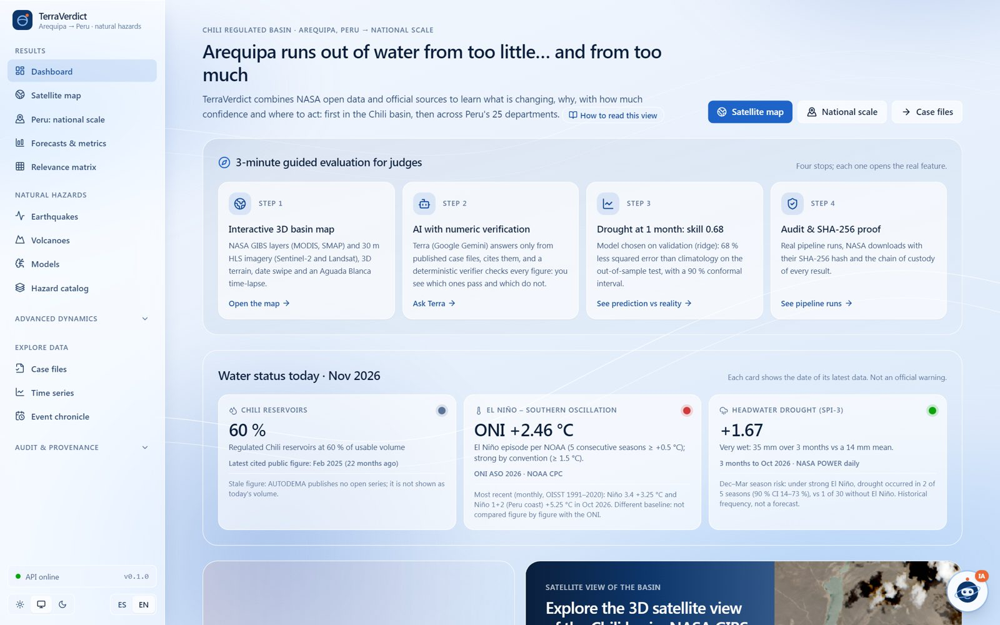
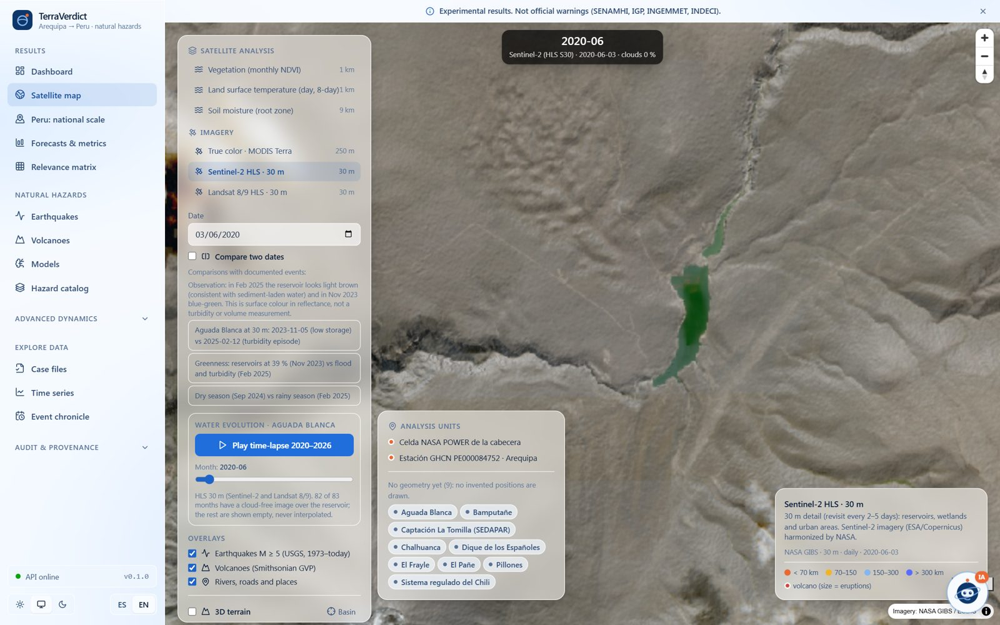
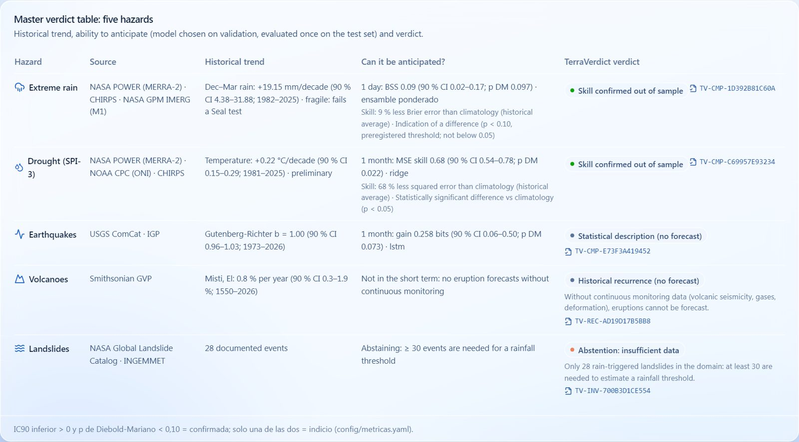
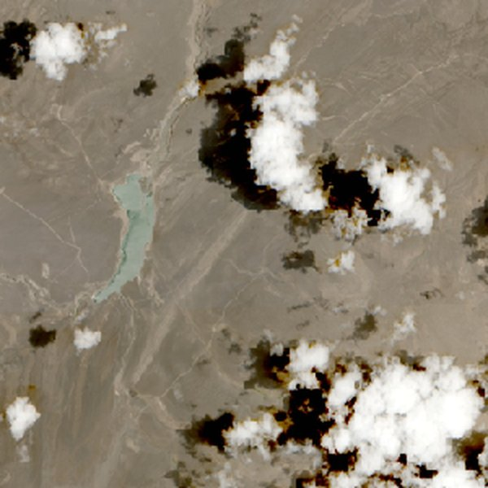
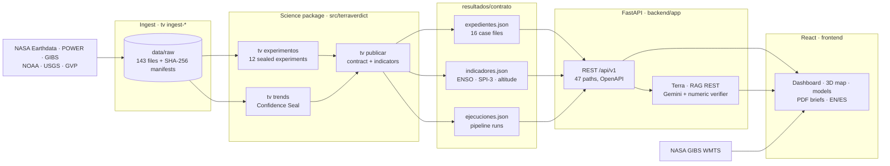

<div align="center">

# 🛰️ TerraVerdict

### Auditable Earth-system verdicts for mountain cities that run out of water — from too little *and* from too much

**NASA Space Apps Challenge 2026 · Challenge: [Be An Earth System Trend Detective!](https://www.spaceappschallenge.org/2026/challenges/earth-system-trend-detective/) · Team TerraVerdict · Arequipa, Peru**

[](https://terraverdict.vercel.app)
[](https://terraverdict.vercel.app/api/docs)
[](#-nasa-and-partner-data)
[](docs/trazabilidad.md)
[](LICENSE)

**🌐 <https://terraverdict.vercel.app>** · 🇪🇸 [Leer en español](readme.es.md)



</div>

> Results are experimental. They are **not official warnings** (SENAMHI, IGP, INGEMMET, INDECI, ENFEN).

---

## Table of contents

1. [The problem](#-the-problem)
2. [What TerraVerdict does](#-what-terraverdict-does)
3. [Product tour](#-product-tour)
4. [Key results](#-key-results-out-of-sample)
5. [NASA and partner data](#-nasa-and-partner-data)
6. [Architecture](#-architecture)
7. [Scientific integrity](#-scientific-integrity)
8. [Run it locally](#-run-it-locally)
9. [Repository layout](#-repository-layout)
10. [Quality and testing](#-quality-and-testing)
11. [Deployment and security](#-deployment-and-security)
12. [Limitations and roadmap](#-limitations-and-roadmap)
13. [Team](#-team)
14. [Documentation index](#-documentation-index)

---

## 💧 The problem

Arequipa, Peru's second city, depends on one regulated basin — the Chili system of seven high-Andean reservoirs — and it fails in both directions:

| When | What happened | Figure | Source |
|---|---|---|---|
| Nov 2023 | Drought: reservoirs nearly empty | **159 of 409 hm³ (39 %)** | La República |
| Mar 2024 | Sediment: Aguada Blanca lost about half its capacity | **43 → 22 hm³** | El Búho |
| Feb 2025 | Flood: turbidity stopped the drinking-water plants | **5,000 NTU, > 70 % of the city without water** | El Búho, Andina |
| Oct 2026 | A strong El Niño is under way | **ONI +2.46 °C** (Aug–Oct 2026) | NOAA CPC |

Every figure is cited in the app's event chronicle (`datos/eventos/arequipa.json`). Ground stations cannot answer the obvious questions: the only GHCN station in Arequipa has 14 complete years of rainfall and none since 2010. Satellites cover the basin, but someone has to decide **which variables matter, which trends to believe, and how confident to be**. That is exactly the challenge.

## 🎯 What TerraVerdict does

TerraVerdict turns NASA open data into **case files** (`TV-…`). Each case file is a sealed, versioned result with its figure, a 90 % interval, a verdict, its sources, the SHA-256 of its inputs and the code commit that produced it. A web app, a REST API and a verified AI assistant are built on top of those case files. Nothing on screen is typed by hand.

| Question a water manager asks | Where TerraVerdict answers it |
|---|---|
| *How are we today?* | Water-status traffic light: reservoirs (with the real date of the latest public figure), ENSO (ONI + monthly Niño 3.4 / 1+2), drought (SPI-3 in the headwaters) |
| *What is really changing?* | Trend detective with a five-test **Confidence Seal** (windows, ENSO, sensor change, independent sources, detectability) plus a leverage test |
| *Can we see it coming?* | Model zoo evaluated **once** out of sample (2021–2026), with conformal intervals and abstention |
| *What does space show?* | 3D map with NASA GIBS layers, a 30 m HLS date swipe and a 2020–2026 monthly time-lapse of Aguada Blanca |
| *What should we tell the mayor?* | Two-page executive PDF brief per case file, and Terra, an AI assistant that cites case files and verifies every number |

## 🧭 Product tour

| | |
|---|---|
| <br>**3D satellite map** (`/mapa`): NASA GIBS (MODIS, SMAP), HLS 30 m (Landsat 8/9 + Sentinel-2), 3D terrain, USGS earthquakes, GVP volcanoes, **date swipe** and a **monthly time-lapse** of Aguada Blanca (82 of 83 months cloud-free; empty months stay empty). | <br>**Terra, verified AI** (floating on every page): Google Gemini answers **only** from published case files and cited events, links each citation, and a deterministic numeric verifier checks every figure. English and Spanish. |
| <br>**Master verdict table** (`/`): five hazards with their historical trend, out-of-sample skill and verdict. Each row links to its case file. | <br>**Prediction vs reality** (`/modelos`): observed SPI-3, the forecast of the model chosen on validation and the 90 % conformal cone, with training, validation and test periods marked. |

**Seen from space: the same reservoir in both crises.** NASA HLS S30 at 30 m, tiles selected automatically and checked pixel by pixel (`scripts/timelapse_hls.py`):

| 5 Nov 2023 · drought, reservoirs at 39 % | 12 Feb 2025 · sediment, 5,000 NTU outage |
|---|---|
|  |  |

This shows surface colour in reflectance, not a turbidity or volume measurement, and the app says so.

Other views: Peru at national scale with 25 departments and the same engine (`/peru`); relevance matrix M1 (`/relevancia`); earthquakes and volcanoes; El Niño stress simulator; February 2025 case study in three acts; pipeline runs with SHA-256 evidence (`/procesos`); advanced dynamics (Takens, D₂, Lyapunov) in a secondary menu.

## 📊 Key results (out of sample)

All figures come from `resultados/contrato/*.json`, the contract generated by `tv publicar` on commit `a59002d`. The test period was used once; models were chosen on validation, never on the test.

| Hazard | Historical trend | Can it be anticipated? | Verdict |
|---|---|---|---|
| **Drought (SPI-3)** | Temperature +0.22 °C/decade (90 % CI 0.15–0.29; 1981–2025), *preliminary* | **1 month ahead:** Ridge, MSE skill **0.68** vs climatology (90 % CI 0.54–0.78; Diebold-Mariano p = 0.022) | Skill confirmed |
| **Extreme rain** | Dec–Mar rain +19.15 mm/decade (90 % CI 4.38–31.88; 1982–2025), *fragile* (fails the leverage test) | 1 day ahead: weighted ensemble, BSS **0.09** (90 % CI 0.02–0.17; p = 0.097) | Monitoring, not alerts |
| **Earthquakes** | Gutenberg-Richter b = **1.00** (90 % CI 0.96–1.03; 1973–2026, USGS) | Monthly counts: 0.26 bits over Poisson | Statistical description |
| **Volcanoes** | El Misti **0.8 %** per year (90 % CI 0.3–1.9 %; GVP since 1550) | Not without continuous monitoring | Historical recurrence |
| **Landslides** | 28 rain-triggered events (NASA GLC) | Abstains: ≥ 30 events needed for a threshold | Needs more data |

**Today (as computed from raw files):** ONI +2.46 °C for Aug–Oct 2026, with 5 consecutive seasons ≥ +0.5 (an El Niño episode by NOAA's criterion). Monthly Niño 3.4 is +3.25 °C and Niño 1+2 is +5.25 °C (Oct 2026, OISST 1991–2020 base). Headwater SPI-3 for Aug–Oct 2026 is **+1.67, very wet**. Historically, strong-El Niño seasons brought drought in **2 of 5** cases (Wilson 90 % CI 14–73 %), versus 1 of 30 otherwise (Fisher p = 0.10). That is a historical frequency, not a forecast. Full numbers are in [`docs/experimentos.md`](docs/experimentos.md).

## 🛰️ NASA and partner data

| Product | Provider | Coverage used | Role in TerraVerdict |
|---|---|---|---|
| **GPM IMERG Final daily V07** (0.1°) | NASA GES DISC | 1998 – Sep 2025, complete | Target of the relevance matrix (M1) |
| **POWER** (MERRA-2 meteorology, CERES/SRB radiation) | NASA LaRC | Daily 1981 – Oct 2026; 25 departments | Trends, drought (SPI), extreme rain, national scale, altitude reference |
| **HLS S30 / L30** (30 m) | NASA/USGS; Sentinel-2 by ESA/Copernicus | 2020–2026, monthly best image | Date swipe, time-lapse, case study |
| **MODIS Terra** (true colour 250 m, NDVI 1 km, LST 1 km) | NASA (GIBS, ORNL DAAC) | 2000 – today | Map layers, land surface temperature |
| **SMAP L4** root-zone soil moisture (9 km) | NASA (GIBS) | 2015 – today | Context layer (not yet in models) |
| **Global Landslide Catalog** | NASA | Southern Peru | Landslide inventory and abstention rule |
| **GIBS** WMTS | NASA ESDIS | — | All satellite tiles in the browser |
| SRTM (via Mapzen Terrain Tiles) | NASA/NGA + USGS, NOAA | — | 3D terrain |
| ONI, Niño 3.4 / 1+2, GHCN-Daily | NOAA CPC / NCEI | 1950 – Oct 2026 | ENSO covariate, station validation |
| ComCat | USGS | 1973 – Nov 2026 | Earthquakes |
| Volcanoes of the World | Smithsonian GVP | Since 1550 | Volcanic recurrence |
| CHIRPS v2 | UCSB CHC | 1981 – 2026 | Independent rainfall for the Seal |

Sources were checked against their official catalogues with real queries: 37 of 40 passed ([`docs/verificacion/README.md`](docs/verificacion/README.md)). Attribution and licences are listed in [`docs/licencias-y-atribuciones.md`](docs/licencias-y-atribuciones.md). TerraVerdict is not endorsed by NASA, ESA or USGS.

## 🏗️ Architecture



- **Contract as interface.** The backend imports only `resultados/contrato/` at start-up and never depends on the science package. Each case file is validated by Pydantic rules; for example, a *fragile* trend must name the failed test.
- **AI architecture.** Terra is a decoupled **RAG over REST** (`POST /api/v1/asistente/consultas`). It retrieves case files and documented events, asks Gemini to answer only from them, and then a deterministic verifier checks every figure. Unsupported answers are rewritten or flagged. An MCP server for external agents is **planned, not implemented**.
- **Stack.** Python 3.12 · NumPy/SciPy/pandas/PyTorch · FastAPI · SQLAlchemy/Alembic · React 18 + TypeScript + TanStack Query + Recharts + MapLibre GL · Vercel (static SPA + Python function).

## 🔬 Scientific integrity

| Rule | How it is enforced |
|---|---|
| Real data only | Every raw file has a manifest with URL, product, version and SHA-256. `tv verificar-integridad` checks all 143 before and after each run |
| No choices made on the test | Frozen temporal split: train 1981–2015, validation 2016–2020, test 2021–2026. Preregistration hash in every result |
| Honest uncertainty | Block-bootstrap 90 % CIs, Diebold-Mariano with HAC, split-conformal intervals, calibration (ECE), Wilson intervals |
| Abstention | Rules publish "no" when skill is not shown (landslides < 30 events; volcanoes without monitoring) |
| Robust trends | Theil-Sen + conservative Mann-Kendall + Confidence Seal; a trend that fails a test is labelled *fragile*, not hidden |
| Old data shown as old | The traffic light prints the date of every figure; Feb 2025 reservoir data is never presented as today's |
| Satellite imagery is real | Time-lapse months are chosen by measured coverage and cloudiness over the reservoir; tile URL and SHA-256 are stored |

Details: [`docs/metodologia.md`](docs/metodologia.md) · [`docs/auditoria-metricas.md`](docs/auditoria-metricas.md) · [`docs/trazabilidad.md`](docs/trazabilidad.md).

## 💻 Run it locally

```bash
python -m venv .venv && . .venv/bin/activate        # Windows: .venv\Scripts\activate
pip install torch --index-url https://download.pytorch.org/whl/cpu
pip install -e ".[dev,ml]" && pip install -e "backend[dev]"
```

Reproduce the science, from raw data to contract. IMERG needs `EARTHDATA_TOKEN`.
```bash
tv ingest-fenomenos && tv ingest-nino && tv verificar-integridad
tv experimentos && tv trends && tv informe
tv publicar --exportar resultados/contrato/expedientes.json   # also writes ejecuciones.json and indicadores.json
```

Run the app (API on :8000, web on :5173):
```bash
cd backend && python -m app.cli migrar && python -m app.cli importar && uvicorn app.main:app --port 8000
```
```bash
cd frontend && npm ci && npm run dev
```
```bash
docker compose up --build    # API on :8000 and web on :8080
```

Secrets live only in `.env` or in Vercel: `EARTHDATA_TOKEN`, `TV_GEMINI_API_KEY`, `TV_JWT_SECRETO` (see [`.env.example`](.env.example)). On Windows set `git config core.autocrlf false`, because SHA-256 seals require LF line endings.

## 🗂️ Repository layout

```
src/terraverdict/      science package: ingest, signals, trends (Seal), models, experiments, publish
backend/app/           FastAPI API: routers, schemas, services (assistant, verifier), Alembic
frontend/src/          React app: pages, map (MapLibre), charts, portada (home), i18n EN/ES
config/                frozen configuration: phenomena, sources, metrics, partition, preregistration
datos/                 cited documented events and the transcribed AUTODEMA report
resultados/            sealed results + contrato/ (what the API imports)
scripts/               reproducible helpers: HLS time-lapse selection, glossary, source verification
tests/                 science tests (unit, integration, statistical, integrity)
docs/                  methodology, audits, API, deployment, logbook, handover
```

## ✅ Quality and testing

| Suite | Command | Last run |
|---|---|---|
| Science package (unit, statistical, integration, integrity) | `pytest` | see [`docs/bitacora.md`](docs/bitacora.md) |
| Backend API | `cd backend && pytest` | see logbook |
| Frontend (unit + i18n) | `cd frontend && npm test` | see logbook |
| End-to-end (Playwright) | `cd frontend && npm run e2e` | CI |
| Types and lint | `npm run typecheck && npm run lint` · `ruff` · `mypy` | CI |

The CI pipeline (`.github/workflows/ci.yml`) runs the science package, backend, frontend and E2E tests on every push. A dedicated test fails if anyone edits the frozen preregistration.

## 🚀 Deployment and security

- **Vercel:** the static React build plus `api/index.py` as a Python function. Every push to `main` deploys. On a cold start the function migrates SQLite in `/tmp` and imports the contract (2–4 s). The UI shows a real "starting the serverless API" banner meanwhile.
- **Persistence:** results are immutable and rebuilt from the contract on each instance. User accounts need `TV_DATABASE_URL` (PostgreSQL), which is optional for the public demo.
- **Security headers:** strict CSP, HSTS, `nosniff`, `X-Frame-Options`, `Referrer-Policy`, `Permissions-Policy`. Without `TV_JWT_SECRETO` the app runs read-only. Per-IP and global rate limits protect the assistant. The Gemini key lives on the server only.

Details: [`docs/despliegue.md`](docs/despliegue.md).

## 🧱 Limitations and roadmap

**Known limitations**
- Reservoir volumes: AUTODEMA publishes no open series, so the latest cited figure is Feb 2025.
- POWER cells are 0.5°: the "city" cell averages terrain at ~3,300 m, while the airport station is at 2,520 m. The app explains the lapse rate.
- Only one data family is available nationally, so national trends can reach at most *fragile*.
- Relevance matrix problems P2–P4 (wetlands, reservoir deficit, turbidity) await local data agreements.

**Roadmap**
1. **M3 · Reservoir twin:** GR2M + reservoir balance calibrated with SWOT and HLS water extent.
2. **M5 · Basin decisions:** RUSLE erosion to prioritise the US$ 1.5 M MERESE conservation fund by gully.
3. **M4 · Seasonal outlook:** ESP conditioned on ENSO, plus a turbidity alert.
4. **Scale:** the same declarative templates for any mountain basin, and an MCP server for external agents.

## 👥 Team

**Team TerraVerdict** · NASA Space Apps Challenge 2026 · Arequipa, Peru

| Member | Contributions (from `git shortlog`) |
|---|---|
| **Ower Frank** (Ower López, UNSA) | Repository owner; problem framing; FastAPI backend; React frontend; science engine (Seal, chaos, model zoo); national scale; bilingual UI; chain of custody; M1 relevance matrix; Gemini assistant; Vercel deployment |
| **MaxsForocca** (UNSA) | Architecture; full experiment runs; chaos on real series; science → backend integration; CI; Docker; E2E; documentation; IMERG ingestion |
| **DiegoNiS** | Team member; team GitHub organisation during the first stage |

## 📚 Documentation index

| Document | Content |
|---|---|
| [`docs/experimentos.md`](docs/experimentos.md) | Current figures, generated by `tv informe` |
| [`docs/metodologia.md`](docs/metodologia.md) · [`docs/diseno-tecnico.md`](docs/diseno-tecnico.md) | Methods, equations, architecture decisions |
| [`docs/modulo-relevancia.md`](docs/modulo-relevancia.md) | M1 relevance matrix |
| [`docs/api/`](docs/api/) | API guide and `openapi.json` |
| [`docs/trazabilidad.md`](docs/trazabilidad.md) | Chain of custody requirements R1–R35 |
| [`docs/bitacora.md`](docs/bitacora.md) · [`docs/pendientes.md`](docs/pendientes.md) | Logbook (what was done and how it was verified) and open items |
| [`docs/traspaso.md`](docs/traspaso.md) | Operations handover: secrets, data refresh, release steps |
| [`readme.es.md`](readme.es.md) | Full Spanish proposal (problem statement, hypotheses, modules, references) |

---

<div align="center">

**Know what is changing. Know how sure we are. Act in time.**

MIT License · TerraVerdict uses open data from NASA, NOAA, USGS, ESA/Copernicus, the Smithsonian and cited Peruvian sources.

</div>
