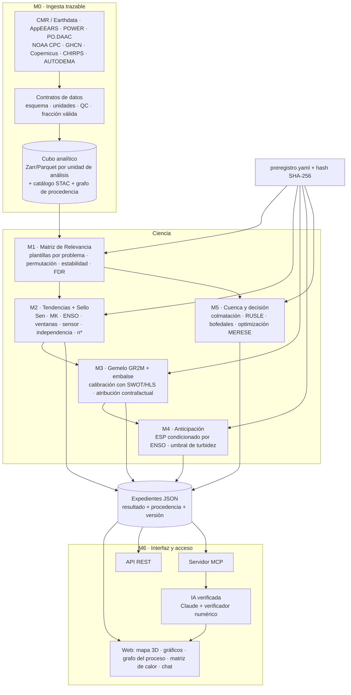

<div align="center">

# 🛰️ TerraVerdict

### Ciencia de datos geoespaciales para saber **qué cambia** en una cuenca de montaña, **por qué**, **con cuánta confianza** y **dónde actuar**

**Caso piloto:** el sistema que abastece de agua a Arequipa (Perú) · **Reto:** [Be An Earth System Trend Detective!](https://www.spaceappschallenge.org/2026/challenges/earth-system-trend-detective/) · NASA Space Apps 2026

[](docs/verificacion/README.md)
[](docs/variables.md)
[](#0-estado-real-del-proyecto)

</div>

---

## 0. Estado real del proyecto

Esta propuesta separa con claridad lo hecho de lo prometido.

| Categoría | Qué incluye | Evidencia |
|---|---|---|
| ✅ **Implementado y ejecutado** | (1) Verificación automática de 40 fuentes contra catálogos oficiales: **37 correctas**. (2) Primer análisis con datos reales (NASA POWER + NOAA ONI): tendencia, filtro ENSO, ventanas y detectabilidad en la cabecera | [`scripts/verificar_fuentes.py`](scripts/verificar_fuentes.py) → [`evidencia.json`](docs/verificacion/evidencia.json) · [`scripts/analisis_preliminar.py`](scripts/analisis_preliminar.py) → [`analisis_preliminar.json`](docs/verificacion/analisis_preliminar.json) |
| ✅ **Revisión de enlaces** | Los 41 enlaces del reto y de la guía abiertos con consultas reales: 38 accesibles; decisión de uso para cada uno | [`docs/verificacion/enlaces.md`](docs/verificacion/enlaces.md) · [`scripts/revisar_enlaces.py`](scripts/revisar_enlaces.py) |
| 🟦 **Verificado, aún sin implementar** | Existencia, periodo y cobertura sobre la cuenca de 29 colecciones NASA; AppEEARS, POWER, ONI/RONI, Niño3.4 de KNMI, GHCN, Sentinel-1/2, CHIRPS v3, GIBS y el reporte de AUTODEMA | [Informe de verificación](docs/verificacion/README.md) |
| ⚠️ **Pendiente de verificar** | Giovanni, la API de FIRMS y *data rods* (conexión reiniciada); Landsat 1984–2012 automatizado; presencia de cada represa en SWOT; archivo histórico de AUTODEMA; ERA5; GSMaP | [Sección 6 del informe](docs/verificacion/README.md#6-vacíos-de-información) |
| 🧪 **Requiere validación experimental** | Matriz de Relevancia, gemelo hidrológico, atribución, pronóstico de temporada, alerta de turbidez, priorización MERESE e IA verificada | [Plan de validación](#9-validación-experimental) |
| 📐 **Diseño** | Arquitectura, interfaz, API, servidor MCP | [Diseño técnico](docs/diseno-tecnico.md) |

---

## 1. Resumen

**El problema.** Arequipa vive del agua que cae en el altiplano y se guarda en siete represas. En tres años sufrió las dos caras de la misma crisis:

- **Falta de agua:** en noviembre de 2023 las represas tenían **159 de 409 hm³** ([La República](https://larepublica.pe/sociedad/2023/11/07/arequipa-represas-del-sur-tienen-bajo-nivel-de-almacenamiento-de-agua-lrsd-444311)) y se declararon **70 distritos en emergencia** ([Andina](https://andina.pe/agencia/noticia-deficit-hidrico-estos-son-los-70-distritos-arequipa-declarados-emergencia-961301.aspx)).
- **Exceso de agua:** en febrero de 2025 la turbidez llegó a **5000 NTU** y **más del 70 %** de la población se quedó sin agua potable ([El Búho](https://elbuho.pe/2025/02/lluvias-en-arequipa-sedapar-detiene-produccion-de-agua-potable-y-pide-a-poblacion-almacenarla/), [Andina](https://andina.pe/agencia/noticia-arequipa-sin-agua-potable-corte-del-servicio-afecta-a-mas-del-70-de-poblacion-977336.aspx)).
- **Pérdida de capacidad:** la represa Aguada Blanca bajó de 43 a unos 22 hm³ por sedimentos ([El Búho](https://elbuho.pe/2024/03/arequipa-proyectan-nueva-represa-ante-altos-niveles-de-colmatacion-en-aguada-blanca/)).

Hoy, 14 de noviembre de 2026, empieza la temporada de lluvias con **El Niño fuerte en curso: ONI ASO 2026 = +2,46** (NOAA CPC, consultado hoy).

**La brecha científica.** Los datos de tierra no alcanzan para responder. La única estación GHCN de Arequipa tiene **14 años de lluvia con datos completos y ninguno desde 2010** (verificado hoy). Los satélites sí cubren la cuenca, pero hay que decidir **qué variables mirar** y **qué tendencias creer**. Eso es exactamente lo que pide el reto.

**La solución.** TerraVerdict es un sistema de ciencia de datos geoespaciales con seis módulos encadenados:

| Módulo | Pregunta |
|---|---|
| **M0 · Ingesta trazable** | ¿De dónde viene cada dato y puedo reproducirlo? |
| **M1 · Matriz de Relevancia** | Para este problema, ¿qué variables importan y con cuánta confianza? |
| **M2 · Detective de tendencias + Sello de Confianza** | ¿Qué cambia, dónde, cuánto, y es significativo de verdad? |
| **M3 · Gemelo hidrológico y atribución** | ¿El agua cambia por la lluvia, por el calor o por la cuenca? |
| **M4 · Anticipación** | ¿Cuál es la probabilidad de déficit esta temporada? ¿Viene un evento de turbidez? |
| **M5 · Cuenca y decisión** | ¿Cuánto almacenamiento se perdió? ¿Dónde invertir el fondo de conservación? |
| **M6 · Interfaz y acceso** | Mapa 3D, gráficos científicos, grafo del proceso, matriz de calor, chat con IA verificada, API y servidor MCP |

---

## 2. Primer resultado con datos reales

> ⚠️ **Preliminar:** un solo producto (POWER/MERRA-2) en una celda de 0,5° cuya elevación media es 4232 m, sin la prueba de independencia. Por las reglas del propio proyecto, ninguna de estas tendencias puede calificar todavía como "robusta". Datos y código: [`analisis_preliminar.json`](docs/verificacion/analisis_preliminar.json).

| Variable (cabecera, lon −71,25, lat −15,95) | Tendencia de Sen (IC 90 %) | p (Mann-Kendall, el mayor de las dos variantes) | Sin El Niño | Ventanas ≥ 20 años con el mismo signo | Años necesarios / disponibles | Lectura preliminar |
|---|---|---|---|---|---|---|
| **Temperatura media anual (T2M), 1981–2024** | **+0,23 °C/década** (0,15 a 0,30) | < 0,001 | +0,25 °C/década, p < 0,001 | **100 %** (86 % significativas) | 14 / 44 | Calentamiento claro. Falta una segunda familia de datos independiente |
| **Lluvia dic–mar (PRECTOTCORR), 1982–2024** | +16 mm/década (1,7 a 30,4) | 0,057 | +16,8 mm/década, p = 0,029 | 92 % (solo **23 %** significativas) | 28 / 43 | **Frágil:** depende del periodo elegido |

**Relación con El Niño (dato real):** la lluvia dic–mar se correlaciona con el ONI de dic–feb con **r = −0,345 (p = 0,024)**, el signo que espera la literatura para los Andes del sur. En las cinco temporadas con El Niño fuerte (ONI ≥ 1,5) el promedio fue **98 mm**, frente a 171 mm con La Niña y 144 mm en años neutros. **Pero no siempre:** 1983 tuvo 5 mm y 2024 tuvo 201 mm.

La década 2015–2024 fue **0,88 °C más cálida** que 1981–1990 en esa celda.

**Qué enseña este primer resultado:**

1. **Hay una señal térmica que probablemente es real.** El sistema debe confirmarla con otra familia de datos (ERA5 o MODIS/VIIRS LST como corroboración física) antes de llamarla robusta.
2. **La lluvia no permite afirmar una tendencia.** Quien diga "llueve menos" o "llueve más" en la cabecera no tiene respaldo con estos datos.
3. **El Niño fuerte no garantiza sequía.** Por eso el pronóstico de temporada debe ser probabilístico y honesto.
4. **La magnitud de lluvia de MERRA-2 parece baja** para la cabecera (146 mm promedio en dic–mar). Esta hipótesis se contrasta con IMERG, CHIRPS v3 y la lluvia local de los reportes de AUTODEMA, y es justamente el motivo de la prueba de independencia.

---

## 3. Planteamiento del problema

### 3.1 Realidad problemática (fuentes citadas)

| Hecho | Dato | Fuente |
|---|---|---|
| Sistema regulado del Chili | 7 represas; capacidad útil de 404,01 hm³ (otras fuentes citan entre 393 y 410) | [El Búho, 2025](https://elbuho.pe/2025/02/arequipa-represas-de-la-cuenca-del-chili-regulado-registran-60-de-volumen-util/) |
| Reporte diario de AUTODEMA (13-03-2024) | Volumen útil, caudal afluente, descarga y lluvia por represa; total Chili 373,30 hm³ | [PDF verificado](https://www.autodema.gob.pe/wp-content/uploads/2024/03/REPORTE-HIDRICO.pdf) |
| Escasez de 2023 | 159 de 409 hm³; Decreto Supremo 122-2023-PCM con 70 distritos en emergencia; solo el 95 % de la demanda garantizada | [La República](https://larepublica.pe/sociedad/2023/11/07/arequipa-represas-del-sur-tienen-bajo-nivel-de-almacenamiento-de-agua-lrsd-444311) · [Andina](https://andina.pe/agencia/noticia-deficit-hidrico-estos-son-los-70-distritos-arequipa-declarados-emergencia-961301.aspx) · [Energiminas](https://energiminas.com/?p=10890) |
| Turbidez de 2024 y 2025 | Plantas detenidas por huaicos y por el rebose de Aguada Blanca (2024); 5000 NTU y más del 70 % de la población sin agua (2025) | [La República](https://larepublica.pe/sociedad/2024/03/07/corte-de-agua-en-arequipa-sedapar-paraliza-produccion-en-sus-2-plantas-por-huaicos-y-rebose-de-represa-aguada-blanca-lrsd-432572) · [El Búho](https://elbuho.pe/2025/02/lluvias-en-arequipa-sedapar-detiene-produccion-de-agua-potable-y-pide-a-poblacion-almacenarla/) · [Andina](https://andina.pe/agencia/noticia-arequipa-sin-agua-potable-corte-del-servicio-afecta-a-mas-del-70-de-poblacion-977336.aspx) |
| Colmatación | Aguada Blanca: de 43 a ~22 hm³; sin estudios de colmatación en más de 50 años; dragado estimado en US$ 50–100 M | [El Búho](https://elbuho.pe/2024/03/arequipa-proyectan-nueva-represa-ante-altos-niveles-de-colmatacion-en-aguada-blanca/) |
| Bofedales | −8,7 % de área en la Reserva de Salinas y Aguada Blanca entre 2000 y 2024 | [Tesis UCSM](https://repositorio.ucsm.edu.pe/bitstreams/0eb69d01-db27-4e5d-a82c-95b19afaad40/download) |
| Fondo de conservación | MERESE de SEDAPAR: ~US$ 454 mil ejecutados en 2022–2023; US$ 1,5 M comprometidos para 2024–2026 | [Forest Trends](https://www.forest-trends.org/wp-content/uploads/2024/10/Brochure-Merese-COP-14.01.25.pdf) |
| Datos de tierra | Estación GHCN PE000084752: 14 años de lluvia completos (1973–2025), ninguno desde 2010; ningún año completo de temperatura máxima | Verificación propia, [evidencia](docs/verificacion/evidencia.json) |
| Debate público | El Ministerio de Agricultura negó la escasez que SENAMHI advertía | [Proactivo](https://proactivo.com.pe/?p=33591) |

### 3.2 Formulación

**Pregunta general:** ¿cómo convertir los datos abiertos de observación de la Tierra en conocimiento **cuantitativo, reproducible y con incertidumbre explícita** sobre qué cambia en la cuenca que abastece a Arequipa, por qué cambia y dónde intervenir?

### 3.3 Hipótesis científicas comprobables

| # | Hipótesis | Cómo se pone a prueba | Qué la refutaría |
|---|---|---|---|
| H1 | La cabecera se calienta de forma robusta | Sello de Confianza con al menos dos familias independientes | Que la tendencia desaparezca en la segunda familia o con la prueba de sensor |
| H2 | La lluvia dic–mar no tiene una tendencia decidible, pero sí una dependencia negativa con El Niño | M2 + M1 con IMERG, CHIRPS v3 y MERRA-2 | Una tendencia robusta en ≥ 2 familias, o una correlación con El Niño no significativa en IMERG/CHIRPS |
| H3 | El aporte a las represas está más limitado por la evaporación (calor) que por la lluvia | Atribución contrafactual con el gemelo (M3) | Que la fracción atribuida al calor no sea significativamente mayor que cero |
| H4 | Los cortes por turbidez siguen a lluvias intensas de 3 a 24 h sobre subcuencas con alta erosión potencial | M4, con los eventos documentados | Que no haya separación entre los días con corte y los días de lluvia sin corte |
| H5 | El verdor de época seca de los bofedales disminuye donde hay más quemas y menos humedad | M1 (P2) con validación espacial por bloques | Importancias no estables o con el signo contrario |

### 3.4 Objetivos

**General:** desarrollar y validar un sistema reproducible que detecte, explique, anticipe y priorice los cambios del agua en una cuenca de montaña, con incertidumbre explícita, comenzando en Arequipa y replicable en cualquier región.

| # | Objetivo específico | Indicador verificable |
|---|---|---|
| OE1 | Identificar las variables relevantes por problema | Matriz de Relevancia con habilidad fuera de muestra > línea base y estabilidad reportada |
| OE2 | Detectar tendencias robustas por variable y zona | Veredicto por celda y subcuenca con el Sello de Confianza y "años para decidir" |
| OE3 | Atribuir el cambio del aporte a sus causas | Rangos de atribución con un gemelo validado (KGE en años independientes) |
| OE4 | Anticipar el déficit de temporada y los eventos de turbidez | CRPSS > 0 frente a la climatología; aciertos y falsas alarmas frente a los eventos documentados |
| OE5 | Cuantificar la colmatación y priorizar la inversión de conservación | Serie del espejo de agua de Aguada Blanca; ranking de inversión exportable |
| OE6 | Comunicar con trazabilidad completa | Cada número de la interfaz y del chat enlazado a su expediente reproducible |

---

## 4. Arquitectura integrada



**Principios de ingeniería:**

1. **Reproducibilidad.** Cada resultado es un expediente con el hash de los datos, del código y del preregistro.
2. **Trazabilidad.** Un grafo de procedencia va del píxel al veredicto.
3. **Calcular en vivo sobre datos reales ya ingeridos.** Los análisis tardan milisegundos; la ingesta sigue el ritmo de publicación de cada misión.
4. **Publicar solo lo validado.** Un modelo o un pronóstico sin habilidad no se muestra.
5. **La IA solo en la interfaz.** Nunca calcula.

---

## 5. Módulos

### M0 · Ingesta trazable

- **Extractores por fuente** con una interfaz común: CMR/earthaccess para NASA, AppEEARS, la API de POWER, PO.DAAC (SWOT), NOAA CPC, NCEI, la API OData de Copernicus y CHIRPS.
- **Contratos de datos:** unidades SI, banderas de calidad de cada producto, fracción de píxeles válidos por mes y DOI obligatorio. Un contrato roto detiene el proceso.
- **Unidad de análisis:** subcuencas de cada represa (con trasvases), polígonos de bofedales y celdas de producto. Agregación ponderada por área.
- **Grafo de procedencia:** qué producto usa qué insumos (por ejemplo, IMERG Final usa GPCC; FLDAS usa CHIRPS y MERRA-2). Sirve para contar familias independientes.
- **Actualización automatizada:** tareas programadas según la latencia verificada (IMERG Early cada 30 min; IMERG Final, MERRA-2 y GLDAS mensual; MOD16A2GF anual). Cada corrida queda registrada con su manifiesto.

### M1 · Matriz de Relevancia — [detalle](docs/modulo-relevancia.md)

Para cada problema hay una **plantilla** con un objetivo medible y variables candidatas justificadas en la física. El método combina dos modelos (elastic-net y árboles con gradiente), validación cruzada por bloques temporales o espaciales, importancia por permutación, SHAP, estabilidad con 200 remuestreos, una distribución nula por barajado en bloques, corrección FDR y una prueba final en años apartados desde el inicio.

| Problema | Viabilidad con los datos verificados |
|---|---|
| P1 · Lluvia extrema en la cabecera | Alta (~10 000 días) |
| P2 · Degradación de bofedales | Alta (miles de píxeles) |
| P3 · Déficit de las represas | Baja (~25 temporadas): solo modelos lineales, con advertencia |
| P4 · Turbidez | Insuficiente (3 eventos): prototipo con umbrales, sin ranking |

**Salida principal:** un **mapa de calor problema × variable** donde el color es la importancia, la intensidad es la confianza y una flecha indica la dirección. Se acompaña de un historial por versión que muestra qué variables son estables. Se reentrena con cada actualización y solo se publica si no pierde habilidad.

### M2 · Detective de tendencias + Sello de Confianza

Responde los cuatro objetivos del reto: **qué** cambia (por variable), **dónde** (mapa por celda y por subcuenca), **cuánto** (Sen por década con IC) y **si es significativo**. Cada tendencia pasa cinco pruebas:

| Prueba | Método | Ya ejecutada en el primer análisis |
|---|---|---|
| Ventanas | Todas las ventanas de 20 años o más | ✅ |
| ENSO | Regresión con ONI/RONI y desfases de 0 a 3 meses | ✅ (desfase 0) |
| Sensor | Escalón en TRMM→GPM (2014-06), en las transiciones de Landsat y en la deriva de Terra (2020) + prueba de Pettitt | ⏳ |
| Independencia | Al menos dos familias del grafo de procedencia coinciden en el signo | ⏳ |
| Detectabilidad | Weatherhead et al. (1998) + bootstrap por bloques | ✅ (analítica) |

**Regla conservadora:** de las variantes de Mann-Kendall (clásica y Hamed-Rao) se usa el p más alto. Los mapas aplican la corrección FDR de Benjamini-Hochberg (Wilks, 2016). Los veredictos son 🟢 robusta, 🟡 frágil (con la prueba que falla), ⚪ no decidible (con años para decidir) o 🔵 sin tendencia detectable.

**El caso del reto "un mismo proceso, tendencias opuestas":** El Niño reduce la lluvia en los Andes del sur y la aumenta en la costa norte del Perú. M2 lo muestra en un mapa de correlación por celda con el ONI, con FDR.

### M3 · Gemelo hidrológico y atribución

- **Modelo:** GR2M mensual (Mouelhi et al., 2006) por subcuenca, con evapotranspiración potencial de Oudin (2005) a partir de la temperatura corregida por altitud. Se acopla un balance del embalse con evaporación de agua libre (Penman, con radiación, humedad y viento de POWER).
- **Calibración sin batimetría:** cambio de almacenamiento de SWOT LakeSP (desde 2022-12, verificado), área de agua de HLS (desde 2013) y, hacia atrás, Landsat. Se valida con los reportes de AUTODEMA.
- **Incertidumbre:** un ensamble de parámetros aceptables y varias familias de lluvia (IMERG, CHIRPS v3 y MERRA-2).
- **Validación:** se calibra con 2001–2015 y se valida con 2016–2025 (KGE), más la prueba de años secos contra años húmedos (Klemeš, 1986).
- **Atribución:** corridas contrafactuales sin la tendencia de la lluvia o sin la de la temperatura. Se reportan rangos al 90 % y el residuo que el clima no explica.

### M4 · Anticipación

- **Probabilidad de déficit de temporada:** Ensemble Streamflow Prediction (Day, 1985) desde el estado actual del gemelo, ponderado por la similitud del ONI. Se evalúa con pronósticos retrospectivos dejando un año fuera (CRPSS, diagrama de confiabilidad). **No se publica si no le gana a la climatología.** Con El Niño fuerte en curso (ONI +2,46), es la salida de mayor interés inmediato, y la de mayor riesgo de interpretarse mal: el primer análisis muestra que El Niño fuerte no siempre trae sequía.
- **Alerta de turbidez (prototipo):** acumulados de IMERG Early y Late (latencia verificada: dato del mismo día) sobre las subcuencas que drenan a la captación, más la humedad previa (SMAP L4) y la erosión potencial. Umbral de intensidad y duración calibrado con los eventos documentados. Se reportan aciertos, falsas alarmas y horas de anticipación, sin presentarlo como un sistema operativo.

### M5 · Cuenca y decisión

- **Colmatación de Aguada Blanca:** serie del espejo de agua a nivel máximo (Landsat, HLS, y Sentinel-1 bajo nubes), tendencia con sello, índice de vegetación sobre el delta y, desde 2022, coherencia volumétrica con SWOT.
- **Erosión:** RUSLE como índice relativo (erosividad de IMERG, factor LS de NASADEM, cobertura C de HLS y MODIS).
- **Bofedales:** mapa por NDVI de época seca y pendiente, con validación por fotointerpretación y tendencia por bofedal.
- **Optimización MERESE:** problema de mochila 0-1 con presupuesto real. El beneficio combina degradación robusta, conectividad hidrológica hacia la represa o la captación y reducción de la erosión.

### M6 · Interfaz y acceso

```
┌──────────────────────────────────────────────┬───────────────────────────┐
│ 🌍 MAPA 3D (NASADEM + GIBS del día)           │ 💬 DETECTIVE (chat)        │
│ · variable elegida · veredictos por celda    │ respuestas con cifras      │
│ · represas, bofedales y ríos                 │ clicables y expediente     │
│ · etiqueta de frescura por capa              │                           │
│ ⏯ 1984 ─────────●───────── hoy              │                           │
├──────────────────────────────────────────────┤ 🔥 MATRIZ DE RELEVANCIA   │
│ 📈 Serie · anomalías · Sen · bandas de El     │ problema × variable        │
│ Niño · triángulo de ventanas                 │ (intensidad = confianza)   │
├──────────────────────────────────────────────┴───────────────────────────┤
│ 🔎 CÓMO LLEGUÉ A ESTO: grafo del proceso que se enciende paso a paso      │
│ [IMERG Final: N meses] → [QC: meses descartados] → [Anomalías] → [MK] →   │
│ [ENSO] → [Años para decidir] → [Veredicto]   (valores reales al ejecutar) │
│ cada nodo es clicable: entrada, salida y fuente            [logs ▸]      │
└──────────────────────────────────────────────────────────────────────────┘
```

- **Todo conectado:** un clic en una cifra del chat resalta el nodo del proceso que la calculó, el punto del gráfico y la zona del mapa.
- **Traza legible:** se muestran los pasos del proceso y su resultado. Los logs técnicos completos quedan en un panel aparte para auditoría.
- **Frescura honesta:** cada capa muestra la fecha de su último dato (por ejemplo, "IMERG Final: septiembre de 2025"; "IMERG Early: hoy").
- **IA verificada:** Claude (`claude-opus-5-5`) responde usando solo las herramientas del sistema. Un verificador numérico determinista rechaza cualquier cifra que no salga de los expedientes. La IA también digitaliza los reportes de AUTODEMA con doble extracción y reglas de consistencia ([sección 7b del diseño técnico](docs/diseno-tecnico.md#7b-ia-generativa-con-garantías)).
- **API REST y servidor MCP** sobre el mismo núcleo.

---

## 6. Fuentes de datos seleccionadas

Selección por **valor científico**, no por cantidad. Detalle completo, con licencias, en el [informe de verificación](docs/verificacion/README.md) y el [catálogo de variables](docs/variables.md).

| Uso | Fuente principal (verificada) | Familia de contraste | Por qué |
|---|---|---|---|
| Lluvia (tendencias) | IMERG V07 Final, 1998-01 → 2025-09 | CHIRPS v3 (satélite + pluviómetros); MERRA-2 | Tres familias con insumos distintos |
| Lluvia (anticipación) | IMERG Early/Late, vigente al día | — | Latencia de horas |
| Temperatura | MERRA-2 / POWER, 1980 → | MODIS y VIIRS LST (corroboración física); ERA5 ⚠️ | Serie larga y corregible por altitud |
| Vegetación y bofedales | HLS 30 m (2013 →); MOD13Q1 (2000 →) | VIIRS VNP13A1 (continuidad tras MODIS) | Escala de bofedal y continuidad de misiones |
| Evapotranspiración | MOD16A2GF | GLDAS 2.1, FLDAS | Única observación con base satelital |
| Nieve | MOD10A1F; VNP10A1F | — | Indicador térmico de los volcanes |
| Humedad del suelo | SMAP L3 y L4 (2015 →) | GLDAS 2.0 (1948–2014) | Memoria de la cuenca y condición previa a huaicos |
| Represas | SWOT LakeSP (2022 →); HLS; Sentinel-1/2; Landsat | ICESat-2 ATL13; reportes de AUTODEMA | Volumen sin batimetría |
| Fuego | VIIRS VNP14IMG; MCD64A1 | — | Presión sobre bofedales |
| Terreno | NASADEM 30 m | — | Altitud, drenaje y erosión |
| El Niño | ONI y RONI (NOAA CPC); Niño3.4 (KNMI) | — | Covariable del sello y de la anticipación |

**Evaluadas y no usadas para tendencias:** NISAR (solo 6 gránulos sobre la cuenca, desde octubre de 2026; útil para monitoreo futuro), GRACE (~300 km, demasiado grueso), GSMaP de JAXA (no verificado; candidato a cuarta familia de lluvia) y la estación GHCN (incompleta; solo validación puntual).

---

## 7. Metodología: resumen y respaldo

| Etapa | Método | Referencia |
|---|---|---|
| Anomalías | Climatología mensual del periodo base | Wilks (2011) |
| Tendencia | Theil-Sen con IC al 90 % | Sen (1968) |
| Significancia | Mann-Kendall clásico y Hamed-Rao (se usa el p mayor); t-test con n efectivo | Hamed y Rao (1998); Santer et al. (2000) |
| Mapas | FDR de Benjamini-Hochberg con α_FDR = 2α | Benjamini y Hochberg (1995); Wilks (2016) |
| ENSO | Regresión con ONI/RONI y desfases | Jonaitis et al. (2021) |
| Quiebres | Escalón en transiciones documentadas + Pettitt | Pettitt (1979) |
| Detectabilidad | n* y bootstrap por bloques | Weatherhead et al. (1998) |
| Relevancia | Permutación, SHAP, selección por estabilidad, nulo por barajado y FDR | Breiman (2001); Lundberg y Lee (2017); Meinshausen y Bühlmann (2010) |
| Sequía | SPI y SPEI | McKee et al. (1993); Vicente-Serrano et al. (2010) |
| Extremos | Índices ETCCDI | Zhang et al. (2011) |
| Hidrología | GR2M, Oudin, Penman, KGE, validación de Klemeš | Mouelhi et al. (2006); Oudin et al. (2005); Gupta et al. (2009); Klemeš (1986) |
| Pronóstico | ESP, CRPS/CRPSS, confiabilidad | Day (1985); Hersbach (2000) |
| Agua superficial | MNDWI + Otsu; armonización de Landsat | Xu (2006); Roy et al. (2016) |
| Erosión | RUSLE relativo | Renard et al. (1997) |
| Incertidumbre visual | Paletas que suprimen valores inciertos (VSUP) | Correll, Moritz y Heer (2018) |

---

## 8. Innovación y diferenciación

| Lo que existe | Qué hace | Qué agrega TerraVerdict |
|---|---|---|
| Giovanni, Worldview, AppEEARS | Series y mapas por variable | Elige las variables por problema (M1), verifica sus tendencias (M2) y las conecta en una explicación (M3) |
| Global Water Watch, JRC Global Surface Water | Monitoreo de embalses | Volumen con SWOT, atribución de causas y colmatación |
| GEOGLOWS, HydroSOS | Pronósticos globales | Pronóstico local calibrado, con regla de no publicar sin habilidad |
| RIOS / InVEST (fondos de agua) | Priorización de inversiones | Priorización con degradación medida desde el espacio y su confianza |
| Modelos fundacionales (Prithvi de NASA e IBM) | Representaciones generales de imágenes | Explicación por problema, con significancia y "no decidible" |
| Otros proyectos del reto | Tendencia y valor p por celda | Las cinco pruebas del sello, el preregistro, la matriz de relevancia y el resultado "faltan X años" |

*Las herramientas de esta tabla se describen de memoria; hay que verificarlas antes de la presentación.*

**Las cinco innovaciones defendibles:**

1. **La matriz de relevancia por problema,** con estabilidad, significancia y la posibilidad de "no explicable": convierte la pregunta "¿qué variables mirar?" en un resultado medible.
2. **El sello de confianza con independencia por genealogía de datos.** Las confirmaciones se cuentan por familias de insumos, no por número de productos.
3. **Volumen de las represas sin batimetría** fusionando SWOT, HLS, ICESat-2 y NASADEM, en una cuenca sin series de tierra continuas.
4. **Publicar solo lo validado:** el pronóstico sin habilidad y los modelos sin ventaja sobre la línea base no se muestran.
5. **IA que no puede inventar cifras:** un verificador determinista entre el modelo y el usuario, más la digitalización de verdad terrestre que hoy solo existe en PDF.

---

## 9. Validación experimental

| ID | Experimento | Datos | Métrica y criterio | Estado |
|---|---|---|---|---|
| E0 | Verificación de fuentes | Catálogos oficiales | Existencia, periodo y cobertura | ✅ 37/40 |
| E1 | Tendencia de T y de lluvia en la cabecera | POWER + ONI | Sen, MK, ENSO, ventanas, n* | ✅ preliminar (una familia) |
| E2 | Independencia de la tendencia térmica | MERRA-2 frente a MODIS/VIIRS LST y ERA5 | Coincidencia de signo en ≥ 2 familias | ⏳ |
| E3 | Lluvia: IMERG frente a CHIRPS v3, MERRA-2 y AUTODEMA | Series por subcuenca | Sesgo, correlación, coincidencia de tendencias | ⏳ |
| E4 | Calibración del sello (falsos positivos) | Monte Carlo AR(1) + forzamiento tipo ENSO | Tasa de "robusta" falsa ≤ α | ⏳ |
| E5 | Matriz de Relevancia: recuperación sintética y estabilidad | Datos sintéticos + P1 y P2 reales | FDR efectivo; Jaccard del top-k; habilidad > línea base | ⏳ |
| E6 | Gemelo de El Frayle | SWOT, HLS y AUTODEMA | KGE en validación ≥ umbral preregistrado | ⏳ |
| E7 | ESP retrospectivo | 1998–2025 dejando un año fuera | CRPSS > 0 con IC al 90 % | ⏳ |
| E8 | Alerta de turbidez | IMERG Early/Late y eventos de 2024 y 2025 | Aciertos, falsas alarmas y anticipación | ⏳ (pocos eventos) |
| E9 | Espejo de agua de Aguada Blanca | Landsat, HLS y SWOT | Tendencia con sello; coherencia con la pérdida reportada | ⏳ |
| E10 | IA verificada | Preguntas de referencia y documentos con instrucciones ocultas | 100 % de cifras verificadas; 0 instrucciones obedecidas | ⏳ |
| E11 | Usabilidad | Estudiantes de la UNSA | Interpretación correcta de la incertidumbre, antes y después | ⏳ |

---

## 10. Métricas de rendimiento

| Ámbito | Métrica | Meta |
|---|---|---|
| Ciencia | Habilidad fuera de muestra (KGE, CRPSS, AUC-PR) frente a la línea base | > 0 con IC al 90 %, o no se publica |
| Ciencia | Tasa de falsos "robusta" en simulación | ≤ α nominal |
| Reproducibilidad | Misma salida con el mismo hash de datos, código y preregistro | 100 % |
| Trazabilidad | Cifras de la interfaz y del chat con expediente | 100 % (lo impone el verificador) |
| Software | Cálculo de tendencia y sello para una unidad y una variable | < 1 s |
| Software | Primera carga de la web sin terreno | < 3 MB |
| Operación | Atraso respecto del último dato publicado por la fuente | ≤ 1 ciclo de actualización |

---

## 11. Limitaciones

1. **Series cortas:** unos 25–28 años de IMERG y MODIS. Muchas tendencias saldrán "no decidibles", y eso es un resultado.
2. **Escala:** IMERG (~11 km) y MERRA-2 (~55 km) son gruesos frente a los bofedales y las quebradas. Cada indicador declara su escala.
3. **Productos de modelo:** MERRA-2, GLDAS y FLDAS heredan sus forzantes. Se tratan como familias dependientes.
4. **Pocos datos para P3 y P4:** el déficit de temporada y la turbidez tienen pocas muestras; se presentan con esa advertencia.
5. **Relevancia y atribución no son causalidad probada:** se redactan como "compatible con".
6. **Operación humana:** las descargas de las represas confunden la señal climática; sin los datos de AUTODEMA, la atribución se hace sobre el aporte y no sobre el volumen.
7. **Dependencias de acceso:** Landsat 1984–2012 automatizado, la base de lagos de SWOT y el archivo de AUTODEMA siguen pendientes.

---

## 12. Escalabilidad

| Nivel | Qué cambia | Qué se mantiene |
|---|---|---|
| **Arequipa** | Polígonos, represas y plantillas P1–P4 | — |
| **Perú** | Archivo de configuración por cuenca (Rímac para Lima, Mantaro, Santa) | Todas las fuentes (globales) y el código |
| **Andes** | La Paz/El Alto, Quito, Bogotá, Santiago, Mendoza | Igual; se agregan plantillas como "retroceso glaciar" |
| **Global** | Biblioteca abierta de plantillas (sequía, olas de calor, incendios, ciclones) y atlas de ciudades de montaña | La misma matriz, sello, gemelo y expedientes |

Lo que lo hace escalable: datos globales verificados, plantillas declarativas, ingesta con contratos de datos, expedientes estándar y un servidor MCP para que otras herramientas consuman los resultados.

---

## 13. Plan para las 48 horas (un corte vertical real)

**Meta:** un flujo completo con datos reales de punta a punta, mejor que muchos módulos a medias.

| Bloque | Entrega | Criterio de terminado |
|---|---|---|
| Hora 0–2 | Solicitudes de AppEEARS (HLS, SMAP, MOD13Q1, NASADEM); descarga de IMERG Final y CHIRPS v3 por subcuenca; cruce de las represas con la base de lagos de SWOT | Archivos con hash en el cubo |
| Día 1 | M2 completo para lluvia y temperatura (con la prueba de independencia: IMERG, CHIRPS y MERRA-2) | Expedientes reales con las 5 pruebas |
| Día 1 | M1 para P1 (lluvia extrema) | Matriz con habilidad, estabilidad y FDR, o "no explicable" |
| Día 2 | Interfaz: mapa 3D + gráfico + grafo del proceso + matriz + chat con verificador | Demo navegable con datos reales |
| Día 2 | Espejo de agua de Aguada Blanca (HLS 2013 →) | Serie y tendencia con sello |
| Si alcanza | Gemelo de El Frayle con SWOT; ESP | Solo si pasan su validación |

**Nunca se recortan:** los datos reales, el sello y el "no decidible".

---

## 14. Documentación

| Documento | Contenido |
|---|---|
| [`docs/verificacion/README.md`](docs/verificacion/README.md) | Verificación de fuentes, licencias, incompatibilidades y vacíos |
| [`docs/verificacion/enlaces.md`](docs/verificacion/enlaces.md) | Revisión de los 41 enlaces del reto y de la guía: cuáles se usan, cuáles no y por qué |
| [`docs/variables.md`](docs/variables.md) | Variables, unidades, resoluciones, procesamiento, indicadores y relaciones físicas |
| [`docs/modulo-relevancia.md`](docs/modulo-relevancia.md) | Módulo M1: plantillas, algoritmo, salidas y validación |
| [`docs/diseno-tecnico.md`](docs/diseno-tecnico.md) | Ecuaciones, decisiones de arquitectura, contratos, API/MCP, IA verificada, pruebas y riesgos |
| [`docs/recursos-guia.md`](docs/recursos-guia.md) | Guía de recursos de la sede |

```bash
pip install requests numpy scipy pymannkendall
```

```bash
python scripts/verificar_fuentes.py
```

```bash
python scripts/analisis_preliminar.py
```

---

## 15. Equipo

| Integrante | Formación | Rol |
|---|---|---|
| Ower López | Ingeniería de Sistemas (UNSA) | Arquitectura, ingesta, API, MCP e IA |
| *[Nombre]* | Ingeniería de Sistemas, datos | Sello de Confianza y Matriz de Relevancia |
| *[Nombre]* | *[Por definir]* | Gemelo hidrológico, anticipación y teledetección |
| *[Nombre]* | Comunicación | Interfaz, historia y pitch |

---

## 16. Referencias

- Benjamini, Y. y Hochberg, Y. (1995). Controlling the false discovery rate. *JRSS-B* 57.
- Breiman, L. (2001). Random forests. *Machine Learning* 45.
- Correll, M., Moritz, D. y Heer, J. (2018). Value-suppressing uncertainty palettes. *CHI 2018*.
- Day, G. N. (1985). Extended streamflow forecasting using NWSRFS. *J. Water Resour. Plann. Manage.* 111(2).
- Funk, C. et al. (2026). CHIRPS v3. *Scientific Data* 13, 718. DOI 10.1038/s41597-026-07096-4.
- Gupta, H. V. et al. (2009). Decomposition of the mean squared error and NSE performance criteria. *J. Hydrology* 377.
- Hamed, K. H. y Rao, A. R. (1998). A modified Mann-Kendall trend test for autocorrelated data. *J. Hydrology* 204.
- Hersbach, H. (2000). Decomposition of the continuous ranked probability score. *Weather and Forecasting* 15.
- Jonaitis, J. A. et al. (2021). ENSO-precipitation relationships in the tropical Andes of southern Peru and Bolivia. *Int. J. Climatology*.
- Klemeš, V. (1986). Operational testing of hydrological simulation models. *Hydrol. Sci. J.* 31.
- Kogan, F. N. (1995). Application of vegetation index and brightness temperature for drought detection. *Adv. Space Res.* 15.
- Lundberg, S. y Lee, S.-I. (2017). A unified approach to interpreting model predictions. *NeurIPS*.
- McKee, T. B., Doesken, N. J. y Kleist, J. (1993). The relationship of drought frequency and duration to time scales. *8th Conf. Applied Climatology*.
- Meinshausen, N. y Bühlmann, P. (2010). Stability selection. *JRSS-B* 72.
- Mouelhi, S. et al. (2006). Stepwise development of a two-parameter monthly water balance model. *J. Hydrology* 318.
- Oudin, L. et al. (2005). Which potential evapotranspiration input for a lumped rainfall–runoff model? *J. Hydrology* 303.
- Pettitt, A. N. (1979). A non-parametric approach to the change-point problem. *Applied Statistics* 28.
- Renard, K. G. et al. (1997). *Predicting soil erosion by water: RUSLE*. USDA Handbook 703.
- Roy, D. P. et al. (2016). Characterization of Landsat-7 to Landsat-8 reflective wavelength and NDVI continuity. *Remote Sens. Environ.* 185.
- Sankarasubramanian, A., Vogel, R. M. y Limbrunner, J. F. (2001). Climate elasticity of streamflow in the United States. *Water Resour. Res.* 37.
- Santer, B. D. et al. (2000). Statistical significance of trends and trend differences. *JGR* 105.
- Sen, P. K. (1968). Estimates of the regression coefficient based on Kendall's tau. *JASA* 63.
- Vicente-Serrano, S. M., Beguería, S. y López-Moreno, J. I. (2010). A multiscalar drought index (SPEI). *J. Climate* 23.
- Wilks, D. S. (2011). *Statistical Methods in the Atmospheric Sciences*, 3.ª ed. Academic Press.
- Weatherhead, E. C. et al. (1998). Factors affecting the detection of trends. *JGR* 103.
- Wilks, D. S. (2016). "The stippling shows statistically significant grid points". *BAMS* 97.
- Xu, H. (2006). Modification of normalised difference water index (MNDWI). *Int. J. Remote Sens.* 27.
- Zhang, X. et al. (2011). Indices for monitoring changes in extremes (ETCCDI). *WIREs Climate Change* 2.

**Licencias y atribuciones:** código MIT (propuesto). Datos NASA y USGS de uso libre, citados con su DOI. Copernicus Sentinel: *"Contains modified Copernicus Sentinel data [año]"*. CHIRPS v3: DOI 10.15780/G2JQ0P. PISCOp solo para validación interna (CC BY-NC-ND). NASA GIBS: *"We acknowledge the use of imagery provided by services from NASA's Global Imagery Browse Services (GIBS), part of NASA's Earth Science Data and Information System (ESDIS)."*

<div align="center">

**TerraVerdict** · NASA Space Apps Challenge 2026 · Arequipa, Perú
*Primero verificamos los datos. Después les preguntamos qué cambia, por qué y con cuánta confianza.*

</div>
