<div align="center">

# TerraVerdict

**Auditable Earth-system verdicts for a mountain city that loses water to drought and to floods**

NASA Space Apps Challenge 2026 · [Be An Earth System Trend Detective!](https://www.spaceappschallenge.org/2026/challenges/earth-system-trend-detective/) · Team TerraVerdict · Arequipa, Peru

[](https://terraverdict.vercel.app)
[](https://github.com/OwerLopez/terraverdict/actions/workflows/ci.yml)
[](https://terraverdict.vercel.app/api/docs)
[](docs/trazabilidad.md)
[](LICENSE)

[Live application](https://terraverdict.vercel.app) · [API reference](https://terraverdict.vercel.app/api/docs) · [Versión en español](readme.es.md)

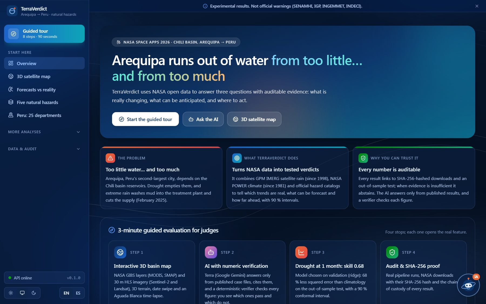

</div>

> **Disclaimer.** TerraVerdict publishes experimental research results. They are not official warnings and do not replace SENAMHI, IGP, INGEMMET, INDECI or ENFEN.

---

## Contents

1. [Summary](#1-summary)
2. [Highlights](#2-highlights)
3. [Problem statement](#3-problem-statement)
4. [Product tour](#4-product-tour)
5. [Data](#5-data)
6. [Methodology](#6-methodology)
7. [Results](#7-results)
8. [Architecture and engineering](#8-architecture-and-engineering)
9. [Reproducibility](#9-reproducibility)
10. [Quality assurance](#10-quality-assurance)
11. [Deployment, security and operations](#11-deployment-security-and-operations)
12. [Threats to validity and limitations](#12-threats-to-validity-and-limitations)
13. [Module status and roadmap](#13-module-status-and-roadmap)
14. [Team](#14-team)
15. [Documentation map](#15-documentation-map)

---

## 1. Summary

TerraVerdict is a geospatial data-science system that answers four questions for a regulated mountain basin: **what is changing, why, with how much confidence, and where to act**. The pilot is the Chili regulated system, which supplies Arequipa, Peru's second-largest city; the same engine runs for Peru's 25 departments.

Its central design choice is that **every number shown to a user is a published, immutable case file**. Each case file (`TV-…`) carries the estimate, its 90 % uncertainty interval and verdict, the sources, the SHA-256 hashes of its raw inputs, the preregistration hash and the git commit that produced it. The web application, the REST API, the executive PDF briefs and the AI assistant all read from these case files; none of them computes or types figures of its own.

When the evidence is insufficient, the system says so: it abstains, labels trends *preliminary* or *fragile*, and names the test that failed.

## 2. Highlights

| | What it does | Why it matters |
|---|---|---|
| **Confidence Seal** | Every trend must pass six adversarial tests (sub-period windows, ENSO removal, sensor change, independent data families, detectability, influential years) before it can be called robust | Separates real trends from artefacts of El Niño, sensor changes or a few extreme years |
| **Honest forecasting** | A model zoo (classical, gradient boosting, ten neural architectures, ensembles) is selected on validation and evaluated once on 2021–2026, with block-bootstrap intervals, Diebold–Mariano tests and split-conformal bands | 1-month drought skill 0.68 (90 % CI 0.54–0.78) is confirmed out of sample; weaker signals are reported as such |
| **Two independent evidence families for landslides** | The NASA Global Landslide Catalog (news-based) is checked against INGEMMET's national field inventory (28,915 records), with a random-location baseline | 24 of 30 NASA events (80 %) lie within 5 km of an inventoried movement, against 39.5 % of random places (binomial p < 0.001) |
| **Satellite evidence at the right scale** | 3D map on NASA GIBS with a pixel-aligned two-date swipe: the reservoir at 30 m (HLS), basin greenness at 1 km (MODIS NDVI), soil moisture at 9 km (SMAP), plus a 2020–2026 monthly time-lapse of only verified cloud-free scenes | Each comparison opens at the zoom its resolution supports and states what can and cannot be read from it |
| **Verified AI** | Terra (Google Gemini) answers only from case files and cited events. A deterministic verifier checks every figure **and the data source it is attributed to**, and asks for a rewrite when either is unsupported | Hallucinated numbers and cross-source misattributions are caught before display |
| **Built for a 3-minute review** | An 8-step guided tour spotlights each feature across pages; English by default with full Spanish; works on phones | A judge or decision-maker sees what the system solves without searching for it |
| **Chain of custody** | 143 raw files verified against SHA-256 manifests before and after every run; 12 sealed results; TLS verification never disabled (INGEMMET is reached by pinning its missing intermediate certificate) | Any reviewer can reproduce every figure from the same inputs |

## 3. Problem statement

The Chili basin fails in both directions, often within the same El Niño–Southern Oscillation (ENSO) cycle:

| Date | Event | Figure | Cited source |
|---|---|---|---|
| Nov 2023 | Drought: storage in the seven reservoirs | 159 of 409 hm³ usable (39 %) | La República |
| Mar 2024 | Sedimentation of Aguada Blanca reservoir | Design capacity 43 hm³, estimated 22 hm³ | El Búho |
| Feb 2025 | Flood-driven turbidity at the city intake | 5,000 NTU; supply cut to more than 70 % of the population | El Búho, Andina |
| Aug–Oct 2026 | ENSO state | ONI +2.46 °C (El Niño episode by NOAA criterion) | NOAA CPC |

The scientific gap is observational. Arequipa's only GHCN-Daily station has 14 complete years of rainfall and none since 2010. Satellite and reanalysis products cover the basin, but they disagree, they change sensors over time, and they are confounded by ENSO. The task is therefore not to produce more trends. It is to decide **which variables carry signal, which trends survive adversarial testing, and when the honest answer is "not enough evidence"**.

## 4. Product tour

The live application opens with what the system solves and an **8-step guided tour** that navigates the real pages and spotlights each feature.

| | |
|---|---|
| 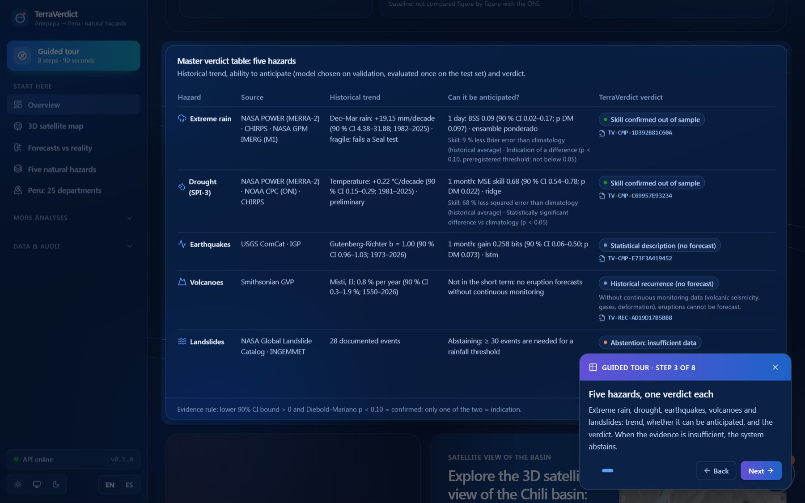<br>**Guided tour.** Eight steps across the application, keyboard-accessible, also on mobile. | 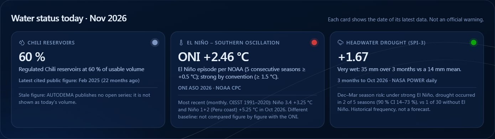<br>**Where things stand today.** Reservoir storage, ONI and monthly Niño 3.4 / 1+2, headwater SPI-3, each with the date of its latest real observation. |
| 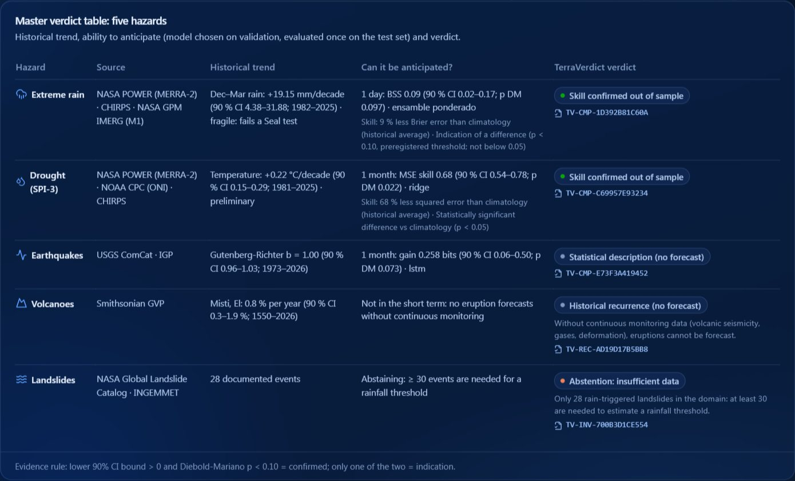<br>**Master verdict table.** Five hazards with historical trend, out-of-sample predictability and verdict, each linked to its case file. | 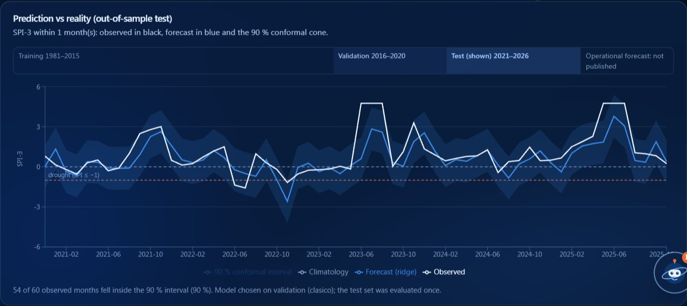<br>**Forecast vs reality.** One-month SPI-3 on years the model never saw, with the 90 % split-conformal band. |
| 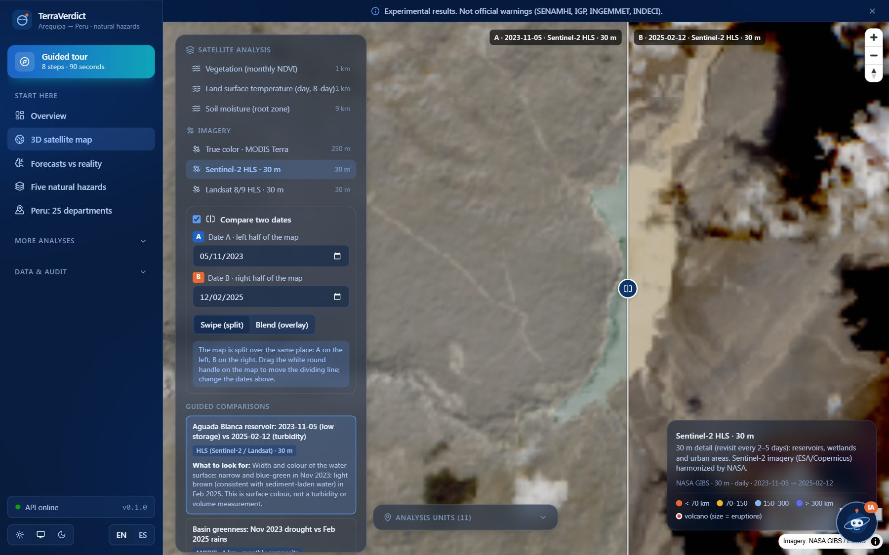<br>**Reservoir at 30 m.** Pixel-aligned swipe: Aguada Blanca narrow and blue-green during the 2023 drought (left), light brown during the February 2025 turbidity episode (right). | 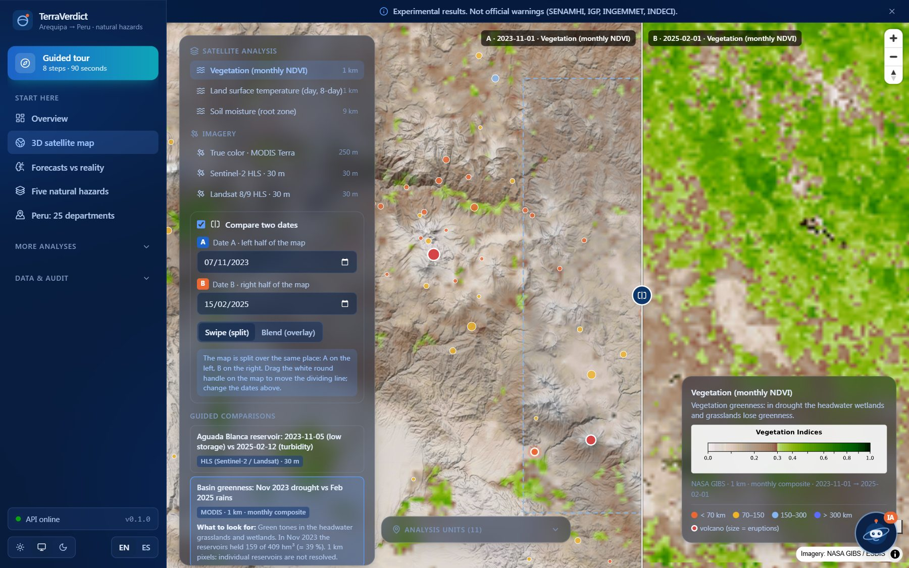<br>**Basin greenness at 1 km.** MODIS NDVI: dry-season minimum in November 2023 against the green-up after the February 2025 rains. |
| 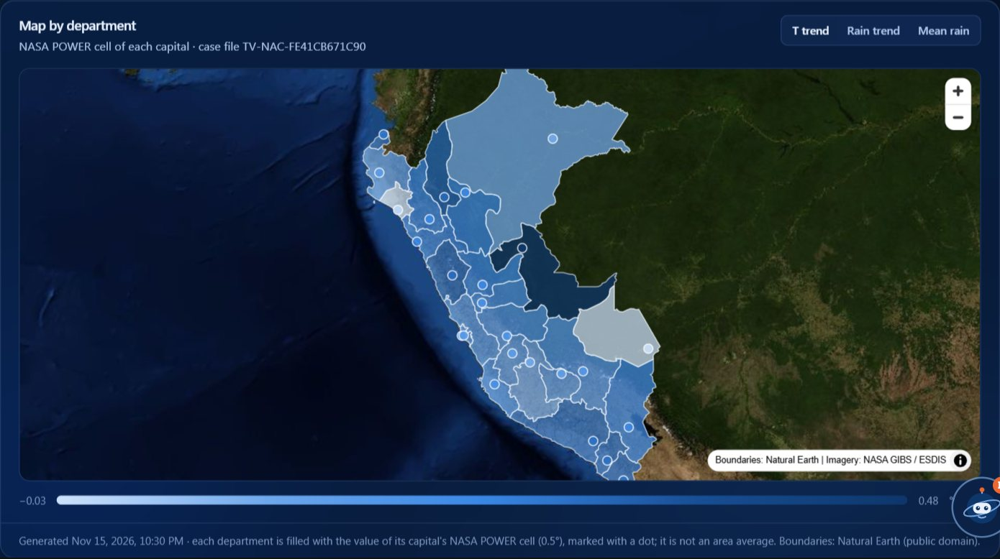<br>**National scale.** The same engine for 25 departments; each department is filled with its capital's POWER cell (stated: not an area average). | 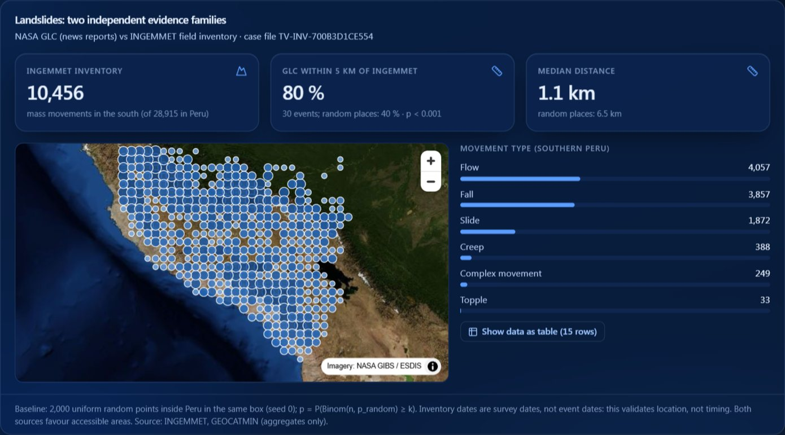<br>**Landslides, two evidence families.** NASA GLC against INGEMMET's field inventory, with a random-location baseline and inventory density. |
| <br>**Terra, the verified AI.** Answers cite case files; every figure and its source are checked before display. | 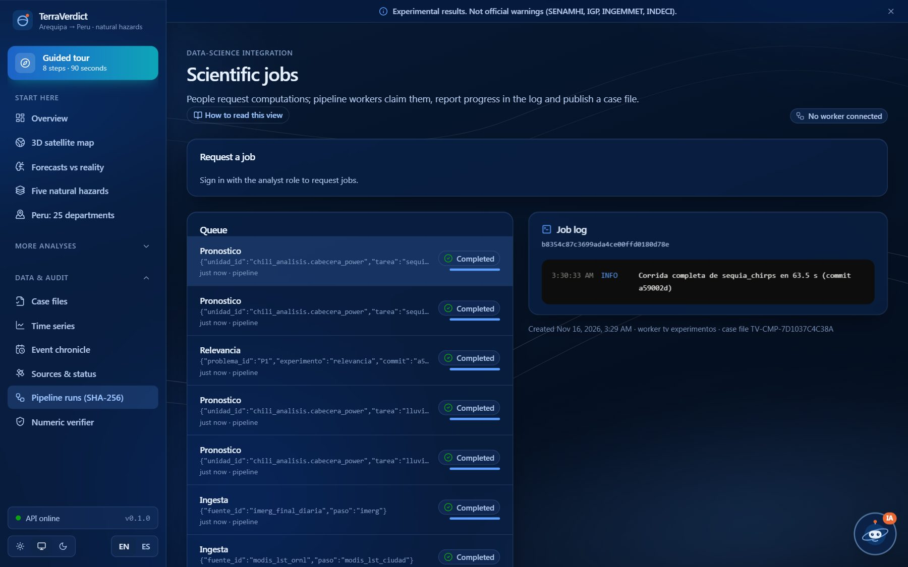<br>**Audit.** Real pipeline runs, NASA downloads with SHA-256 hashes, and the commit behind every result. |

<p align="center">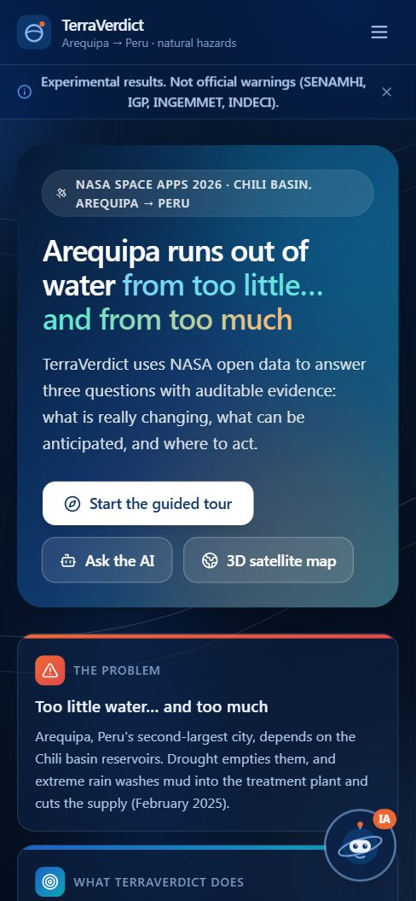</p>

## 5. Data

### 5.1 Sources

| Product | Provider | Coverage used | Role |
|---|---|---|---|
| GPM IMERG Final daily, V07 (0.1°) | NASA GES DISC | Jan 1998 – Sep 2025, complete | Target of the relevance matrix; independent rainfall family |
| POWER (MERRA-2 meteorology; CERES/SRB radiation) | NASA LaRC | Daily Jan 1981 – Oct 2026; 25 departmental cells | Trends, SPI, extreme-rain and drought models, national scale |
| Harmonized Landsat Sentinel-2, S30/L30 (30 m) | NASA/USGS; Sentinel-2 by ESA/Copernicus | 2020–2026, one verified scene per month | Reservoir swipe and time-lapse, case study |
| MODIS Terra true colour, NDVI (1 km), LST (1 km) | NASA via GIBS and ORNL DAAC | 2000 – present | Map layers; land-surface temperature contrast |
| SMAP L4 root-zone soil moisture (9 km) | NASA via GIBS | 2015 – present | Map layer (not used in models) |
| Global Landslide Catalog | NASA | Southern Peru | Landslide inventory (news-based) |
| Geological hazards inventory (GEOCATMIN) | INGEMMET | 28,915 mass movements, national | Second, field-based landslide evidence family |
| Oceanic Niño Index; Niño 3.4 and 1+2 (OISST v2.1) | NOAA CPC | 1950 – Oct 2026 | ENSO covariate and current state |
| GHCN-Daily, station PE000084752 | NOAA NCEI | Station record | Point validation, lapse-rate reference |
| ComCat | USGS | 1973 – Nov 2026 | Seismicity |
| Volcanoes of the World | Smithsonian GVP | Since 1550 | Volcanic recurrence |
| CHIRPS v2.0 | UCSB Climate Hazards Center | 1981 – 2026 | Independent rainfall family for the Seal |
| Admin-1 boundaries v5.1.2 | Natural Earth (public domain) | Peru | Department choropleth; random-location baseline |
| SRTM via Mapzen Terrain Tiles | NASA/NGA, USGS, NOAA | — | 3D terrain |

Every source was checked against its official catalogue with live queries ([`docs/verificacion/README.md`](docs/verificacion/README.md)). Peruvian national services were re-probed on 15 Nov 2026 with TLS verification on: INGEMMET is integrated; SENAMHI (GeoServer WMS/WFS) and CENEPRED (ArcGIS REST) respond but are not yet used; IGP volcano observatory does not resolve in DNS. Attributions and licences are in [`docs/licencias-y-atribuciones.md`](docs/licencias-y-atribuciones.md). TerraVerdict is not endorsed by NASA, ESA, USGS or any Peruvian agency.

### 5.2 Data governance

- Every download is stored with a manifest entry (URL, product, version, byte count, SHA-256, timestamp). `tv verificar-integridad` verifies all 143 raw files before and after each run.
- Results are sealed: `resultados/indice.json` stores the SHA-256 of each of the 12 result files, so any edit is detected.
- Satellite imagery is selected, not curated by hand. `scripts/timelapse_hls.py` evaluates every HLS acquisition over the reservoir footprint (OpenStreetMap way 23815221) and keeps the scene with full coverage and the lowest bright-pixel fraction, at most 10 %. Months without a valid scene stay empty and are never interpolated.
- No source is reached with TLS verification disabled. INGEMMET's server omits its intermediate certificate; the official Sectigo intermediate is added with a pinned SHA-256 fingerprint and a test rejects any altered copy.

## 6. Methodology

### 6.1 Evaluation protocol

- **Frozen temporal split.** Training 1981–2015, validation 2016–2020, test 2021–2026. The split is part of a preregistration whose hash is embedded in every result; a dedicated test fails if the preregistration is edited.
- **Selection on validation only.** Hyperparameters, input windows, calibration, ensemble weights and the reported model are chosen on validation. The test set is evaluated once and only reported.
- **Rolling origin.** A year-by-year history (2016–2026) re-fits the frozen design, with training up to Y−2, validation on Y−1 and test on Y. Years up to 2020 are flagged as optimistic because they informed the design.
- **Model zoo.** Persistence and climatology references; linear, regularised and gradient-boosted models; ten neural architectures (GRU, LSTM, TCN, MLP, DLinear, N-BEATS, N-HiTS, PatchTST, iTransformer and a selective state-space model); and two ensembles. Neural models are run with several seeds and the seed dispersion is reported.

### 6.2 Skill, uncertainty and significance

| Quantity | Definition |
|---|---|
| Brier skill score | BSS = 1 − BS(model) / BS(climatology), for daily heavy-rain probability |
| MSE skill | 1 − MSE(model) / MSE(climatology), for SPI-3 regression |
| Information gain | Log-likelihood gain over a constant-rate Poisson process, in bits per month, for earthquake counts |
| Confidence intervals | Moving-block bootstrap of the test loss differential (90 %) |
| Significance | Diebold–Mariano test with HAC variance and the Harvey–Leybourne–Newbold correction, against climatology |
| Predictive intervals | Split-conformal, calibrated on validation (nominal 90 %) |
| Calibration | Reliability diagram and expected calibration error (equal-frequency bins) |

**Evidence rule.** Skill is *confirmed* when the lower bound of the 90 % CI is above zero **and** the Diebold–Mariano p-value is below 0.10, the preregistered threshold. Meeting only one of the two is an *indication*. A model that does not beat climatology on validation is not published as a forecast: the system abstains and states why.

### 6.3 Trend detection and the Confidence Seal

Slopes are Theil–Sen estimates. Inference uses the most conservative of the original, Hamed–Rao and pre-whitened Mann–Kendall p-values. A significant trend is labelled *robust* only if it passes every test of the Confidence Seal:

1. **Windows.** The sign is stable across sliding sub-periods.
2. **ENSO.** The slope remains after regressing out the ONI, with HAC inference.
3. **Sensor.** There is no sign change or large relative change across known sensor or product transitions.
4. **Independence.** The sign agrees across independent data families (POWER, CHIRPS, IMERG).
5. **Detectability.** Enough years exist to detect the effect at the observed noise level.
6. **Leverage.** The trend survives the removal of its most influential years.

A failed test yields *fragile*; untested conditions yield *preliminary*. The API contract rejects a *robust* verdict with any test not passed, and a *fragile* verdict that does not name the failed test.

### 6.4 Relevance matrix (M1)

For problem P1, extreme rain in the headwaters with an IMERG target, the matrix combines permutation importance on validation blocks, stability across 200 resamples, conditional significance under Benjamini–Hochberg FDR control, and a single evaluation on 2021–2025. The procedure was validated on synthetic data with known relevant variables. Problems P2–P4 (wetland degradation, reservoir deficit, turbidity) are shown as awaiting local data rather than filled in.

### 6.5 Landslide evidence across families

For each NASA GLC event in southern Peru, the distance to the nearest INGEMMET inventory point is computed and compared with 2,000 uniformly random locations inside Peru in the same box (seed 0). The fraction within 5 km is tested with a one-sided binomial test against the random-location fraction. Inventory dates are survey dates, not event dates, so the comparison validates **location**, not timing; both sources favour accessible terrain, which is stated with the result.

### 6.6 Current-state indicators

`tv publicar` computes `indicadores.json` from raw files: ENSO episode status (NOAA criterion), headwater SPI-3 (gamma fit on the training period, unreliable months flagged), ENSO-conditional drought frequency (Wilson intervals, one-sided Fisher test; descriptive, not a forecast) and the observed lapse rate between the GHCN station (2,520 m) and the POWER headwater cell (4,232 m), compared with, never corrected by, the 6.5 °C/km reference.

## 7. Results

All figures are read from `resultados/contrato/*.json`, produced from data downloaded on 15 Nov 2026. Complete tables are in [`docs/experimentos.md`](docs/experimentos.md).

### 7.1 Verdicts by hazard

| Hazard | Historical signal | Out-of-sample predictability (test 2021–2026) | Verdict |
|---|---|---|---|
| Drought (SPI-3, headwaters) | Mean temperature +0.22 °C/decade (90 % CI 0.15–0.29; 1981–2025); preliminary, independence pending | 1-month horizon, Ridge: MSE skill 0.68 (90 % CI 0.54–0.78), DM p = 0.022, conformal coverage 0.90 | Skill confirmed |
| Extreme rain (next day ≥ training p90) | Dec–Mar rainfall +19.15 mm/decade (90 % CI 4.38–31.88; 1982–2025); fragile, fails the leverage test | Weighted ensemble: BSS 0.092 (90 % CI 0.02–0.17), DM p = 0.097, ECE 0.035 | Confirmed at the preregistered threshold; operationally, monitoring only |
| Earthquakes (350 km of Arequipa) | Gutenberg–Richter b = 1.00 (90 % CI 0.96–1.03), Mc 4.5 | Monthly counts: 0.26 bits/month over Poisson, DM p = 0.073 | Statistical description, not a forecast |
| Volcanoes | El Misti annual eruption probability 0.8 % (90 % CI 0.3–1.9 %) | Not attempted without continuous monitoring data | Historical recurrence |
| Rain-triggered landslides | 28 events with rainfall series (NASA GLC); location corroborated by INGEMMET (80 % within 5 km vs 39.5 % of random places, p < 0.001) | Rainfall threshold requires at least 30 events | Abstention |

At three months, drought skill falls to 0.14 (iTransformer, POWER) and to 0.08 (DLinear, CHIRPS). The one-month skill comes mainly from the persistence of SPI-1 and SPI-3, with the ONI contributing at the longer horizon.

### 7.2 Current state (computed from raw data)

| Indicator | Value | Reference period |
|---|---|---|
| ONI | +2.46 °C; El Niño episode (5 consecutive seasons ≥ +0.5) | Aug–Oct 2026 |
| Niño 3.4 / Niño 1+2 monthly anomaly | +3.25 °C / +5.25 °C (OISST, 1991–2020 base; not comparable figure-by-figure with the ONI) | Oct 2026 |
| Headwater SPI-3 | +1.67, very wet | Aug–Oct 2026 |
| Drought frequency in strong-El Niño seasons | 2 of 5 (Wilson 90 % CI 14–73 %), versus 1 of 30 in other seasons; Fisher p = 0.10 | 1982–2026 |
| Latest public reservoir figure | 60 % of usable volume | Feb 2025 (shown as stale) |

### 7.3 Earth-observation evidence

| 5 Nov 2023, drought | 12 Feb 2025, turbidity episode |
|---|---|
|  | 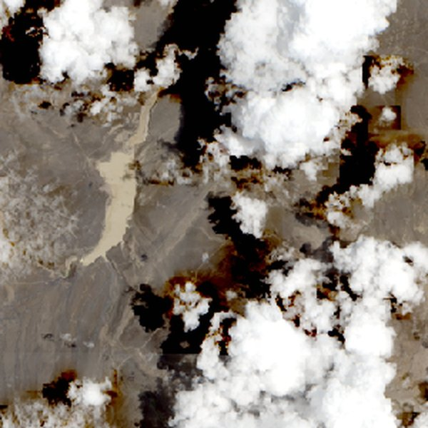 |

HLS S30 at 30 m over Aguada Blanca. The reservoir surface is blue-green during the 2023 drought and light brown during the February 2025 outage, consistent with sediment-laden water. This is surface reflectance colour, not a turbidity or volume retrieval, and the application states this. During February 2025 the headwater cell recorded 9 heavy-rain days, on which the extreme-rain model assigned a mean probability of 0.50, against 0.15 for climatology.

## 8. Architecture and engineering

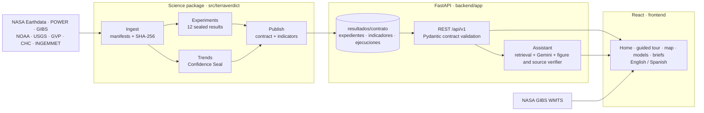

**Design decisions**

- **Contract as the interface.** The API imports only `resultados/contrato/` at start-up and has no dependency on the scientific stack (NumPy, PyTorch). The serverless function stays small and the science can be re-run without redeploying code.
- **Scientific rules in the schema.** Pydantic validators encode domain rules: a robust trend needs every Seal test passed, a fragile one must name its failure, and a published model must beat climatology on validation. Invalid science is rejected with HTTP 422 instead of being displayed.
- **Idempotent publication.** Case files are content-addressed; republishing identical content creates no duplicate.
- **Grounded generation.** The assistant is retrieval-augmented over case files and cited events, using REST. Generated text is parsed for numbers and data-source names; each is matched against the cited case files, and unsupported answers trigger a rewrite or are flagged. An MCP server for external agents is designed but **not implemented**.
- **Front-end data flow.** All data come from the typed OpenAPI client (`openapi-typescript`) cached with TanStack Query. Charts use Recharts; the map uses MapLibre GL with Terrarium DEM tiles and a second, camera-synchronised map for the swipe. Interface strings are written bilingually inline and checked by a test; data texts are translated through a glossary that preserves every digit.

**Stack.** Python 3.12, pandas, SciPy, scikit-learn, PyTorch · FastAPI, SQLAlchemy 2, Alembic, Pydantic 2 · React 18, TypeScript, Vite, TanStack Query, Recharts, MapLibre GL 4, Tailwind CSS · Playwright · GitHub Actions · Vercel.

**Repository layout**

```
src/terraverdict/    ingest, signal processing, trends and Seal, models, experiments, publication
backend/app/         API routers, schemas, services (assistant, verifier), persistence, migrations
frontend/src/        pages, map, charts, guided tour, home components, typed API client, i18n
config/              frozen configuration: phenomena, sources, metrics, partitions, pinned certificates
datos/               cited documented events; transcribed AUTODEMA report
resultados/          sealed results and the API contract
scripts/             HLS time-lapse selection, glossary, source and link verification
tests/               science tests: unit, statistical, integration, integrity, portability
docs/                methodology, audits, API guide, deployment, logbook, handover, original proposal
```

## 9. Reproducibility

```bash
python -m venv .venv && . .venv/bin/activate              # Windows: .venv\Scripts\activate
pip install torch --index-url https://download.pytorch.org/whl/cpu
pip install -e ".[dev,ml]" && pip install -e "backend[dev]"
```

End-to-end regeneration, from raw downloads to the API contract (IMERG requires `EARTHDATA_TOKEN`):

```bash
tv ingest-fenomenos && tv ingest-nino && tv ingest-ingemmet && tv verificar-integridad
tv experimentos && tv trends && tv informe
tv publicar --exportar resultados/contrato/expedientes.json
tv verificar-integridad
```

Commit before running `tv experimentos`: every result records the `HEAD` commit that produced it.

Run the application locally:

```bash
cd backend && python -m app.cli migrar && python -m app.cli importar && uvicorn app.main:app --port 8000
```
```bash
cd frontend && npm ci && npm run dev
```
```bash
docker compose up --build
```

Secrets are read only from `.env` or the hosting platform: `EARTHDATA_TOKEN`, `TV_GEMINI_API_KEY` and `TV_JWT_SECRETO` (see [`.env.example`](.env.example)). On Windows, set `git config core.autocrlf false`, because the SHA-256 seals assume LF line endings.

## 10. Quality assurance

| Suite | Scope | Command | Latest result |
|---|---|---|---|
| Science package | Unit, statistical properties, synthetic recovery, contract integration, integrity, portability | `pytest` | 168 passed, 2 skipped |
| Backend | Endpoints, scientific validators, assistant (figure and source verification), security, migrations | `cd backend && pytest` | 111 passed |
| Frontend | Components, formatting, i18n completeness, choropleth join, home logic | `cd frontend && npm test` | 48 passed |
| End-to-end | English first visit, full 8-step guided tour across pages, provenance, numeric verifier, hazard views, Spanish toggle | `cd frontend && npm run e2e` | 3 of 3, locally and against production |
| Static analysis | Types and lint | `ruff`, `mypy`, `npm run typecheck`, `npm run lint` | Clean |

GitHub Actions runs every suite on each push (`.github/workflows/ci.yml`), and the OpenAPI document is regenerated from code and checked for drift. All 16 pages were also checked at phone width (375 px) for horizontal overflow and console errors.

## 11. Deployment, security and operations

- **Hosting.** Vercel serves the static React build and `api/index.py` as a Python function; every push to `main` deploys. On a cold start the function applies migrations to SQLite in `/tmp` and imports the contract in 2–4 s, and the client shows a real connection notice while requests are pending. Scientific results are immutable and rebuilt identically on each instance. User accounts persist only when `TV_DATABASE_URL` points to PostgreSQL; the public demo is read-only and needs no login.
- **Security.** Strict Content Security Policy, HSTS, `nosniff`, `X-Frame-Options`, `Referrer-Policy` and `Permissions-Policy`. Without `TV_JWT_SECRETO` the API runs read-only. The assistant has per-IP and global rate limits, and the model provider key is held on the server only.
- **Operations.** Release procedure, secret management and the data-refresh runbook are in [`docs/traspaso.md`](docs/traspaso.md) and [`docs/despliegue.md`](docs/despliegue.md).

## 12. Threats to validity and limitations

- **Small test samples.** Test sets are short (for example, 60 months for SPI-3). Intervals are wide and reported as such; individual years are not interpreted on their own.
- **Reanalysis resolution.** POWER cells are 0.5° × 0.625°; point-scale extremes are smoothed.
- **Single data family at the national scale.** With only POWER nationally, the independence test stays pending, so national trends reach at most *preliminary* or *fragile*.
- **Reservoir state.** AUTODEMA publishes no open time series, which blocks the reservoir twin (M3) and problem P3.
- **Event catalogues.** NASA GLC is news-based and under-records rural events; INGEMMET validates location but not dates. The landslide threshold abstains below 30 events.
- **Seismic completeness.** Mc = 4.5 was declared before analysis and kept as a stated limitation.
- **Colour is not concentration.** The HLS reservoir comparison documents surface colour, not turbidity.

## 13. Module status and roadmap

| Module | Status |
|---|---|
| M1 Relevance matrix | Implemented for P1; P2–P4 await local data |
| M2 Trends + Confidence Seal | Implemented, six tests, published case files |
| M3 Hydrological twin and attribution | Not implemented: needs AUTODEMA inflow and volume series (or SWOT) to calibrate GR2M + reservoir |
| M4 Anticipation | Partial: out-of-sample rain and drought forecasts; ENSO-conditioned seasonal outlook and turbidity alert depend on M3 |
| M5 Basin decisions | Not implemented: needs the Aguada Blanca water-surface series and RUSLE erosion |
| M6 Natural hazards · M7 National scale · M8 Metrics history | Implemented |

Next: data partnerships with SENAMHI, AUTODEMA and ANA (unlock P2–P4, M3 and national independence tests); integrating CENEPRED risk scenarios; an MCP server for external agents; persistent PostgreSQL storage for multi-user operation.

## 14. Team

**Team TerraVerdict** · NASA Space Apps Challenge 2026 · Arequipa, Peru

| Member | Contributions |
|---|---|
| Ower Frank (Ower López, UNSA) | Repository owner; problem framing and proposal; FastAPI backend; React frontend; science engine (Confidence Seal, chaos analysis, model zoo); national scale; chain of custody; relevance matrix; AI assistant; deployment |
| MaxsForocca (UNSA) | Architecture; full experiment runs; chaos analysis on observed series; science-to-API integration; CI; Docker; end-to-end tests; documentation; IMERG ingestion |
| DiegoNiS | Team member; team GitHub organisation during the first stage |

Per-commit contributions can be listed with `git shortlog -sn`; a detailed record is kept in [`docs/bitacora.md`](docs/bitacora.md).

## 15. Documentation map

| Document | Purpose |
|---|---|
| [`docs/experimentos.md`](docs/experimentos.md) | Current results, generated from the sealed JSON files |
| [`docs/metodologia.md`](docs/metodologia.md) | Statistical methods and their references |
| [`docs/diseno-tecnico.md`](docs/diseno-tecnico.md) | Technical design, equations and architecture decision records |
| [`docs/auditoria-metricas.md`](docs/auditoria-metricas.md) | Audit of the evaluation protocol (19 findings and their resolution) |
| [`docs/modulo-relevancia.md`](docs/modulo-relevancia.md) | Relevance matrix (M1) |
| [`docs/trazabilidad.md`](docs/trazabilidad.md) | Chain-of-custody requirements |
| [`docs/api/README.md`](docs/api/README.md) | API guide, error model and `openapi.json` |
| [`docs/despliegue.md`](docs/despliegue.md) | Deployment options and production verification |
| [`docs/traspaso.md`](docs/traspaso.md) | Operations handover and data-refresh runbook |
| [`docs/bitacora.md`](docs/bitacora.md) · [`docs/pendientes.md`](docs/pendientes.md) | Engineering logbook and open items |
| [`docs/propuesta-original.md`](docs/propuesta-original.md) | Original Spanish proposal: hypotheses, objectives, modules and references |

---

MIT License. TerraVerdict uses open data from NASA, NOAA, USGS, ESA/Copernicus, the Smithsonian Institution, UCSB CHC, INGEMMET and Natural Earth, and cited Peruvian sources.
